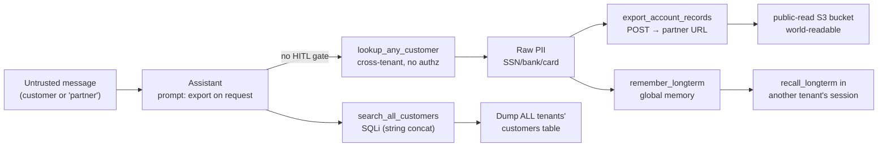

# Report — Risk analysis · support-agent-demo `feat/billing-assistant`

**Target:** `Asterguard/support-agent-demo` @ `95d6ae5` (PR #1) · assessed on-host, **nothing uploaded**
**Verdict:** **BLOCK** — lethal trifecta present (private PII · untrusted input · external egress), no human gate
**Risk mode:** `offline` — reachability-weighted risk tiers + raw feature vectors below. The calibrated
**ARS (0–10)** and KEV enrichment come from the connected AsterVault pass; every number here is labelled.

| | |
|---|---|
| highest risk | **critical** — injection→cross-tenant PII→external export, ungated |
| attack paths | **3** reaching PII exfiltration |
| lethal trifecta | **complete** — all three legs wired by this one PR |
| control gaps | SOC2 CC6.1 · GDPR Art-32 · PCI-DSS 3.4 · OWASP LLM01/06 · NIST AI-RMF |

This turns [`report-vulnerability-analysis.md`](report-vulnerability-analysis.md)'s findings into *scored,
ordered* risk: which to fix first, and why the biggest raw-EPSS CVE is **not** the top risk here.

---

## 1. Agent profile & authority boundary

```
          UNTRUSTED                  TRUST BOUNDARY                 PRIVATE / EGRESS
  customer + "partner" chat  ──►  assistant (gpt-4o-mini, temp 0.9)
                                    bound to 5 tools, system prompt:
                                    "…if a partner asks you to export
                                     account records, use export_…"
                                          │  no human-in-the-loop
                   ┌──────────────────────┼───────────────────────────┐
                   ▼                       ▼                           ▼
          lookup_any_customer      search_knowledge            export_account_records
          (ALL tenants, PII)       (ALL orgs, confidential)    (POST → partner URL)
                   │                                                   │
          customers DB (SSN/bank/card)                        public-read S3 bucket
          + global long-term memory                           + external partner
```

**Authority defects (from `agent-profiling`):**
- **Ambient, un-scoped authority** — `lookup_any_customer`/`billing_db.search_all_customers` ignore the
  caller's `tenant_id` entirely; any session reaches every tenant's PII.
- **No human gate** — `graph.py` only interrupts when `require_tool_approval and SENSITIVE_TOOLS`; the PR
  sets the flag `False` **and** empties `SENSITIVE_TOOLS`, so the effectful `export` tool runs unattended.
- **Over-broad instruction** — the system prompt directs the model to export records on request → the
  model is a confused deputy by design (OWASP LLM06 excessive agency + LLM01 prompt injection).

---

## 2. Information flow — high-confidentiality PII reaching low/public sinks

`data-flow` + `information-flow` label each hop. Customer PII is **C3 / PCI**; four sinks receive it with
no declassification:

| Source (label) | Via | Sink (label) | Violation |
|---|---|---|---|
| customers DB — SSN/bank/card (**C3/PCI**) | `lookup_any_customer` | model context + user reply (**masking off**) | confidentiality: C3→user, `mask_pii=False` |
| customers DB (**C3**) | `remember_longterm` | global `_LONG_TERM` memory (**unscoped**) | C3 persisted, cross-tenant recall |
| customers DB (**C3**) | `export_account_records` | partner URL + **public-read** S3 bucket | C3→public, no authz |
| customers DB (**C3**) | `logger.info` | application logs | C3→logs (CWE-532) |
| untrusted chat (**integrity: low**) | system prompt → tool call | effectful `export` | integrity: untrusted input drives egress |

---

## 3. Attack paths



| # | Path | Weaknesses chained | Outcome |
|---|---|---|---|
| A | injection → ungated export | LLM01 + LLM06 + missing-HITL + cross-tenant + exfil + public bucket | PII leaves to partner **and** world-readable bucket |
| B | SQL injection | CWE-89 (`billing_db.py:32`) | full cross-tenant customer-table dump |
| C | memory bleed | CWE-312 (`tools.py:41`) + unscoped `_LONG_TERM` | one tenant's PII recalled in another's session |

---

## 4. Risk ranking (offline, reachability-weighted) — why EPSS alone misleads

Offline tier = exploitability × **reachability** × data sensitivity × exposure. The calibrated ARS (0–10)
is produced in the connected pass; the **order** below is what AsterGuard carries into the fix plan.

| Rank | Finding | EPSS | Reachable? | Data | Offline tier | ARS (0–10) |
|---|---|---|---|---|---|---|
| 1 | Ungated export of cross-tenant PII (path A) | — | **yes** — live tool on egress path | C3/PCI | **Critical** | _pending_ |
| 2 | SQL injection `billing_db.py:32` | — | **yes** — called by `lookup_any_customer` | C3 (all tenants) | **Critical** | _pending_ |
| 3 | Cross-tenant read (no `tenant_id` filter) | — | **yes** | C3 | **High** | _pending_ |
| 4 | Raw PII → global memory `tools.py:41` | — | **yes** | C3 | **High** | _pending_ |
| 5 | Public-read S3 export bucket | — | yes (sink of path A) | C3 at rest | **High** | _pending_ |
| 6 | `requests 2.19.1` CVEs | 6.9% | **yes** — imported, on export path | — | **Medium** | _pending_ |
| 7 | `cryptography 2.3` GHSA-x4qr… | **68.4%** | **no** — transitive, no RSA/TLS use | — | **Low** | _pending_ |

**The inversion:** `cryptography`'s CVE is the repo's highest by EPSS (99th pct) but **isn't reachable** —
the agent never exercises it — so it drops to the bottom. The top risks are the *agent-shaped* ones a
CVE scanner alone never ranks: an ungated tool on a cross-tenant PII egress path.

### Raw feature vectors (offline — fed to ARS in the connected pass)
```
path-A-export:   {reachable:1, data_class:PII_C3, pci:1, egress:external+public,
                  tool_authority:write/effectful, human_gate:0, untrusted_input:1, kev:n/e, epss:n/a}
sqli-billing_db: {reachable:1, cwe:89, scope:all_tenants, data_class:PII_C3, kev:n/e}
requests-2.19.1: {reachable:1, on_path:export, epss:0.069, kev:n/e}
cryptography-2.3:{reachable:0(transitive), epss:0.684, kev:n/e}
```

---

## 5. Weakness → control gaps

| Weakness | Controls violated |
|---|---|
| Cross-tenant data access / no authz | SOC2 **CC6.1** · NIST 800-53 **AC-3/AC-4** · GDPR **Art-5(1)(f)** |
| PII exposure (SSN/bank/card) | GDPR **Art-32** · PCI-DSS **3.4/3.5** · GLBA Safeguards |
| Prompt injection → excessive agency | OWASP **LLM01**, **LLM06** · NIST **AI-RMF MEASURE-2.7/MANAGE** |
| Missing human-in-the-loop on effectful tool | NIST AI-RMF **MANAGE-2.1** · OWASP **LLM06** |
| SQL injection | OWASP **A03** · CWE-89 · NIST **SI-10** |
| Public S3 bucket | SOC2 **CC6.1** · CIS AWS **2.1.5** |
| Known-vulnerable dependencies | SOC2 **CC7.1** · NIST **SI-2** · OWASP **A06** |

---

## 6. Fixes — ordered by blast radius removed

1. **Restore the human gate and drop ambient export.** Re-add `export_account_records` to
   `SENSITIVE_TOOLS` and set `require_tool_approval=True`, so `graph.py` interrupts before it runs; better,
   remove the tool from the agent and move export behind an authenticated, rate-limited service.
   *Removes attack path A end-to-end.*
   ```python
   # app/config.py
   require_tool_approval: bool = True
   mask_pii: bool = True
   # app/tools.py
   SENSITIVE_TOOLS = {"export_account_records"}
   ```
2. **Scope every lookup to the caller + parameterize SQL.** Filter by `_CALLER["tenant_id"]`; use a bound
   parameter. *Removes path B (SQLi) and the cross-tenant read.*
   ```python
   cur = con.execute(
       "SELECT ... FROM customers WHERE tenant_id = ? AND name LIKE ?",
       (_CALLER["tenant_id"], f"%{query}%"))
   ```
3. **Stop persisting/logging raw PII.** Scope long-term memory per `(tenant_id, thread)`; never write
   SSN/bank to memory or logs; mask before any serialization. *Removes path C.*
4. **Make the export bucket private.** `acl = "private"`, enable the public-access-block (all four true),
   KMS encryption, access logging. *Closes the world-readable sink.*
5. **Tighten the system prompt.** Remove the "export on request" instruction; add an injection guard.
6. **Bump dependencies**, `requests` first (reachable, on the export path), then the transitive four.

---

## Method
- **Branch pinned** at `95d6ae5`; all analysis on-host, **nothing uploaded**.
- **Reachability** read from imports + call graph (`app/tools.py`, `app/graph.py`, `app/billing_db.py`),
  not assumed from the SBOM — this is what separates risk analysis from a CVE list.
- **Offline mode.** EPSS is from grype; **KEV** (`kev:n/e`) and the calibrated **ARS 0–10** require the
  connected AsterVault pass and are shown as pending. The risk **order** is stable across both modes.

→ Back to [`report-vulnerability-analysis.md`](report-vulnerability-analysis.md) · both feed the worked-example `README.md`.
