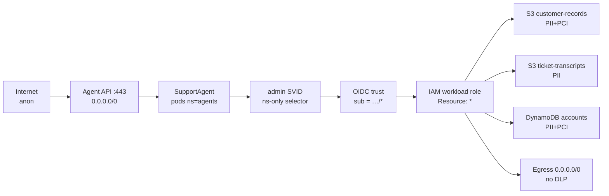

# Report — `/security-engineer` (full-360) · terraform-agent-platform-demo

**Target:** `CoMatrixlabs/terraform-agent-platform-demo` @ `cbae078` · 6 Terraform files · a SupportAgent
LLM platform on AWS + SPIFFE/SPIRE
**Verdict:** **Gate: BLOCK** · **ARS floor 9.0 · critical** · all paths **theoretical** (static IaC, no live run)

| | |
|---|---|
| checkov checks failed | **53** (47 passed) over 12 resources → full list in [`report-local-scan.md`](report-local-scan.md) |
| identity-layer gaps (manual review) | **10** — checkov missed all of them |
| hardcoded credential (semgrep) | **1** |
| attack paths to regulated data or full account | **5** |
| registry weaknesses mapped to controls | **7** |

> **ARS floor** comes from `risk.score` (free tier: features + a risk floor, no point score). Nothing
> is canary-proven — the target is static Terraform, so every path below is *reachable as written*, not
> demonstrated.

---

## Lede — anonymous reach

**As written, two PII/PCI stores can be reached from the internet with no identity.** `S3 customer-records`
carries a `public-read` ACL and no public-access block. `RDS support-agent-db` is `publicly_accessible`,
unencrypted, and its master password is committed in `data.tf:59`. Behind those, any pod in namespace
`agents` is issued the `admin` SVID, which federates into AWS and reads every bucket and table.

---

## Attack paths

Computed locally from the security graph (17 components, 19 edges). None is proven — IaC only.

| # | Path | Hops | Auth |
|---|---|---|---|
| 1 | **Anonymous read of customer records** — `Internet → S3 customer-records` [PII+PCI] | 1 | none |
| 2 | **Direct login to the support database** — `Internet → RDS support-agent-db` with the committed password | 1 | none |
| 3 | **Prompt-injected agent reads every regulated store** (kill chain below) | 7 | none + injection |
| 4 | **Leaked deployer key owns the account** — `static key → *:* → AdministratorAccess exec role → all data, KMS, IAM` | — | credential theft |
| 5 | **Workload-identity plane exposed** — `Internet → SPIRE :8081 → join-token attestation → mint any SVID` | — | identity forgery |

Paths 1 and 2 need **no identity**. Path 3 is the full agent-abuse chain. Paths 4 and 5 are
account-level compromise.

### Kill chain — path 3 (prompt-injected agent → regulated data)



The agent API is open to the world. Every pod in `ns:agents` receives both SVIDs. The OIDC trust matches
the whole trust domain. The data grant is `Resource:*` with `dynamodb:Scan`. Egress is unrestricted with
no DLP.

---

## Findings — workload identity (SPIFFE/SPIRE)

Manual review of `spire.tf`, `agent_access.tf` and `network.tf`. checkov doesn't parse SPIRE config
inside a ConfigMap; it also skipped the OIDC trust condition and the open port 8081.

| Sev | Finding | Where |
|---|---|---|
| 🔴 critical | admin SVID handed to **every pod** in the namespace — registration selector is only `k8s:ns:agents` | `spire.tf:87` |
| 🟠 high | OIDC trust is `StringLike sub spiffe://agents.internal/*` — any SVID (incl. admin) can assume the data role; no `aud` condition | `agent_access.tf:30` |
| 🟠 high | `support-agent` SVID uses a namespace-only selector, shared across LLM, tools and deployer | `spire.tf:79` |
| 🟠 high | `join_token` node attestation with no `k8s_psat` / `aws_iid` platform binding | `spire.tf:42` |
| 🟠 high | `UpstreamAuthority "disk"` — trust-domain CA key unencrypted on the container filesystem | `spire.tf:33` |
| 🟠 high | SPIRE server port **8081 open to `0.0.0.0/0`** (checkov flags 22, not 8081) | `network.tf:20` |
| 🟡 medium | SVID TTL 168h / registration 604800s / CA 8760h — leaked SVIDs outlive their pods by days | `spire.tf:24` |
| 🟡 medium | `audit_log_enabled = false` — no record of registration or attestation events | `spire.tf:27` |
| 🟡 medium | federation uses `https_web` instead of `https_spiffe`; bundle endpoint bound to `0.0.0.0` | `spire.tf:49` |
| ⚪ low | OIDC thumbprint is all zeros and the issuer host is private, so STS can't fetch JWKS as written | `agent_access.tf:12` |

The **cloud-misconfiguration** findings (53 checkov failures across 12 resources, plus the semgrep-caught
hardcoded RDS password, CWE-522/798) are detailed in [`report-local-scan.md`](report-local-scan.md).

---

## Weaknesses and the controls they break

Each weakness was resolved against the AsterVault registry and checked by hand. Counts include
graph-crosswalk controls (SCF families via ATT&CK).

| Weakness | Where | Named controls | Σ incl. crosswalk |
|---|---|---|---|
| `llm_over_privileged_agent` | exec role `s3:*`/`dynamodb:*`/`kms:*` + Admin; data grant `Resource:*` | SOC2 CC6.1/CC6.3/CC8.1 · NIST AC-6 · AI-RMF GOVERN-1.4 · PCI 6.4 | 26 |
| `llm_excessive_agency` | IAM self-escalation (PassRole, AttachRolePolicy, PutRolePolicy) | SOC2 CC6.3/CC8.1 · AI-RMF MANAGE-2.2 · PCI 6.4 | 24 |
| `llm_data_boundary_pii_trust_zone_downgrade` | public-read bucket; publicly accessible RDS | GDPR Art-32/Art-5 · CCPA 1798.100 · SOC2 CC6.7 · PCI 3.4 | 30 |
| `llm_data_pii_ctrl_encryption_at_rest_removed` | buckets without SSE-KMS; RDS `storage_encrypted=false` | GDPR Art-32 · NIST-privacy PR.DS-1 · SOC2 CC6.7 · PCI 3.4 | 30 |
| `llm_data_pci_ctrl_encryption_at_rest_removed` | DynamoDB without a CMK; KMS key `Principal:*`, no rotation | PCI 3.3/3.4 · NIST-privacy PR.DS-1 | 26 |
| `llm_data_pii_ctrl_access_approval_removed` | data grant reads all stores, no per-class scoping or approval | GDPR Art-32 · CCPA 1798.100 · SOC2 CC6.7 · PCI 3.4 | 30 |
| `llm_cfg_egress_no_dlp` | security-group egress `0.0.0.0/0`, no allowlist or DLP | SOC2 CC6.1/CC6.7 · GDPR Art-32 · PCI 3.4 | 26 |

Hardcoded credentials, SPIFFE identity misbinding and network exposure have **no IaC-native registry
entry**, so they stay keyed to CWE rather than force-fit to an unrelated LLM weakness.

---

## Fixes (in order of blast radius removed)

Each fix is scoped to the allow-set the graph shows the agent actually needs. **Fixes 1–3 together break
every path above.**

**1 · Bind the AWS trust to one SPIFFE subject** — admin/tool SVIDs can no longer assume the data role. *(breaks path 3)*
```hcl
# agent_access.tf
Condition = {
  StringEquals = {
    "oidc.agents.internal:sub" = "spiffe://agents.internal/ns/agents/sa/support-agent"
    "oidc.agents.internal:aud" = "sts.amazonaws.com"
  }
}
```

**2 · Scope the data grant** — no `Scan`, no wildcard resources; card data behind a separate, approval-gated identity. *(breaks the wildcard read in path 3)*
```hcl
# agent_access.tf — support agent reads ticket transcripts only
Statement = [{
  Effect = "Allow"  Action = ["s3:GetObject"]
  Resource = ["${aws_s3_bucket.ticket_transcripts.arn}/tickets/*"]
}, {
  Effect = "Allow"  Action = ["dynamodb:GetItem"]
  Resource = [aws_dynamodb_table.accounts.arn]
  Condition = { "ForAllValues:StringEquals" = {
    "dynamodb:Attributes" = ["customer_id","name","email","plan"] } }   # no PAN columns
}]
```

**3 · Fix SPIRE registration & attestation** — pin each workload by SA + image, delete the admin entry, platform attestation, KMS-backed CA, short TTLs. *(breaks paths 3 and 5)*
```hcl
# spire.tf — server.conf
default_x509_svid_ttl = "1h"
audit_log_enabled     = true
NodeAttestor "k8s_psat" { plugin_data { clusters = { "agents" = { service_account_allow_list = ["spire:spire-agent"] } } } }
KeyManager   "aws_kms"  { plugin_data { region = "us-east-1" } }
UpstreamAuthority "aws_pca" { plugin_data { region = "us-east-1"  certificate_authority_arn = var.pca_arn } }
# entries.json — one identity per workload, no admin in ns agents
{ "spiffe_id": "spiffe://agents.internal/ns/agents/sa/support-agent",
  "selectors": ["k8s:ns:agents","k8s:sa:support-agent","k8s:pod-image:<digest>"], "x509_svid_ttl": 3600 }
```

**4 · Remove admin from the agent role, retire the static key** — permissions boundary, trust only workload federation, replace the deployer user with CI OIDC. *(breaks path 4)*
```hcl
# iam.tf
resource "aws_iam_role" "agent_exec_role" {
  permissions_boundary = aws_iam_policy.agent_boundary.arn   # denies iam:*, kms:CreateGrant, s3:PutBucket*
  assume_role_policy   = data.aws_iam_policy_document.spiffe_trust.json   # not account root
}
# delete: aws_iam_role_policy_attachment.agent_admin, aws_iam_access_key.agent_deployer, aws_iam_user.*
# deployer -> role trusted by token.actions.githubusercontent.com, sub = repo:CoMatrixlabs/<repo>:ref:refs/heads/main
```

**5 · Close public data exposure & encrypt** *(breaks paths 1 and 2)*
```hcl
resource "aws_s3_bucket_public_access_block" "customer_records" {
  bucket = aws_s3_bucket.customer_records.id
  block_public_acls = true  block_public_policy = true  ignore_public_acls = true  restrict_public_buckets = true
}
# + SSE-KMS (aws:kms, kms_master_key_id = aws_kms_key.data.arn), drop aws_s3_bucket_acl
# KMS: enable_key_rotation = true; Principal = role ARNs that need Decrypt, never "*"
# RDS: publicly_accessible = false, storage_encrypted = true, manage_master_user_password = true,
#      iam_database_authentication_enabled = true, deletion_protection = true
# DynamoDB: server_side_encryption { enabled = true  kms_key_arn = aws_kms_key.data.arn }, point_in_time_recovery { enabled = true }
```

**6 · Default-deny the network** — remove the `0.0.0.0/0` rules on 22 and 8081, API behind an ALB/WAF, egress only to allowlisted hosts via a DLP proxy.
```hcl
ingress { from_port = 443  to_port = 443  protocol = "tcp"  security_groups = [aws_security_group.alb.id] }
ingress { from_port = 8081 to_port = 8081 protocol = "tcp"  cidr_blocks = [var.cluster_node_cidr] }   # SPIRE agents only
# SSH: remove; use SSM Session Manager
egress  { from_port = 443  to_port = 443  protocol = "tcp"  prefix_list_ids = [var.egress_proxy_pl] }
```

---

## Method & coverage notes

- **Collectors.** checkov 3.4.5 (terraform, secrets) + semgrep `p/terraform` ran fresh on the clone.
  SCA/SBOM, AI-BOM and SAST don't apply (no packages, no app code).
- **Registry resolution was noisy.** `registry.resolve` keyword matching mapped 5/8 IaC findings to
  **unrelated** LLM weaknesses (password → `code_active_debug_code`; SPIRE registration →
  `cascading_hallucination`; security group → SSN exfiltration). Those were **rejected** and re-searched.
- **`graph.enrich` returned no paths** and dropped both PII+PCI stores (probably the compound data-class
  label), so the paths were computed locally from the same graph.
- **AWS defaults would blunt two findings at apply time.** New S3 buckets enforce Block Public Access;
  RDS gets the VPC default security group. The posture is still non-compliant — each default is one
  change away from real exposure.
- **One README claim is overstated.** Federation uses `https_web` (Web-PKI authenticated), not
  unauthenticated — rated medium, not critical. The bundle endpoint on 8443 isn't opened by the SG.
- **Not run:** DAST, behavioral red-team, canary episodes. There's no live agent endpoint to drive, so
  **nothing is marked proven**.

---

*Produced by the AsterGuard `security-engineer` pipeline (client mode): `scan.plan → checkov/semgrep →
graph (asterguard.graph/v1) → registry.resolve + controls.map → risk.score → local path analysis`.*
