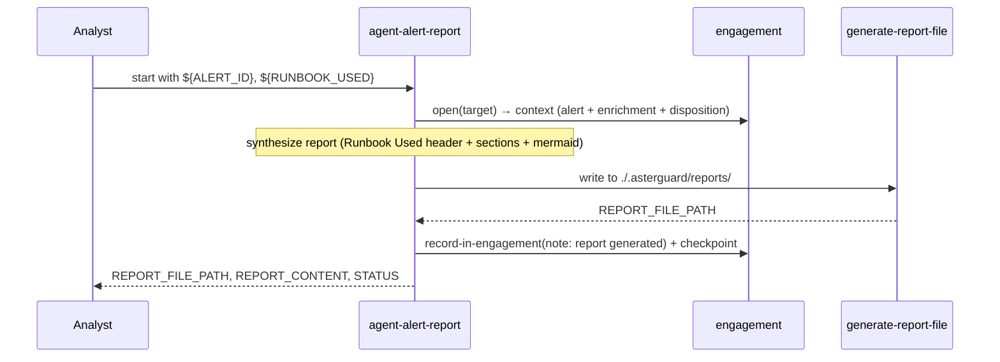

# Agent Alert Report

Produce a standardized, standalone summary of **one** agent alert/finding and its triage: what fired, the
indicators involved, the enrichment that grounded them, the disposition reached, and any immediate action
taken. The lightweight reporting deliverable for documentation, handover, or escalation — it reports on
work already done (by `triage-agent-alert` / `triage-agent-finding`); it does not investigate or contain.
Every report names the runbook used at the top so a reader (and the `evals` rubric) can trace output to
procedure.

## When to Activate

- `triage-agent-alert` or `triage-agent-finding` reaches a disposition and a written record is needed for
  handover or escalation.
- An analyst asks for an alert/triage summary for one finding.

## Objective

Emit one structured, self-contained report for a single agent alert/finding — indicators, enrichment,
disposition, and immediate actions — sourced from the engagement, written to `./.asterguard/reports/`.

## Scope

Covers: gathering the alert's details + its enrichment from the engagement, synthesizing a concise report,
and writing it. Excludes: deep investigation (`investigate-agent-incident`), the full incident narrative
(`agent-incident-report`), and containment.

## Inputs

- `${ALERT_ID}`: the alert/finding id to report on. *Source:* the triage runbook output / engagement.
- `${AGENT_TARGET}`: the agent/deployment the alert is on. *Source:* engagement.
- `${RUNBOOK_USED}`: the triage runbook that produced the disposition (e.g. `triage-agent-alert`).
  *Source:* the engagement event stream.
- `${REPORT_SUFFIX}` (optional): string — a suffix for the report filename (e.g. `initial_triage`).

## Outputs

- `${REPORT_FILE_PATH}`: the path of the written report under `./.asterguard/reports/`.
- `${REPORT_CONTENT}`: the Markdown content (with the `**Runbook Used:**` header).
- `${STATUS}`: ["Success" | "Partial" | "Failure"] with a message on non-success.

## Tools

- **Gateway (connected, metered — carry `X-ARS-Token`, record each `audit_id`):** none required beyond
  what the triage already spent; optionally `memory.recall` for prior sightings of the indicators to
  include as context.
- **Client-side:** read the alert + its enrichment + disposition from the engagement; synthesize the
  report; build the summary mermaid diagram of the triage path performed.
- **Sibling skills:** `engagement` (`context()` for the alert + its events), `generate-report-file`
  (writes the artifact), `enrich-indicator` (only to fill a missing indicator read — not re-triage),
  `record-in-engagement` (note the report was produced), `risk-report` (optional HTML hand-off).

## Workflow Steps & Diagram

1. **Open + gather.** `engagement.open(${AGENT_TARGET})`; read `context()` for `${ALERT_ID}` — the alert
   fields, the key indicators, the `enrich-indicator` output already recorded, the disposition/`verdict`,
   and any `decision` (immediate action). Connected: ensure the ARS token via `ars-token`.
2. **Synthesize.** Compose the report sections: **Metadata** (`**Runbook Used:** ${RUNBOOK_USED}`,
   timestamp, `${ALERT_ID}`, `${AGENT_TARGET}`), **Alert Summary**, **Key Indicators**, **Enrichment
   Summary** (registry/graph/knowledge/prior-sightings), **Disposition / Assessment**, **Immediate
   Actions** (with `audit_id`s), and a **Workflow Diagram** (mermaid) of the triage path. Cite evidence
   by `./.asterguard/` artifact path + `audit_id`, never inline payloads.
3. **Write.** `generate-report-file` with the Markdown content → `${REPORT_FILE_PATH}`. (Optional: hand
   the same structured data to `risk-report` for a shareable HTML view.)
4. **Record + checkpoint.** `record-in-engagement` a `note` that the report was generated (with its path);
   `engagement.checkpoint`.

## Decision Logic / Completion Criteria

- The report **must** carry `**Runbook Used:** ${RUNBOOK_USED}` at the top (reporting requirement).
- IF a required indicator read is missing from the engagement THEN fill it via `enrich-indicator` (do not
  re-triage); ELSE report only from recorded data.
- **Done when:** the report has all sections including the runbook header + mermaid diagram, is written to
  `./.asterguard/reports/`, and its generation is noted in the engagement.

## Integration

- **Composes:** `engagement` + `record-in-engagement` bookends, `generate-report-file`; optionally
  `enrich-indicator`, `risk-report`.
- **Called by:** `triage-agent-alert`, `triage-agent-finding`; the `soc-triage` playbook.
- **Offline:** writes the Markdown report from local engagement data to `./.asterguard/reports/` with no
  network; an HTML hand-off to `risk-report` still renders locally. **Connected:** optional `memory.recall`
  context, metered.
