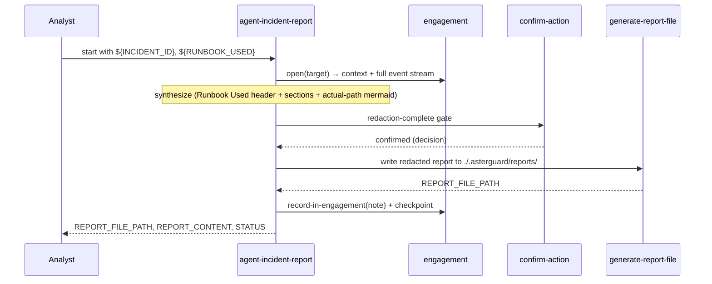

# Agent Incident Report

Fold a full agent incident/investigation into one comprehensive, stakeholder-ready report: executive
summary, timeline, involved indicators + enrichment, root cause, actions taken (containment/eradication/
recovery), and recommendations. The heavyweight reporting deliverable — it reports *on* an investigation
or IRP that has run; it does not perform new investigation or containment. The engagement event stream is
the system of record; this report is a lens over it. Names the runbook used at the top so output traces
to procedure, and prompts for redaction of sensitive data before the file is written.

## When to Activate

- An IRP (`irp-prompt-injection`, `irp-agent-credential-compromise`, `irp-tool-abuse-rce`,
  `irp-data-exfil-via-agent`, `irp-model-supply-chain`) or `investigate-agent-incident` is complete or
  winding down and a full report is needed.
- A stakeholder, handover, or `post-incident-review` needs the consolidated incident document.

## Objective

Produce one comprehensive incident/investigation report for an agent incident — synthesized from the
engagement — structured to the reporting standard, reviewed/redacted, and written to
`./.asterguard/reports/`.

## Scope

Covers: gathering the incident's data from the engagement, synthesizing the narrative, structuring to the
standard, prompting for redaction, and writing the report (optionally an HTML view via `risk-report`).
Excludes: new investigation steps, deep forensics, and executing any containment/remediation (those are
inputs, already done).

## Inputs

- `${INCIDENT_ID}`: the engagement incident/finding id to report on. *Source:* the IRP / investigation.
- `${AGENT_TARGET}`: the agent/deployment. *Source:* engagement.
- `${RUNBOOK_USED}`: the IRP/investigation runbook this report documents (e.g. `irp-data-exfil-via-agent`).
  *Source:* the engagement event stream.
- `${PIR_INPUTS}` (optional): root cause / gaps / recommendations from `post-incident-review`.
- `${REPORT_SUFFIX}` (optional): string — a suffix for the report filename.

## Outputs

- `${REPORT_FILE_PATH}`: the path of the written report under `./.asterguard/reports/`.
- `${REPORT_CONTENT}`: the Markdown content (with the `**Runbook Used:**` header).
- `${STATUS}`: ["Success" | "Partial" | "Failure"] with a message on non-success.

## Tools

- **Gateway (connected, metered — carry `X-ARS-Token`, record each `audit_id`):** `memory.recall`
  (related prior incidents for context); otherwise this consumes enrichment already recorded — it does not
  re-ground.
- **Client-side:** fold the engagement event stream into the timeline + narrative; synthesize root cause +
  actions + recommendations; build the mermaid diagram of the *actual* workflow performed (including any
  degraded lanes); drive the redaction gate.
- **Sibling skills:** `engagement` (`context()` + event stream = the record; `checkpoint`),
  `generate-report-file` (writes the artifact), `confirm-action` (the redaction-complete gate),
  `record-in-engagement`, `post-incident-review` (supplies root cause/recommendations), `risk-report`
  (optional HTML hand-off).

## Workflow Steps & Diagram

1. **Open + gather.** `engagement.open(${AGENT_TARGET})`; read `context()` + the full event stream for
   `${INCIDENT_ID}` — findings, enrichment, `decision`s (containment/eradication, each with `audit_id`),
   `canary_hit`s, `policy_applied`, verdicts, recovery result. Fold in `${PIR_INPUTS}` if present.
   Connected: ensure the ARS token via `ars-token`.
2. **Synthesize + structure.** Compose the report to the reporting standard: **Metadata**
   (`**Runbook Used:** ${RUNBOOK_USED}`, timestamp, `${INCIDENT_ID}`, `${AGENT_TARGET}`), **Executive
   Summary**, **Incident Timeline**, **Involved Indicators & Enrichment**, **Root Cause**, **Actions
   Taken** (containment/eradication/recovery, each with its `audit_id`), **Recommendations / Lessons
   Learned**, and a **Workflow Diagram** (mermaid) reflecting the *actual* path performed. Cite evidence by
   `./.asterguard/` artifact path + `audit_id`, never inline raw data.
3. **Redaction gate.** `confirm-action` — prompt the analyst to review and redact/defang any sensitive
   data (PII, secrets, internal identifiers) before writing. Recorded as a `decision`.
4. **Write.** `generate-report-file` with the redacted Markdown → `${REPORT_FILE_PATH}`. (Optional: hand
   the structured data to `risk-report` for a shareable HTML view.)
5. **Record + checkpoint.** `record-in-engagement` a `note` that the report was produced (with its path);
   `engagement.checkpoint`.

## Decision Logic / Completion Criteria

- The report **must** carry `**Runbook Used:** ${RUNBOOK_USED}` at the top (reporting requirement).
- The **redaction gate** via `confirm-action` must pass before the file is written — no unredacted
  sensitive data leaves in the artifact.
- The mermaid diagram reflects the **actual** workflow (including degraded lanes / tool failures), not the
  ideal path.
- **Done when:** the report has all standard sections including the runbook header + actual-path mermaid,
  redaction is confirmed, it is written to `./.asterguard/reports/`, and its generation is noted in the
  engagement.

## Integration

- **Composes:** `engagement` + `record-in-engagement` bookends, `confirm-action` (redaction gate),
  `generate-report-file`, `post-incident-review` (root cause/recommendations); optionally `risk-report`.
- **Called by:** the IRPs (as the `${INCIDENT_REPORT}` output), `investigate-agent-incident`,
  `post-incident-review`; the `incident-response` playbook.
- **Offline:** writes the Markdown report from the local engagement stream to `./.asterguard/reports/`
  with no network; an HTML hand-off to `risk-report` renders locally. **Connected:** optional
  `memory.recall` context, metered.
