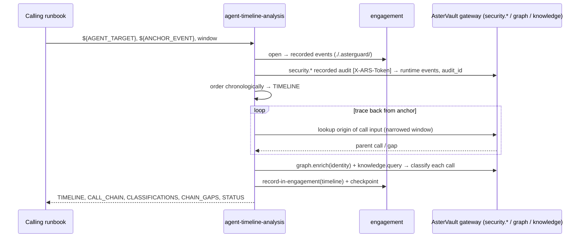

# Agent Timeline Analysis

Reconstruct an agent's action timeline for an incident: order its recorded actions, tool calls, and
egress chronologically, and trace the **tool-call chain** backward from the alerted action to its
trigger (the agent-security analogue of a process-execution tree — tool-call chains, not OS processes).
Classify each call against the agent's known authority and the weakness registry: expected,
over-privileged, or malicious. Feeds `investigate-agent-incident`, the `irp-*` runbooks, and
`deep-dive-indicator-analysis`.

## When to Activate

- An investigation or IRP needs to know *what the agent did*, in order, and *what triggered it*.
- A canary egress / runtime `security.*` alert needs its originating tool-call chain reconstructed.

## Objective

Produce an ordered, classified timeline of the agent's actions/tool-calls/egress for the incident
window, with the trigger→action chain for the alerted behaviour made explicit (and any gap in the chain
clearly marked).

## Scope

Covers: event collection, chronological ordering, tool-call-chain reconstruction, per-call
classification, and the timeline artifact. Excludes: enrichment of individual indicators
(`enrich-indicator`), disposition (`investigate-agent-incident`), and containment (`contain-indicator`).

## Inputs

- `${AGENT_TARGET}`: string — the agent/deployment whose timeline to build (service principal,
  endpoint, session/run id). *Source:* the calling runbook / engagement.
- `${ANCHOR_EVENT}` (optional): the alerted action/tool-call/egress to trace back from. *Source:* the
  finding or runtime alert.
- `${TIME_WINDOW_HOURS}` (optional): int — lookback (default 168); narrow around the anchor for the
  chain trace.
- `${RUN_ID}` (optional): a specific agent run/trace id to scope to.

## Outputs

- `${TIMELINE}`: chronologically ordered events `{ts, actor, action/tool, inputs-origin, target,
  egress, classification}`.
- `${CALL_CHAIN}`: the trigger→…→alerted-action chain (text + a `graph LR` mermaid tree), with any
  untraceable gap marked `[?]`.
- `${CLASSIFICATIONS}`: per-call `expected | over-privileged | malicious` with the grounding reason.
- `${CHAIN_GAPS}`: where tracing stopped and why (retention, missing trace, pre-window start).
- `${STATUS}`: ["Success" | "Partial" | "Failure"].

## Tools

- **Gateway (connected, metered — carry `X-ARS-Token`, record each `audit_id`):** runtime `security.*`
  (runtimevault — recorded tool-calls/egress/alerts), `graph.enrich` (the agent's granted authority to
  judge over-privilege), `registry.resolve`/`knowledge.query` (classify a call against known
  weakness/TTP patterns).
- **Client-side:** collect + normalise events; sort chronologically; walk the call chain backward;
  classify each call; render the tree; mark gaps. The reconstruction + judgement is the harness's.
- **Sibling skills:** `engagement` (open/context; reads `./.asterguard/` recorded events) ·
  `atom-lookup-identity` (authority for over-privilege checks) · `atom-trace-egress` (egress legs) ·
  `atom-query-pattern` (pattern classification) · `record-in-engagement`.

## Workflow Steps & Diagram

1. **Open + collect.** `engagement.open(${AGENT_TARGET})`; pull recorded events from `./.asterguard/`
   and, connected, the runtime audit (`security.*`) for `${TIME_WINDOW_HOURS}` / `${RUN_ID}`.
2. **Extract + order.** Parse each event into `{ts, actor, tool/action, input-origin, target, egress}`;
   sort chronologically into `${TIMELINE}`.
3. **Trace the chain (critical).** From `${ANCHOR_EVENT}`, walk backward: find the tool-call/turn that
   produced each call's input, narrowing the time window around each step, until a trusted origin
   (user turn, scheduled trigger) or an untraceable gap. Record steps into `${CALL_CHAIN}`; mark gaps
   `[?]` in `${CHAIN_GAPS}`.
4. **Classify.** For each call, compare the invoked tool/scope against the agent's granted authority
   (`atom-lookup-identity`) and known patterns (`atom-query-pattern`): `expected` (in authority, benign
   origin), `over-privileged` (beyond granted scope), or `malicious` (traces to untrusted input / known
   TTP / canary egress). → `${CLASSIFICATIONS}`.
5. **Render + record.** Emit the timeline table + the `graph LR` call-chain tree; `record-in-engagement`
   the timeline as a typed event; `engagement.checkpoint`.

## Decision Logic / Completion Criteria

- A call is **malicious** when it traces to untrusted input, matches a known TTP, or precedes a canary
  egress; **over-privileged** when its scope exceeds the identity's granted authority; else **expected**.
- IF the chain cannot be fully traced THEN still return the partial chain with gaps marked `[?]` and set
  `${STATUS}` = `Partial` — never block the caller.
- **Done when:** the timeline is ordered, the call chain is traced (or its gap marked), every call is
  classified, and the artifact is recorded.

## Integration

- **Composes:** `atom-lookup-identity`, `atom-trace-egress`, `atom-query-pattern`,
  `record-in-engagement`; `engagement` bookends.
- **Called by:** `investigate-agent-incident`, `deep-dive-indicator-analysis`, the `irp-*` runbooks,
  the hunts.
- **Offline:** uses recorded `./.asterguard/` events only; runtime audit + authority grounding noted as
  unavailable and the affected classifications marked low-confidence. **Connected:** full runtime audit
  + graph/knowledge grounding, metered.
