# Hunt: APT-Style Agent Kill-Chain Hunt

Hunt a named threat actor's playbook, re-expressed as an **agentic kill-chain**: initial access
(prompt injection / poisoned content) → tool abuse → privilege or credential access → data exfil →
persistence (poisoned long-term memory / altered instructions). Pull the actor's TTPs and indicators
from the knowledge corpus, then walk each kill-chain stage across the built graph + recorded agent
events, looking for the actor's signature on this target.

## When to Activate

- Intel ties a threat actor / APT playbook to the kind of agent this target runs, and you must check
  for its signature.
- An `advanced-agent-threat-hunt` lead implicates a known actor/campaign and you want the full
  stage-by-stage kill-chain hunt.

## Objective

Determine whether `${ACTOR_ID}`'s agentic kill-chain has any stage present on `${TARGET}` under
`${HYPOTHESIS}`, map the stages that match, and route confirmed actor presence to incident response.

## Scope

Covers: one actor's TTP/indicator set walked stage by stage across the agentic kill-chain on the
target's graph + recorded events. Excludes: generic multi-hypothesis hunting
(`advanced-agent-threat-hunt`), single-pattern campaigns (`proactive-pattern-campaign-hunt`),
containment (IRPs).

## Inputs

- `${HYPOTHESIS}`: string — the actor hypothesis (e.g. "actor X is targeting our RAG agent's memory
  for persistence"). *Source:* hunter / intel.
- `${ACTOR_ID}`: the threat actor / playbook id in the knowledge corpus. *Source:* intel feed.
- `${TARGET}`: engagement target. *Source:* engagement.
- `${SCOPE_FILTER}` (optional): host group / namespace / trust boundary.
- `${LOOKBACK}` (optional): recorded-event window (default: wide).

## Outputs

- `${HUNT_FINDINGS}`: per kill-chain stage `{stage, matched_ttps:[…], matched_indicators:[…], evidence,
  verdict}`, non-matches recorded.
- `${KILL_CHAIN_MAP}`: which stages have evidence on the target (the actor's realized reach).
- `${DETECTION_GAPS}`: matched stages lacking a covering rule → `detection-as-code-agent-rules`.
- `${ESCALATION}`: incident/finding id if escalated.
- `${STATUS}`: ["Success" | "Partial" | "Failure"] with per-lane notes.

## Tools

- **Gateway (connected, metered — `X-ARS-Token`, record `audit_id`):** `knowledge.query` /
  `knowledge.graph` (actor profile, TTPs, kill-chain topology, indicators), `graph.enrich` (map
  indicators/TTPs to target nodes + reach), runtime `security.*` (recorded events per stage),
  `memory.recall`, `risk.score`.
- **Client-side:** decompose the actor into kill-chain stages; sweep each stage; assemble the realized
  kill-chain map; judge actor presence.
- **Sibling skills:** `engagement`, `enrich-indicator`, `correlate-indicator`, `pivot-on-indicator`,
  `indicator-threat-hunt`, `hunt-tool-abuse-lateral`, `hunt-agentic-ttp-credential-access`,
  `hunt-exfil-paths`, `agent-timeline-analysis`, `record-in-engagement`,
  `detection-as-code-agent-rules`; atoms `atom-query-pattern`, `atom-recall-memory`.

## Workflow Steps & Diagram

1. **Open engagement.** `engagement.open(${TARGET})` → context. Connected: ensure the ARS token.
2. **Profile the actor.** `knowledge.query`/`knowledge.graph`(`${ACTOR_ID}`) → TTPs, indicators, and
   the kill-chain stages the actor uses; `memory.recall` prior sightings of this actor here.
3. **Walk the kill-chain (per stage):**
   - **Initial access** → compose `hunt-prompt-injection-exposure` signals / `indicator-threat-hunt`
     on access indicators.
   - **Tool abuse** → `hunt-tool-abuse-lateral` chains for the actor's tools.
   - **Privilege / credential access** → `hunt-agentic-ttp-credential-access` for the actor's techniques.
   - **Data exfil** → `hunt-exfil-paths` for the actor's channels.
   - **Persistence** → recorded events + `memory.recall` for poisoned memory / altered instructions.
   Record matches + non-matches per stage; `agent-timeline-analysis` orders any multi-stage evidence.
4. **Assemble the kill-chain map.** `correlate-indicator` across stages → `${KILL_CHAIN_MAP}`; enrich
   confirmed stages with `enrich-indicator`.
5. **Route.** Contiguous stages matched → open a finding, hand to the matching IRP. Isolated/no match →
   document (foothold or cleared).
6. **Close the gap + checkpoint.** Emit `${DETECTION_GAPS}` for `detection-as-code-agent-rules`;
   `record-in-engagement`; `engagement.checkpoint`.

```mermaid
graph LR
    OPEN["engagement.open(${TARGET})"] --> PROF["profile actor: knowledge.query(${ACTOR_ID})"]
    PROF --> IA["initial access<br/>hunt-prompt-injection-exposure"]
    IA --> TA["tool abuse<br/>hunt-tool-abuse-lateral"]
    TA --> PA["priv/cred access<br/>hunt-agentic-ttp-credential-access"]
    PA --> EX["data exfil<br/>hunt-exfil-paths"]
    EX --> PE["persistence<br/>memory.recall + events"]
    PE --> MAP["${KILL_CHAIN_MAP} (correlate-indicator)"]
    MAP --> ROUTE{"contiguous stages?"}
    ROUTE -- "yes" --> ESC["finding_opened → irp-*"]
    ROUTE -- "no" --> DOC["document (foothold/cleared)"]
    ESC --> GAP["${DETECTION_GAPS} → detection-as-code-agent-rules"]
    GAP --> CP["record-in-engagement + checkpoint"]
    DOC --> CP
```

## Decision Logic / Completion Criteria

- **Actor present** when contiguous kill-chain stages of `${ACTOR_ID}` have evidence on the target;
  **foothold** when an isolated stage matches; **cleared** when none do.
- Confirmed actor presence → escalate to the matching IRP; never contain inside the hunt.
- **Done when:** every kill-chain stage has been swept (with non-matches recorded), the realized map is
  assembled with evidence, gaps handed off, and the engagement checkpointed.

## Integration

- **Composes:** `indicator-threat-hunt`, `hunt-prompt-injection-exposure`, `hunt-tool-abuse-lateral`,
  `hunt-agentic-ttp-credential-access`, `hunt-exfil-paths`, `enrich-indicator`, `correlate-indicator`,
  `agent-timeline-analysis`, `record-in-engagement`, `detection-as-code-agent-rules`; `engagement`
  bookends; atoms `atom-query-pattern`, `atom-recall-memory`.
- **Called by:** `threat-hunt` playbook; escalated into from `advanced-agent-threat-hunt`; escalates to
  `irp-*`.
- **Offline:** stage sweeps run over the local graph/events; the actor profile degrades to local pack
  data (note if the actor id is unavailable offline). **Connected:** full knowledge/graph grounding +
  runtime `security.*`, metered.
