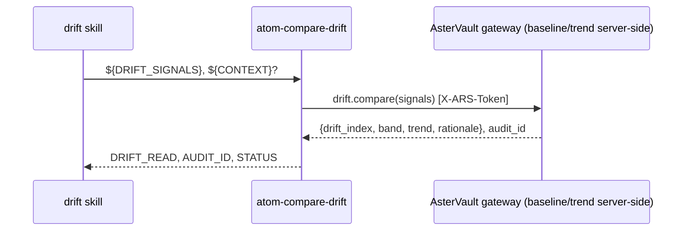

# Atomic: Compare Drift

Hand the assembled, per-facet drift signals for two versions to the gateway `drift.compare`
and get back one calibrated **drift index** (0–10), a band, and the multi-run **trend** for
this target. The baseline and trend models run server-side — the harness assembles the
signals (via the `tools/drift` comparators) and consumes the index; it does **not** run the
drift model locally.

**ID:** `ATOM-COMPARE-DRIFT`
**Purpose:** Produce one calibrated drift index + trend for a version-to-version change, so
release gates and continuous-testing route on a consistent, baseline-aware number — not an
ad-hoc read of a single diff.
**Trigger:** The `drift` skill (or `tools/drift/drift.py`) has assembled the per-facet
`Delta`s + signals for two versions and needs the calibrated index + trend.

## Inputs Required

- `${DRIFT_SIGNALS}`: object — the assembled signals and per-facet direction/magnitude, e.g.
  `{signals:[...], by_facet:{tools:{direction,magnitude}, surface:{...}}}`. *Source:* the
  `tools/drift` comparators / `drift.py build_report`.
- `${CONTEXT}` (optional): object — `{app_id, from_version, to_version, tenant}` for the
  per-target trend and the per-tenant overlay.

## Execution Steps

1. **Tool Selection** — gateway tool `drift.compare` (sole remote call; the model is gateway-side).
2. **Parameter Mapping** — `drift.compare(signals=${DRIFT_SIGNALS}, context=${CONTEXT})`.
   Connected: attach `X-ARS-Token` (see `ars-token`).
3. **Execute** — call `drift.compare`; the gateway returns the index + trend (the harness does
   **not** materialize the baseline/trend model locally). Record `audit_id`.
4. **Extract** — read `drift_index`, `band`, `trend`, and `rationale[]` into `${DRIFT_READ}`.

## Outputs Expected

- `${DRIFT_READ}`: object — `{drift_index (0–10), band ∈ hardening|stable|minor-regression|regression|critical-regression, trend, rationale[]}`.
- `${AUDIT_ID}`: string — metered-call handle (connected).
- `${STATUS}`: ["Success" | "Degraded" | "Failure"] — `Degraded` = local structural report only.

## Decision Logic / Next Steps

- The index is a **read**, not a disposition — the caller (drift / pr-gate) decides pass/block.
- IF `band` ∈ {regression, critical-regression} → caller routes to the gate's FAIL/WARN path.
- IF `Degraded` → the gateway was unavailable; use the deterministic local band from
  `tools/drift/drift.py` and say the trend is not available.

## Connected vs Offline

- **Connected**: `drift.compare` live + metered — the server returns the calibrated index and
  the per-target trend; carry `X-ARS-Token`, record `audit_id`.
- **Offline**: no trend/baseline model — use the deterministic local report (direction,
  magnitude, band, cause→effect narrative) from `tools/drift`, mark `${STATUS}=Degraded`, and
  say so. Never present the local band as the calibrated index.

## AI Agent Execution Notes

- Do **not** attempt to run or approximate the baseline/trend model locally — assemble the
  signals, call the gateway, consume the index.
- Keep `${DRIFT_SIGNALS}` the exact signals the local comparators emitted, so the index is
  reproducible for `evals` and the local narrative and the gateway index always agree on what
  changed.
- `drift.compare` is the planned gateway tool; until it is deployed every call degrades to the
  local report — that is expected, not an error.
