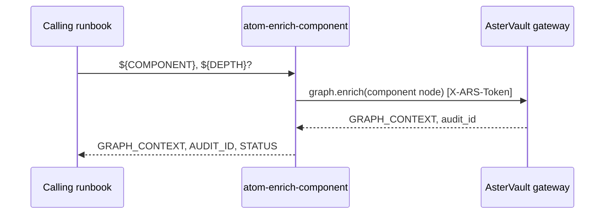

# Atomic: Enrich Component

Enrich one component node against the gateway `graph.enrich` and get its dependencies, reach, and linked weaknesses — the grounding step that places a component in the security graph.

**ID:** `ATOM-ENRICH-COMPONENT`
**Purpose:** Resolve where a component sits in the built graph (deps, reach, weaknesses) so triage/hunt reason over real edges, not names.
**Trigger:** A runbook holds a `component` indicator (dep/module/service) and needs its graph neighborhood.

## Inputs Required

- `${COMPONENT}`: string — the component ref (e.g. `langchain-core@0.2.1`, `svc:billing-agent`, module path). *Source:* an AI-BOM/SBOM finding, a graph node, or a prior runbook output.
- `${DEPTH}` (optional): integer — dependency/reach traversal depth. Default 2.

## Execution Steps

1. **Tool Selection** — gateway tool `graph.enrich` (sole remote call).
2. **Parameter Mapping** — `graph.enrich(node={type:"component", value:${COMPONENT}}, depth=${DEPTH})`. Connected: attach `X-ARS-Token`.
3. **Execute** — call `graph.enrich`; record `audit_id`.
4. **Extract** — pull `deps[]` (dep tree + CVEs), `reach` (what it can reach / what reaches it), and `weaknesses[]` (linked `weakness_id`s) into `${GRAPH_CONTEXT}`.

## Outputs Expected

- `${GRAPH_CONTEXT}`: object — `{node, deps[], reach, weaknesses[]}`.
- `${AUDIT_ID}`: string — metered-call handle (connected).
- `${STATUS}`: ["Success" | "NotInGraph" | "Failure"].

## Decision Logic / Next Steps

- IF `weaknesses[]` non-empty → chain `atom-resolve-weakness` on each for taxonomy/controls.
- IF `reach` touches an egress endpoint → chain `atom-trace-egress` for recorded traffic.
- IF `NotInGraph` → the component wasn't scanned; the caller may trigger a scan or note the blind spot.

## Connected vs Offline

- **Connected**: `graph.enrich` live + metered; carry `X-ARS-Token`, record `audit_id`.
- **Offline**: read the locally built graph in `./.asterguard/` (sca-graph / weakness-graph output); no token, no quota. Mark `${STATUS}=Partial` if only the local graph was available.

## AI Agent Execution Notes

- One gateway call — enrich only; resolving the linked weaknesses is a separate atomic.
- Use the same node identity the graph schema uses so edges resolve.
- Reference `${GRAPH_CONTEXT}` by handle; don't inline a large subgraph.
