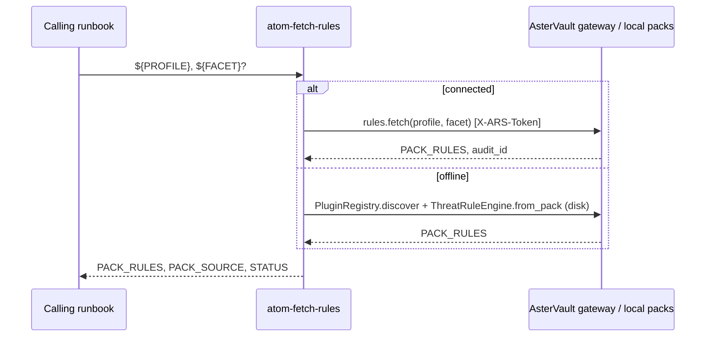

# Atomic: Fetch Rules

Fetch the vendor-pack threat-rule content for a target's profile. Connected serves it via `rules.fetch(profile)`; offline loads packs from disk. Either way the client evaluates the rules locally — only the pack *content* is served, never a verdict.

**ID:** `ATOM-FETCH-RULES`
**Purpose:** Obtain the behavioral `.rule.yaml` content for a profile so the `ThreatRuleEngine` can evaluate it over the built graph/events client-side.
**Trigger:** A runbook (scan, weakness-graph, detection) has a resolved profile and needs the pack's threat rules to evaluate.

## Inputs Required

- `${PROFILE}`: object/string — the detected target profile (agent-framework / provider / runtime / harness), e.g. `{framework:"langchain", provider:"openai"}`. *Source:* `check-planner` profile output.
- `${FACET}` (optional): one of `behavioral | static | mappings | how-to-read`. Default `behavioral` (`threat_rules_path`).

## Execution Steps

1. **Tool Selection** — connected: gateway tool `rules.fetch(profile)` (serves rule content). Offline: `PluginRegistry.discover` + `ThreatRuleEngine.from_pack` (load from disk).
2. **Parameter Mapping** — `rules.fetch(profile=${PROFILE}, facet=${FACET})`. Connected: attach `X-ARS-Token`.
3. **Execute** — fetch/load the pack content; record `audit_id` (connected).
4. **Extract** — collect `rules[]` (`.rule.yaml` records) + `mappings` (`weakness_id → controls`) into `${PACK_RULES}`. Hand to `ThreatRuleEngine.from_records(...)` for local evaluation (not performed here).

## Outputs Expected

- `${PACK_RULES}`: object — `{profile, facet, rules[], mappings}` (rule *content*, not results).
- `${PACK_SOURCE}`: ["gateway" | "disk"] — where the content came from.
- `${AUDIT_ID}`: string — metered-call handle (connected).
- `${STATUS}`: ["Success" | "NoPack" | "Failure"].

## Decision Logic / Next Steps

- IF `Success` → hand `${PACK_RULES}` to `ThreatRuleEngine` to evaluate over the graph/events (client-side) → findings born resolved to `weakness_id` + controls.
- IF `NoPack` → no vendor pack for this profile; fall back to generic rules and note reduced framework-accuracy.
- IF `Failure` connected → load from disk; set `${PACK_SOURCE}=disk`, mark `${STATUS}=Partial`.

## Connected vs Offline

- **Connected**: `rules.fetch(profile)` serves the rule content live + metered; carry `X-ARS-Token`, record `audit_id`. The MCP serves content; the client still evaluates.
- **Offline**: load packs from disk via `PluginRegistry.discover` + `ThreatRuleEngine.from_pack`; no token, no quota. `${PACK_SOURCE}=disk`.

## AI Agent Execution Notes

- This atomic **fetches content only** — it never returns detection verdicts; evaluation is client-side via the `ThreatRuleEngine`.
- Keep the `weakness_id → controls` mappings with the rules so resulting findings resolve to controls.
- Reference `${PACK_RULES}` by handle; don't inline full rule bodies into chat.
