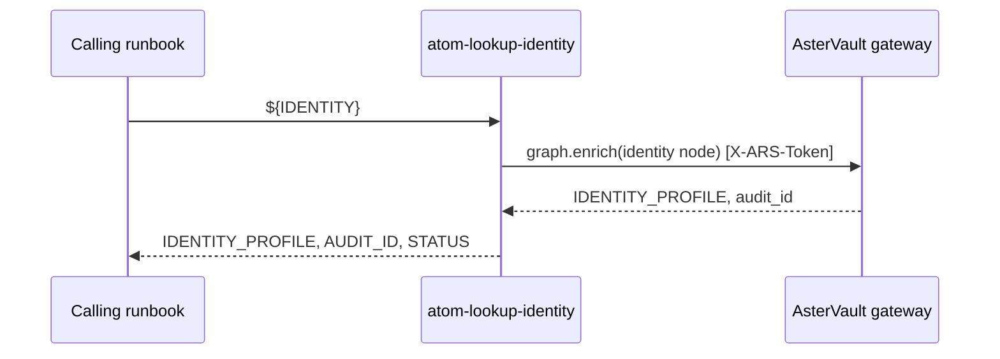

# Atomic: Lookup Identity

Resolve one agent/service identity to its authority profile — granted tools, scopes, and authority boundary — via `graph.enrich` (with `registry.resolve` for role/scope definitions). The grounding step for over-privilege and credential-compromise reasoning.

**ID:** `ATOM-LOOKUP-IDENTITY`
**Purpose:** Establish what an identity *can* do (tools + scopes + boundary) so a runbook can judge whether an observed action was in-bounds.
**Trigger:** A runbook holds an `identity` indicator (agent/service principal) and needs its granted authority — for triage, over-privilege hunts, or credential-compromise IRP.

## Inputs Required

- `${IDENTITY}`: string — the principal ref (e.g. `svc:billing-agent`, `agent:planner@tenant`, SPIFFE id). *Source:* an alert `principal` field, a graph `identity` node, or a prior runbook output.

## Execution Steps

1. **Tool Selection** — gateway tool `graph.enrich` (primary; sole remote call). Optionally the same call resolves scope/role definitions via `registry.resolve` semantics — still one grounded round-trip.
2. **Parameter Mapping** — `graph.enrich(node={type:"identity", value:${IDENTITY}})`. Connected: attach `X-ARS-Token`.
3. **Execute** — call `graph.enrich`; record `audit_id`.
4. **Extract** — pull `granted_tools[]`, `scopes[]`, `authority_boundary` (the allow-set / blast radius), and `linked_weaknesses[]` into `${IDENTITY_PROFILE}`.

## Outputs Expected

- `${IDENTITY_PROFILE}`: object — `{identity, granted_tools[], scopes[], authority_boundary, linked_weaknesses[]}`.
- `${AUDIT_ID}`: string — metered-call handle (connected).
- `${STATUS}`: ["Success" | "NotInGraph" | "Failure"].

## Decision Logic / Next Steps

- IF an observed action falls **outside** `authority_boundary` → authority violation; caller routes to triage/IRP.
- IF `granted_tools[]`/`scopes[]` exceed what the role needs → over-privilege lead for `hunt-over-privilege`.
- IF `NotInGraph` → identity not profiled; note the blind spot (an unmanaged principal is itself a finding).

## Connected vs Offline

- **Connected**: `graph.enrich` live + metered; carry `X-ARS-Token`, record `audit_id`.
- **Offline**: read the locally built graph / agent-profiling output in `./.asterguard/` for granted tools + boundary; no token, no quota. Mark `${STATUS}=Partial`.

## AI Agent Execution Notes

- The identity lane of `enrich-indicator` — it resolves *authority*, where `atom-enrich-component` resolves *dependency reach*.
- Keep the authority boundary explicit; it's the reference an investigation compares observed actions against.
- Reference `${IDENTITY_PROFILE}` by handle.
