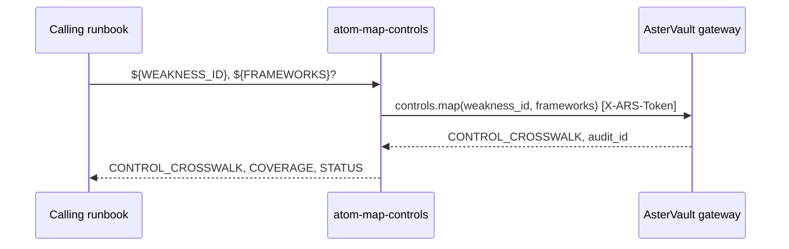

# Atomic: Map Controls

Map one `weakness_id` to its mitigating controls across frameworks (NIST 800-53, HIPAA, ISO 27001, …) via the gateway `controls.map` crosswalk — the grounding step that turns a weakness into remediation/compliance obligations.

**ID:** `ATOM-MAP-CONTROLS`
**Purpose:** Invert weakness → controls so remediation and compliance lanes cite real framework controls, not invented ones.
**Trigger:** A runbook has a resolved `weakness_id` and needs the control families (for remediation, gap analysis, or a compliance report).

## Inputs Required

- `${WEAKNESS_ID}`: string — the weakness identifier (keep any `llm_*` alias). *Source:* `atom-resolve-weakness` output, a finding, or a graph `weakness` node.
- `${FRAMEWORKS}` (optional): list — restrict to specific frameworks (e.g. `["nist-800-53","hipaa"]`). Default: all crosswalked.

## Execution Steps

1. **Tool Selection** — gateway tool `controls.map` (sole remote call).
2. **Parameter Mapping** — `controls.map(weakness_id=${WEAKNESS_ID}, frameworks=${FRAMEWORKS})`. Connected: attach `X-ARS-Token`.
3. **Execute** — call `controls.map`; record `audit_id`.
4. **Extract** — collect `controls[]` as `{framework, control_id, title, lifecycle_phase}` into `${CONTROL_CROSSWALK}`.

## Outputs Expected

- `${CONTROL_CROSSWALK}`: list — `[{framework, control_id, title, lifecycle_phase}]`.
- `${COVERAGE}`: object — `{mapped: n, frameworks: […]}`; empty if the weakness has no crosswalk yet.
- `${AUDIT_ID}`: string — metered-call handle (connected).
- `${STATUS}`: ["Success" | "NoMapping" | "Failure"].

## Decision Logic / Next Steps

- IF `Success` → hand `${CONTROL_CROSSWALK}` to `remediation` (policy-as-code) or a compliance report.
- IF `NoMapping` → flag a crosswalk gap for the weakness-registry (the weakness resolves but no control covers it).
- IF `Failure` → degrade to the local crosswalk pack; mark `${STATUS}`.

## Connected vs Offline

- **Connected**: `controls.map` live + metered; carry `X-ARS-Token`, record `audit_id`.
- **Offline**: read the local weakness→control crosswalk (shipped pack / `./.asterguard/`); no token, no quota. Mark `${STATUS}=Partial`.

## AI Agent Execution Notes

- Complements `atom-resolve-weakness` — resolve first (taxonomy), map second (controls); don't duplicate the resolve call here.
- Preserve the `weakness_id` alias so the crosswalk join hits.
- Reference `${CONTROL_CROSSWALK}` by handle; don't paste the full list into chat.
