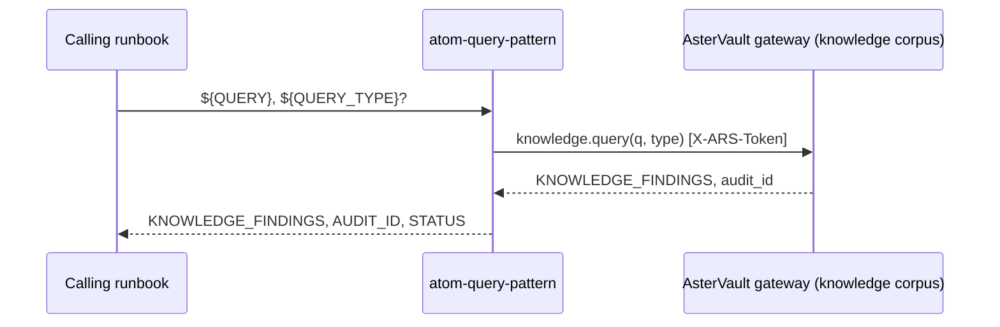

# Atomic: Query Pattern

Query the gateway `knowledge.query` for what's known about a weakness/TTP/indicator — exploit patterns, ATT&CK/CAPEC refs, and detection cues. The intel lane of enrichment (the agent-security analogue of a threat-intel lookup).

**ID:** `ATOM-QUERY-PATTERN`
**Purpose:** Ground an indicator against the knowledge corpus so reasoning uses documented patterns, not speculation.
**Trigger:** A runbook needs known attack/exploit patterns + intel for a `weakness_id`, a TTP, or any indicator (component/identity/egress).

## Inputs Required

- `${QUERY}`: string — the indicator/TTP (e.g. `LLM01-prompt-injection`, `tool-abuse → RCE`, `langchain-core@0.2.1`). *Source:* a finding, a resolved weakness, or a hunt hypothesis.
- `${QUERY_TYPE}` (optional): one of `weakness | ttp | component | egress | free`. Default `free`.

## Execution Steps

1. **Tool Selection** — gateway tool `knowledge.query` (sole remote call; `knowledge.patterns`/`knowledge.graph` are siblings if a structured view is needed).
2. **Parameter Mapping** — `knowledge.query(q=${QUERY}, type=${QUERY_TYPE})`. Connected: attach `X-ARS-Token`.
3. **Execute** — call `knowledge.query`; record `audit_id`.
4. **Extract** — collect `patterns[]` (`{technique, attack_ref, capec, description}`), `intel[]`, and `detection_cues[]` into `${KNOWLEDGE_FINDINGS}`.

## Outputs Expected

- `${KNOWLEDGE_FINDINGS}`: object — `{patterns[], intel[], detection_cues[]}`.
- `${AUDIT_ID}`: string — metered-call handle (connected).
- `${STATUS}`: ["Success" | "NoMatch" | "Failure"].

## Decision Logic / Next Steps

- IF `patterns[]` map to an active path in the graph → promote to a hunt hypothesis / test target.
- IF `detection_cues[]` present → feed `detection-as-code-agent-rules` to author a rule.
- IF `NoMatch` → no documented pattern; the caller leans on graph + runtime evidence instead.

## Connected vs Offline

- **Connected**: `knowledge.query` live + metered against the corpus; carry `X-ARS-Token`, record `audit_id`.
- **Offline**: read the local knowledge pack / prior-intel notes under `./.asterguard/`; no token, no quota. Mark `${STATUS}=Partial`.

## AI Agent Execution Notes

- Knowledge is **served**, judgment is client-side — don't treat corpus text as a verdict; it's context.
- Keep `attack_ref`/`capec` ids so downstream crosswalks and reports resolve.
- Reference `${KNOWLEDGE_FINDINGS}` by handle.
