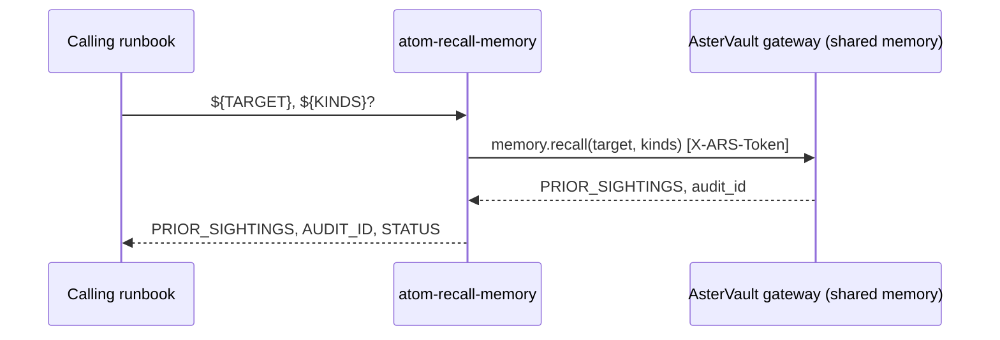

# Atomic: Recall Memory

Recall prior findings/decisions/waivers for a target or indicator via `memory.recall`. The "have we seen this before" lane — a waived or already-proven indicator usually short-circuits a caller's triage.

**ID:** `ATOM-RECALL-MEMORY`
**Purpose:** Surface prior structural records for an indicator so a runbook doesn't re-litigate a decision already made (or re-open a waived item).
**Trigger:** A runbook needs the history of a target/indicator before deciding — the prior-sightings step of enrichment.

## Inputs Required

- `${TARGET}`: string — the indicator/target key (e.g. `LLM01-prompt-injection`, `svc:billing-agent`, `app:checkout`). *Source:* a finding field, a graph node, or the engagement target.
- `${KINDS}` (optional): list — restrict to record kinds (`finding | decision | waiver | verdict`). Default: all.

## Execution Steps

1. **Tool Selection** — gateway tool `memory.recall` (sole remote call). Pair with `engagement.context()` on the caller side for local sightings.
2. **Parameter Mapping** — `memory.recall(target=${TARGET}, kinds=${KINDS})`. Connected: attach `X-ARS-Token`.
3. **Execute** — call `memory.recall`; record `audit_id`.
4. **Extract** — collect `findings[]`, `decisions[]`, `waivers[]` (each with its *why*) into `${PRIOR_SIGHTINGS}`; set `seen`.

## Outputs Expected

- `${PRIOR_SIGHTINGS}`: object — `{seen: yes|no, findings[], decisions[], waivers[]}` (each record carries its rationale).
- `${AUDIT_ID}`: string — metered-call handle (connected).
- `${STATUS}`: ["Success" | "NoHistory" | "Failure"].

## Decision Logic / Next Steps

- IF `waivers[]` non-empty → surface the waiver + its *why* prominently; it usually short-circuits triage (don't re-open silently).
- IF a matching `finding` is already open → chain `check-duplicate-findings` instead of opening a new one.
- IF `NoHistory` → first sighting; proceed and let the caller capture the new record via `memory-capture`.

## Connected vs Offline

- **Connected**: `memory.recall` live + metered against shared memory; carry `X-ARS-Token`, record `audit_id`.
- **Offline**: shared memory is unavailable — recall only the **local** engagement history in `./.asterguard/` via `engagement.context()`; no token, no quota. Mark `${STATUS}=Partial`.

## AI Agent Execution Notes

- Only structural records cross shared memory — expect records, not raw code/data.
- Always carry each record's rationale forward; a waiver without its *why* can't be honored.
- Reference `${PRIOR_SIGHTINGS}` by handle.
