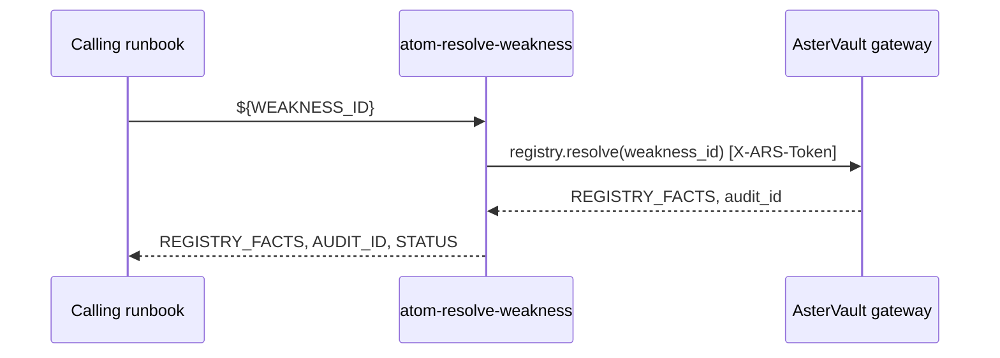

# Atomic: Resolve Weakness

Resolve one `weakness_id` to its registry record — definition, STRIDE, CWE, `attack_refs`, controls — the single grounded fact-lookup every enrichment/triage lane starts from.

**ID:** `ATOM-RESOLVE-WEAKNESS`
**Purpose:** Ground a weakness indicator against the registry so downstream steps reason over its real taxonomy, not a guess.
**Trigger:** A runbook (`enrich-indicator`, triage, investigation, IRP) holds a `weakness_id` and needs its definition/taxonomy/controls before deciding.

## Inputs Required

- `${WEAKNESS_ID}`: string — the weakness identifier (e.g. `LLM01-prompt-injection`, `llm_excessive_agency`). *Source:* a finding field, a graph `weakness` node, or a prior runbook output.

## Execution Steps

1. **Tool Selection** — gateway tool `registry.resolve` (the one and only remote call; everything else is client-side).
2. **Parameter Mapping** — map `${WEAKNESS_ID}` → `registry.resolve(weakness_id=…)`. Connected: attach `X-ARS-Token` (via `ars-token`).
3. **Execute** — call `registry.resolve`. Record the returned `audit_id` (connected).
4. **Extract** — pull `definition`, `stride`, `cwe[]`, `attack_refs[]` (CAPEC/ATT&CK), and `controls[]` into `${REGISTRY_FACTS}`. Note that catalog ids may alias `llm_*`; keep the alias.

## Outputs Expected

- `${REGISTRY_FACTS}`: object — `{definition, stride, cwe[], attack_refs[], controls[]}`.
- `${AUDIT_ID}`: string — audit handle for the metered call (connected only).
- `${STATUS}`: ["Success" | "NotFound" | "Failure"] — with a message on non-success.

## Decision Logic / Next Steps

- IF `Success` and `controls[]` is empty → chain `atom-map-controls` for the crosswalk.
- IF `NotFound` → the id is unknown/mistyped; surface to the caller for a weakness-registry gap (do not fabricate a definition).
- IF `Failure` (quota/offline) → fall back to local pack/registry data (see below) and mark `${STATUS}` so the caller can weight it.

## Connected vs Offline

- **Connected** (`ASTERVAULT_MCP_URL` set): `registry.resolve` is live and metered — carry `X-ARS-Token`, record `audit_id`.
- **Offline**: read the local weakness-registry markdown / pack mappings under `./.asterguard/` or the shipped registry; no token, no quota. Mark `${STATUS}=Partial` and note the source.

## AI Agent Execution Notes

- One gateway call only — do not also enrich the graph here; that is `atom-enrich-component`.
- Preserve `weakness_id` aliasing (`llm_*`) end to end so controls/crosswalk joins resolve.
- Do not inline the full record into chat; reference `${REGISTRY_FACTS}` by handle.
