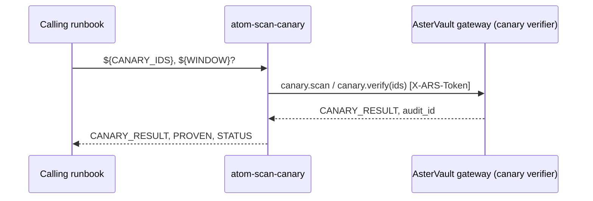

# Atomic: Scan Canary

Check whether a planted canary egressed or was triggered, via `canary.scan` / `canary.verify`. A canary hit is independent, code-checkable proof — the hardest evidence a runbook can produce.

**ID:** `ATOM-SCAN-CANARY`
**Purpose:** Turn a suspicion of exfil/tool-abuse into hard proof by checking planted-canary state against the gateway's independent verifier.
**Trigger:** A red-team episode or incident planted canaries and a runbook needs to know if any egressed/was hit.

## Inputs Required

- `${CANARY_IDS}`: list — the planted canary identifiers/tokens to check. *Source:* `canary.mint`/`canary.plant` output recorded in the engagement (`behavioral-redteam`).
- `${WINDOW}` (optional): string — lookback for the egress/hit check. Default: episode window.

## Execution Steps

1. **Tool Selection** — gateway tool `canary.scan` (did any value appear in egress?) and/or `canary.verify` (confirm a specific hit). One grounded verifier call per intent.
2. **Parameter Mapping** — `canary.scan(ids=${CANARY_IDS}, window=${WINDOW})` / `canary.verify(id=…)`. Connected: attach `X-ARS-Token`.
3. **Execute** — call the verifier; record `audit_id`.
4. **Extract** — collect `hits[]` (`{canary_id, where, ts, channel}`) and `verdict` into `${CANARY_RESULT}`.

## Outputs Expected

- `${CANARY_RESULT}`: object — `{hits[], verdict}` (`verdict` ∈ `egressed | hit | clean`).
- `${PROVEN}`: bool — `true` if any canary egressed/was hit (hard proof).
- `${AUDIT_ID}`: string — metered-call handle (connected).
- `${STATUS}`: ["Success" | "Failure"].

## Decision Logic / Next Steps

- IF `PROVEN` → a confirmed exfil/abuse; caller routes to IRP/containment and records a `finding_opened` with the canary hit as evidence. This outweighs a soft model judgment.
- IF `verdict = clean` → no proof via canary; the caller relies on `atom-trace-egress` + judgment, and should not over-claim.

## Connected vs Offline

- **Connected**: `canary.scan`/`canary.verify` live + metered — the gateway is the independent verifier; carry `X-ARS-Token`, record `audit_id`.
- **Offline**: the independent verifier is unavailable; check locally recorded canary sightings in `./.asterguard/` only, and clearly mark the result `Partial` — a local-only check is weaker evidence than a gateway verify.

## AI Agent Execution Notes

- A canary hit is **hard evidence** — prefer it over narrative judgment when they disagree.
- Only check canaries that were actually minted/planted for this engagement (ids from the engagement stream).
- Reference `${CANARY_RESULT}` by handle; record the hit as a typed event via the caller.
