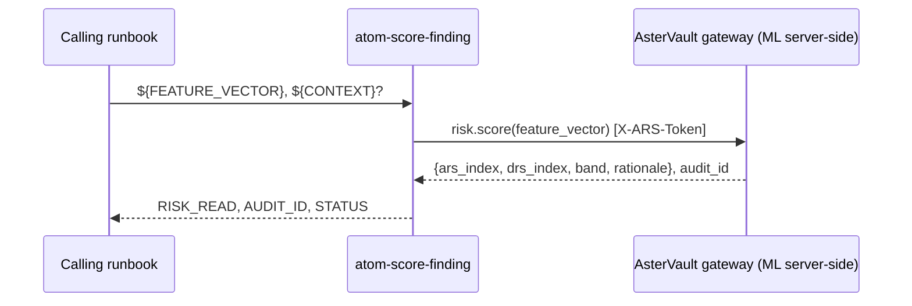

# Atomic: Score Finding

Hand a finding's feature vector to the gateway `risk.score` and get back one ARS/DRS index plus a rationale. The ML runs server-side — the harness assembles the vector and consumes the index; it does **not** run the model locally.

**ID:** `ATOM-SCORE-FINDING`
**Purpose:** Produce one calibrated risk index (CVE-like 0–10) for a finding so triage/priority routes on a consistent score, not ad-hoc judgment.
**Trigger:** A runbook has assembled a feature vector for a finding/indicator and needs its ARS/DRS index + rationale.

## Inputs Required

- `${FEATURE_VECTOR}`: object — the assembled signals, e.g. `{kev, epss, reachability, data_class, owasp_weight, exposure, blast_radius}`. *Source:* merged from `atom-resolve-weakness` + `atom-enrich-component` + `atom-trace-egress` by the calling (common) runbook.
- `${CONTEXT}` (optional): object — `{app_id, finding_id, tenant}` for per-tenant overlay scoring.

## Execution Steps

1. **Tool Selection** — gateway tool `risk.score` (sole remote call; the model is gateway-side).
2. **Parameter Mapping** — `risk.score(feature_vector=${FEATURE_VECTOR}, context=${CONTEXT})`. Connected: attach `X-ARS-Token`.
3. **Execute** — call `risk.score`; the gateway returns the index (the harness does **not** materialize M1–M8/meta/DRS locally). Record `audit_id`.
4. **Extract** — read `ars_index`, `drs_index`, `band`, and `rationale[]` into `${RISK_READ}`.

## Outputs Expected

- `${RISK_READ}`: object — `{ars_index, drs_index, band, rationale[]}` (index 0–10; `band` ∈ low|medium|high|critical).
- `${AUDIT_ID}`: string — metered-call handle (connected).
- `${STATUS}`: ["Success" | "Degraded" | "Failure"] — `Degraded` = heuristic fallback used.

## Decision Logic / Next Steps

- The index is a **read**, not a disposition — the caller decides escalate/close.
- IF `band` ∈ {high, critical} → caller routes to investigation/IRP.
- IF `Degraded` → the gateway score was unavailable; the caller should weight the heuristic lower and note it.

## Connected vs Offline

- **Connected**: `risk.score` live + metered — the server returns the learned index; carry `X-ARS-Token`, record `audit_id`.
- **Offline**: no ML available — compute a transparent heuristic band from the raw vector (e.g. KEV+reachability+data-class), mark `${STATUS}=Degraded`, and say so. Never present the heuristic as the learned ARS.

## AI Agent Execution Notes

- Do **not** attempt to run or approximate the ML locally — assemble the vector, call the gateway, consume the index.
- Keep the feature vector explicit and inspectable so the score is reproducible for `evals`.
- Carry `rationale[]` forward; a bare number without rationale is not actionable.
