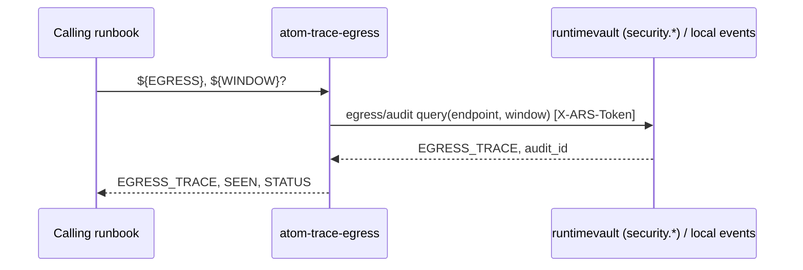

# Atomic: Trace Egress

Pull the recorded egress for one endpoint/host — what the agent actually sent where — from the proxy/runtime audit. The grounded "what happened" lane: connected uses `security.*` runtimevault, offline reads `./.asterguard/` recorded events.

**ID:** `ATOM-TRACE-EGRESS`
**Purpose:** Produce the observed egress record for an endpoint so a runbook reasons over real traffic, not assumptions.
**Trigger:** A runbook holds an `egress` indicator (endpoint/host/domain the agent can reach) and needs the recorded calls to/from it.

## Inputs Required

- `${EGRESS}`: string — the endpoint/host/domain (e.g. `https://paste.ee/x`, `api.vendor.com`, an IP). *Source:* an alert `destination` field, a graph `egress` node, or `atom-enrich-component`/`atom-lookup-identity` reach.
- `${WINDOW}` (optional): string — lookback window (e.g. `24h`). Default: engagement window.

## Execution Steps

1. **Tool Selection** — connected: runtime `security.*` (runtimevault) egress/audit query; offline: local recorded-events read. One grounded source either way.
2. **Parameter Mapping** — `security.<egress_query>(endpoint=${EGRESS}, window=${WINDOW})`. Connected: attach `X-ARS-Token`.
3. **Execute** — run the query; record `audit_id` (connected).
4. **Extract** — collect `events[]` as `{ts, principal, tool, bytes, direction, verdict}`, plus `summary` (counts, distinct principals, any blocked/alerted) into `${EGRESS_TRACE}`.

## Outputs Expected

- `${EGRESS_TRACE}`: object — `{endpoint, events[], summary}`.
- `${SEEN}`: bool — whether any recorded egress exists for this endpoint.
- `${AUDIT_ID}`: string — metered-call handle (connected).
- `${STATUS}`: ["Success" | "NoEvents" | "Failure"].

## Decision Logic / Next Steps

- IF `SEEN` and `events[]` include un-allowlisted destinations / confidential-data direction → exfil lead; caller routes to `hunt-exfil-paths` / IRP.
- IF a canary value appears in the egress → chain `atom-scan-canary` for hard proof.
- IF `NoEvents` → the endpoint is reachable but unused in-window; note it (reachability ≠ use).

## Connected vs Offline

- **Connected**: query `security.*` runtimevault egress/audit live + metered; carry `X-ARS-Token`, record `audit_id`.
- **Offline**: read recorded events under `./.asterguard/` (proxy-recon / runtime capture output); no token, no quota. Mark `${STATUS}=Partial` and note the capture source.

## AI Agent Execution Notes

- This is **observed** egress (what happened), distinct from `atom-enrich-component` reach (what's possible).
- Preserve event verdicts (blocked/allowed/alerted) — they drive the exfil decision.
- Reference `${EGRESS_TRACE}` by handle; don't inline raw event dumps.
