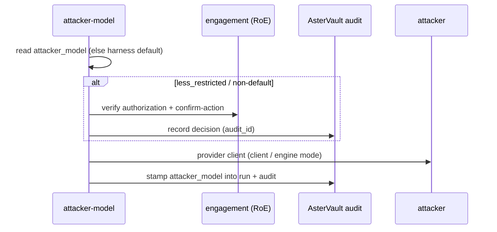

# Attacker Model (selection + governance)

The attacker drives the campaign; *which model* drives the attacker materially changes the result — a
less safety-restricted research model finds breaks a safety-tuned model refuses to attempt, so a bare
success rate without naming the attacker model is meaningless. This skill closes the doctrine's first
gap: make attacker-model selection **explicit, selectable, and governed**.

> **Dual-use.** A non-default / less-restricted attacker model is sensitive. It is for **authorized**
> engagements only, and every run records which model attacked — selection here is inseparable from the
> accountability below.

## When to Activate

- Configuring a red-team / pentest run's attacker (the `attacker` / `behavioral-redteam` / `exploit-chain`
  skills read this).
- Auditing a past run: which model attacked, under whose authorization.

## The config

```jsonc
attacker_model: {
  provider: "openai" | "anthropic" | "deepseek" | "<registry id>",
  model: "<model id>",
  base_url: "<optional>",           // self-hosted / gateway-routed
  api_key_env: "<optional env var>",
  less_restricted: false            // true = a research model with relaxed safety tuning
}
```

- **Default** = the harness model (the model running the skill). Unset → the harness attacks, also recorded.
- Resolve the provider via the existing provider abstraction (`llm_providers.provider_client` /
  the workforce `OpenAICompatBackend`) — never invent a provider layer.
- Honored in both execution modes: **client** (the attacker loop uses the selected model locally) and
  **engine** (passed to the forge when driving it).

## Governance (inseparable from selection)

1. **Authorized-only.** A `less_restricted` attacker model runs only under a recorded RoE authorization
   (`offensive-engineer` step 0). Without it, fall back to the default model and note why.
2. **Record it everywhere.** Write `attacker_model` into the run artifacts (`tests.behavioral.json` /
   `runs/`) **and** stamp it to the AsterVault audit (every tool call returns an `audit_id`), so the run
   is reproducible and attributable.
3. **Report it.** Always report results as "ASR@10 with attacker=`<model>`", never a bare rate — the
   attacker model is part of the finding.
4. **Human gate.** Selecting a non-default / less-restricted model is a `decision` event via
   `confirm-action`.

## Method

1. Read `attacker_model` (or default to the harness model).
2. If non-default/less-restricted: verify the RoE authorization exists; `confirm-action`; record the
   `decision`.
3. Resolve the provider client; hand it to the attacker loop (client or engine mode).
4. Stamp `attacker_model` into the run artifact + audit; ensure the report surfaces it with ASR.



## Integration

- **Used by:** `attacker`, `behavioral-redteam`, `exploit-chain`, `offensive-engineer`; surfaced by
  `pentest-report` (methodology).
- **Reuses:** the provider abstraction (`llm_providers` / workforce backends); the forge for engine mode.
- **Recorded:** run artifacts + the AsterVault audit — reproducibility + accountability by construction.
