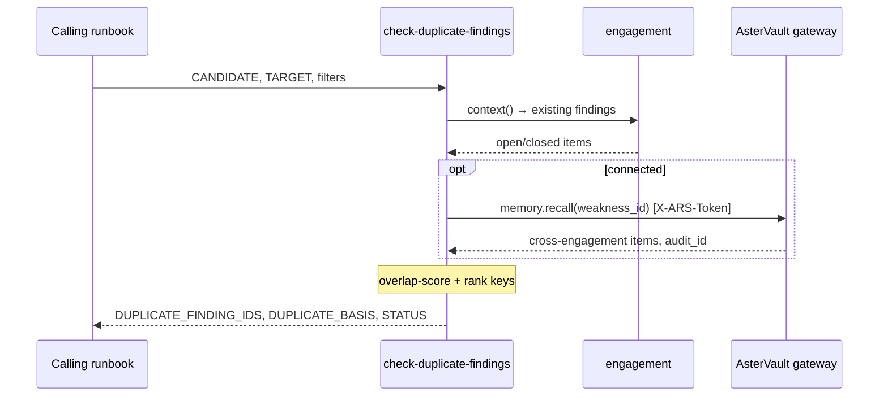

# Common Step: Check Duplicate Findings

Decide whether a candidate finding/incident is a duplicate of one already on record, by overlap of its
structural keys. The reusable building block a triage or grouping runbook calls before it commits a new
record. It is the agent-security analogue of a SOC "get similar cases" step — but similarity is
computed over our structural keys (weakness_id + location + component/identity/egress), not a vendor's
case-similarity engine.

## When to Activate

- A candidate finding/incident is in hand and you must avoid creating a second record for the same
  underlying issue.
- Called by `triage-agent-finding`, `investigate-agent-incident`, `correlate-finding-groups`, and
  `close-duplicate-findings-wf` — anywhere the source would "check for similar cases".

## Objective

Return the existing findings/incidents that are likely duplicates of the candidate, each with a
similarity basis (which keys overlap) and a confidence, so the caller can **collapse into the primary**
or confirm the candidate is genuinely new — without itself closing anything.

## Scope

Covers: computing structural overlap between the candidate and existing items from the engagement +
memory, and ranking the duplicates. Excludes: opening/attaching (caller), closing the duplicate (use
`close-finding`, human-gated via `confirm-action`), and relevance-by-thread search (use
`find-related-findings`).

## Inputs

- `${CANDIDATE}`: object — the new finding's structural keys: `{weakness_id, location, component?,
  identity?, egress?, severity/index?}`. *Source:* the calling triage/investigation runbook.
- `${TARGET}`: string — the engagement to check within. *Source:* engagement context.
- `${DAYS_BACK}` (optional): int — lookback for existing items (default: all open + recent closed).
- `${INCLUDE_CLOSED}` (optional): bool — also compare against recently closed items (default: true, to
  catch re-opens).

## Outputs

- `${DUPLICATE_FINDING_IDS}`: list — ids judged duplicate/near-duplicate, ranked.
- `${DUPLICATE_BASIS}`: list — `{id, overlap_keys:[…], confidence: high|medium|low}` per match.
- `${AUDIT_ID}` (optional): string — `audit_id` of the metered `memory.recall`, when connected.
- `${STATUS}`: ["Success" | "Partial" | "Failure"] — with a per-lane note.

## Tools

- **Gateway (connected, metered — carry `X-ARS-Token`, record the `audit_id`):**
  `memory.recall` (via `atom-recall-memory`) — existing items sharing the candidate's keys across
  engagements.
- **Client-side:** compute key overlap (weakness_id + location exact; component/identity/egress
  partial) between `${CANDIDATE}` and each existing item; score confidence; rank. This judgment is the
  model's, not the gateway's.
- **Sibling skills:** `engagement` (`context()` for existing findings); `atom-recall-memory`.

## Workflow Steps & Diagram

1. **Receive** `${CANDIDATE}` + `${TARGET}` (+ filters) from the caller.
2. **Gather existing.** `engagement.context()` → local open (and, per `${INCLUDE_CLOSED}`, recent
   closed) findings; connected, also `atom-recall-memory` for cross-engagement items with the same
   weakness_id. Degrade the memory lane on failure (note in `${STATUS}`).
3. **Compare.** For each existing item, compute overlap: `weakness_id` + `location` match is the strong
   signal; shared `component`/`identity`/`egress` raises confidence; divergent location lowers it.
4. **Rank.** Assign `high | medium | low` confidence; drop non-overlapping items. Build
   `${DUPLICATE_BASIS}`.
5. **Return** `${DUPLICATE_FINDING_IDS}` + `${DUPLICATE_BASIS}` + `${STATUS}`. (Collapse/close is the
   caller's job, human-gated.)

## Decision Logic / Completion Criteria

- IF `weakness_id` + `location` match an existing item THEN mark `high` — the caller collapses the
  candidate into that primary.
- IF only `weakness_id` matches but location differs, with a shared component/identity/egress, THEN
  mark `medium` — surface for the caller to judge (related, maybe a variant, not an outright dupe).
- IF no structural overlap THEN return empty — the candidate is new.
- **Done when:** every existing candidate has been scored or dropped and the ranked list is returned.

## Integration

- **Composes:** `engagement` (context), `atom-recall-memory`.
- **Called by:** `triage-agent-finding`, `investigate-agent-incident`, `correlate-finding-groups`,
  `close-duplicate-findings-wf`.
- **Offline:** compares against the local engagement only; memory lane noted unavailable.
  **Connected:** adds the metered cross-engagement `memory.recall`.
