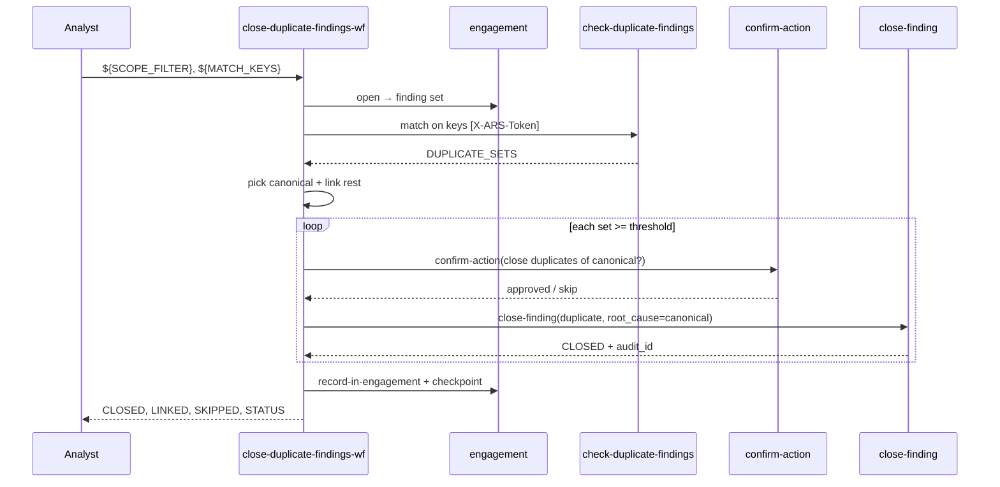

# Close Duplicate Findings (Workflow)

Find and close duplicate findings/incidents across the engagement at scale: cluster by signature +
shared indicators, confirm each duplicate set, pick a canonical, link the rest to it, and close the
duplicates with a `duplicate` reason pointing at the canonical. The agent-security analogue of SOC
"close duplicate cases" — closure is resolving a finding with reason + root-cause, human-gated.

## When to Activate

- The engagement queue has many findings and some are clearly the same issue re-reported (same
  weakness on the same component, same identity/egress signature).
- After `correlate-finding-groups` surfaces identical (not merely related) members.

## Objective

Reduce the open queue to distinct work: every duplicate set collapsed to one canonical finding, the
rest linked and closed with a `duplicate` reason, each closure human-gated and recorded.

## Scope

Covers: duplicate detection at scale, canonical selection, linking, and gated closure. Excludes:
merging *related* (non-identical) findings into one incident (`correlate-finding-groups`), investigation
(`investigate-agent-incident`), and containment.

## Inputs

- `${SCOPE_FILTER}` (optional): which findings to scan — status/age/weakness-class/component. Default =
  all open findings on the engagement. *Source:* engagement.
- `${MATCH_KEYS}` (optional): the fields that define a duplicate (e.g. `weakness_id + component +
  identity`, or finding signature hash). Default = signature + primary indicator.
- `${AUTO_THRESHOLD}` (optional): confidence above which a duplicate is proposed for closure
  (still human-gated). Default = exact signature match only.

## Outputs

- `${DUPLICATE_SETS}`: groups of `{canonical_id, duplicate_ids[], match_reason, confidence}`.
- `${CLOSED}`: duplicates closed, each with its `decision` + `close-finding` event + (connected)
  `audit_id`.
- `${LINKED}`: duplicate→canonical links recorded on the engagement.
- `${SKIPPED}`: candidate sets held back (below threshold / ambiguous) for analyst review.
- `${STATUS}`: ["Success" | "Partial" | "Failure"].

## Tools

- **Gateway (connected, metered — carry `X-ARS-Token`, record each `audit_id`):** `memory.recall`
  (prior duplicate decisions), reached via the composed siblings; closure state changes recorded via
  `close-finding`.
- **Client-side:** compute signatures/indicator sets; cluster exact + near matches; choose the canonical
  (oldest / most-enriched / highest-fidelity); decide the match reason. The dedupe judgement is the
  harness's.
- **Sibling skills:** `engagement` (open/context) · `check-duplicate-findings` (the dedupe primitive) ·
  `find-related-findings` (candidate gathering) · `confirm-action` (gate per set) · `close-finding`
  (the closure) · `record-in-engagement`.

## Workflow Steps & Diagram

1. **Open + gather.** `engagement.open`; pull the finding set per `${SCOPE_FILTER}`.
2. **Detect duplicates.** For each finding, `check-duplicate-findings` over the set + memory using
   `${MATCH_KEYS}`; cluster exact/near matches → `${DUPLICATE_SETS}`.
3. **Pick canonical + link.** In each set, select the canonical (oldest / most complete); mark the rest
   as duplicates of it → `${LINKED}`.
4. **Gate.** For each set at/above `${AUTO_THRESHOLD}`, `confirm-action` (batchable: present the set,
   canonical, and match reason). Below threshold / ambiguous → `${SKIPPED}`.
5. **Close.** For each confirmed set, `close-finding` each duplicate with reason `duplicate`,
   `root_cause = <canonical_id>`; record a `decision` event + `audit_id`. → `${CLOSED}`.
6. **Checkpoint.** `record-in-engagement` all link + closure events; `engagement.checkpoint`.

## Decision Logic / Completion Criteria

- A finding is a **duplicate** only on a confirmed signature/indicator match to the canonical — *related*
  but distinct findings go to `correlate-finding-groups`, not here.
- Every closure is **human-gated** via `confirm-action` and recorded as a `decision` (dual-use
  discipline). Use the least-destructive closure (resolve as duplicate, keep the canonical open).
- Ambiguous or below-threshold sets are **skipped**, not closed.
- **Done when:** every duplicate set is linked and either closed (gated) or skipped, and all events are
  recorded.

## Integration

- **Composes:** `check-duplicate-findings`, `find-related-findings`, `confirm-action`, `close-finding`,
  `record-in-engagement`; `engagement` bookends.
- **Called by:** the `soc-triage` playbook; downstream of `correlate-finding-groups`.
- **Offline:** dedupe runs over the local engagement findings; closures are recorded locally and marked
  pending-sync (no shared-memory write). **Connected:** memory-backed prior decisions + metered closure,
  each `audit_id` recorded.
