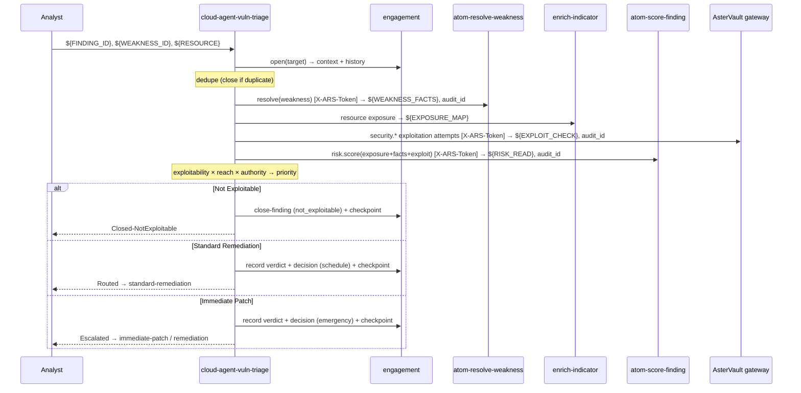

# Runbook: Cloud Agent Vulnerability Triage

Initial triage of a **cloud/infra vulnerability on an agent deployment** — an IaC misconfiguration, an
exposed endpoint, or over-broad IAM on the service principal the agent runs as. The agent-security
analogue of cloud-posture vuln triage: the "SCC finding" is a weakness on the deployment's infra
(`component`/`identity`/`egress`), contextualized by what the agent can reach and whether it is being
exploited. Triage only: it prioritizes + routes; it does not patch, re-deploy, or contain.

## When to Activate

- An IaC scanner (`local-scan` checkov lane), a posture check, or a cloud finding flags a vuln on an
  agent deployment: public-exposed endpoint, over-broad IAM/role, permissive egress, or misconfigured
  secret store.
- `triage-agent-alert` routed an infra finding here for exposure-centric triage.

## Objective

Contextualize a cloud/infra vulnerability on an agent deployment — resolve the weakness, map the exposed
resource and the authority an attacker would reach through it, check for active exploitation — and route
it to emergency remediation or the standard patch schedule, or close as not-exploitable.

## Scope

Covers: resolve the weakness, map the exposed resource + reachable authority, check recorded events for
exploitation attempts, relate to open findings, prioritize, and route.
Excludes: patching / IaC re-deploy / IAM narrowing / endpoint lockdown (human-gated via `remediation` +
`confirm-action` + `cloud-agent` IRP paths), and deep forensics.

## Inputs

- `${FINDING_ID}`: string — the cloud/infra finding id. *Source:* IaC/posture scan.
- `${WEAKNESS_ID}`: string — the misconfig/vuln class (e.g. `exposed-endpoint`, `iam-over-broad`,
  `permissive-egress`, a CVE). *Source:* finding. Typed `weakness_id` for enrichment.
- `${RESOURCE}`: string — the affected cloud resource / agent deployment (endpoint, role, bucket,
  service principal). *Source:* finding. Typed `component`/`identity`/`egress` for `enrich-indicator`.
- `${TARGET}`: string — the app/project that owns the deployment. *Source:* engagement.
- `${TIME_FRAME_HOURS}` (optional): int — lookback for the exploitation-events search (default 168).

## Outputs

- `${ASSESSMENT}`: ["Not Exploitable" | "Duplicate" | "Standard Remediation" | "Immediate Patch"] —
  verdict + rationale.
- `${ACTION_TAKEN}` / route: ["Closed-NotExploitable" | "Closed-Duplicate" |
  "Routed → standard-remediation" | "Escalated → immediate-patch"].
- `${WEAKNESS_FACTS}`: definition/CWE/attack_refs/controls (from `atom-resolve-weakness`).
- `${EXPOSURE_MAP}`: the exposed resource + the reachable authority/data behind it (from
  `atom-enrich-component` / `atom-lookup-identity` / `graph.enrich`).
- `${EXPLOIT_CHECK}`: recorded events showing exploitation attempts against the resource (recorded-events
  search).
- `${RISK_READ}`: ARS/DRS index + rationale (from `atom-score-finding`).
- `${STATUS}`: ["Success" | "Partial" | "Failure"] — with a per-lane note on non-success.

## Tools

- **Gateway (connected, metered — carry `X-ARS-Token`, record each `audit_id`):** `registry.resolve`
  (weakness), `graph.enrich` (exposure/reach), `risk.score`, `knowledge.query` (exploitability),
  `memory.recall` (via the composed skills), runtime `security.*` exploitation-events search.
- **Client-side:** judge exploitability from exposure + the weakness facts; weigh reach × authority to
  prioritize; pick emergency-vs-standard.
- **Sibling skills:** `engagement` (open/context/checkpoint) · `atom-resolve-weakness` ·
  `enrich-indicator` (resource exposure) · `atom-score-finding` · `find-related-findings` ·
  `check-duplicate-findings` · `record-in-engagement` · `close-finding`.

## Workflow Steps & Diagram

1. **Open engagement.** `engagement.open(${TARGET})` → context + history. Connected: ensure the ARS token
   via `ars-token`.
2. **Dedupe.** `check-duplicate-findings` on resource + weakness → if already open, `close-finding`
   (reason=`duplicate`), route **Closed-Duplicate**. Stop.
3. **Resolve the weakness.** `atom-resolve-weakness(${WEAKNESS_ID})` → `${WEAKNESS_FACTS}` (CWE,
   attack_refs, controls). Degrade to local pack data if it won't resolve (note in `${STATUS}`).
4. **Map exposure.** `enrich-indicator` on `${RESOURCE}` (type `component`/`identity`/`egress`) →
   `${EXPOSURE_MAP}`: is the endpoint publicly reachable? what IAM authority / data does an attacker
   reach through it? what does the agent on it hold?
5. **Check exploitation.** One targeted runtime `security.*` search over `${TIME_FRAME_HOURS}` for
   exploitation attempts / anomalous access against the resource → `${EXPLOIT_CHECK}`. Connected: carries
   `X-ARS-Token`, returns `audit_id`.
6. **Score + relate.** `atom-score-finding` over exposure + weakness facts + exploit signal →
   `${RISK_READ}`; `find-related-findings` on the resource → related open items.
7. **Prioritize + route.** Map `${RISK_READ}` + exploitation + exposure to a route. Not-exploitable →
   `close-finding`. Otherwise route standard-remediation or immediate-patch.
   `record-in-engagement` the `verdict` + `decision` events (with `audit_id`s); `engagement.checkpoint`.

## Decision Logic / Completion Criteria

- IF `${DUPLICATE_OF}` confirmed THEN **Closed-Duplicate** → `close-finding`.
- IF `${EXPOSURE_MAP}` shows the resource is not externally reachable and the weakness is not
  exploitable in context (per `${RISK_READ}`) THEN **Closed-NotExploitable**.
- IF exploitable but low reach/authority and no active exploitation THEN **Standard Remediation** →
  route to the patch schedule (`remediation`).
- IF a known-exploited weakness, public exposure, over-broad IAM reaching sensitive authority/data, OR
  `${EXPLOIT_CHECK}` shows active attempts THEN **Immediate Patch** → escalate (emergency `remediation`;
  a confirmed compromise hands off to the matching IRP).
- **Done when:** the weakness is resolved, exposure + exploitation + score are gathered, a route is set,
  the action is taken, and events are recorded + checkpointed.

## Integration

- **Composes:** `atom-resolve-weakness`, `enrich-indicator`, `atom-score-finding`,
  `find-related-findings`, `check-duplicate-findings`, `close-finding`; `engagement` +
  `record-in-engagement` bookends.
- **Fed by:** `local-scan` (IaC/checkov), posture checks. **Escalated from:** `triage-agent-alert`.
  **Routes to:** `remediation`; confirmed compromise → `endpoint-agent-triage-isolation` or an IRP.
- **Offline:** registry/graph/score degrade to local pack data + the local graph; exploitation lane uses
  local recorded events; route still produced (noted `Partial`). **Connected:** full `registry.resolve` +
  `graph.enrich` + `risk.score` + runtime search, metered, each metered call records an `audit_id`.
