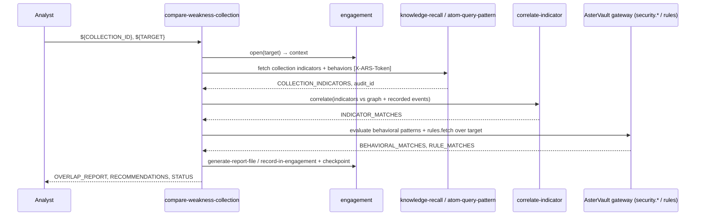

# Compare Weakness Collection to the Target

Point-in-time overlap check: take a known collection (a campaign pattern or weakness/TTP set) and
compare its indicators **and** modeled behaviors against the target's security graph and recently
recorded agent events, then report exactly where they overlap. The event search runs over the target's
recorded tool-calls/egress + graph nodes (`knowledge.query` supplies the collection's modeled behaviors),
and the behavioral layer is modeled agent behavior, not just atomic indicators.

## When to Activate

- A fresh advisory/campaign collection drops and you need to know, now, whether the target shows any of
  it.
- A periodic sweep compares an active-campaign collection against recent agent activity.

## Objective

Produce a concise overlap report: which of the collection's indicators/behaviors match the target's
graph or recently recorded events, with evidence, plus recommended follow-on actions for confirmed
overlaps.

## Scope

Covers: a point-in-time indicator + behavioral comparison of one collection against the target's graph +
recorded events, and the overlap report. Excludes: full collection investigation
(`investigate-weakness-collection`), deep analysis (`deep-dive-indicator-analysis`), containment.

## Inputs

- `${COLLECTION_ID}`: string — the collection/campaign to compare (may be a private/local bundle).
  *Source:* analyst, advisory, or threat-rule profile.
- `${TARGET}`: string — the agent/app/deployment to compare against. *Source:* engagement.
- `${LOOKBACK_HOURS}` (optional): int — recorded-event window (default 72).
- `${INCLUDE_BEHAVIORAL}` (optional): bool — also compare modeled behaviors (indicator++), not just
  atomic indicators (default true).

## Outputs

- `${COLLECTION_INDICATORS}`: the collection's atomic indicators + (if enabled) behavioral patterns.
- `${INDICATOR_MATCHES}`: collection indicators found on the target graph / in recorded events, with
  evidence.
- `${BEHAVIORAL_MATCHES}`: modeled-behavior matches in recorded agent events (which event fields).
- `${RULE_MATCHES}`: hits from `rules.fetch`-sourced threat rules for the collection evaluated over the
  target.
- `${OVERLAP_REPORT}` + `${RECOMMENDATIONS}`; `${STATUS}`: ["Success" | "Partial" | "Failure"].

## Tools

- **Gateway (connected, metered — carry `X-ARS-Token`, record each `audit_id`):** `knowledge.query` /
  `knowledge.graph` (the collection's indicators + behaviors), runtime `security.*` (recorded-event +
  rule-match search over the target), `graph.enrich` (graph-node overlap), `rules.fetch` (the
  collection's threat rules).
- **Client-side:** extract atomic + behavioral signatures; search the graph + recorded events; judge a
  real match vs a coincidence; assemble the overlap report.
- **Sibling skills:** `engagement` (open/context) · `atom-query-pattern` / `knowledge-recall`
  (collection) · `atom-fetch-rules` (rule content) · `correlate-indicator` (graph + event matching) ·
  `generate-report-file` · `record-in-engagement`.

## Workflow Steps & Diagram

1. **Open + fetch collection.** `engagement.open(${TARGET})`; `knowledge-recall`/`atom-query-pattern`
   to pull `${COLLECTION_ID}`'s atomic indicators and, if `${INCLUDE_BEHAVIORAL}`, its modeled behaviors
   → `${COLLECTION_INDICATORS}`.
2. **Indicator overlap.** `correlate-indicator` each collection indicator against the target's graph
   nodes and recorded events over `${LOOKBACK_HOURS}` → `${INDICATOR_MATCHES}`.
3. **Behavioral overlap.** If enabled, interpret the relevant recorded-event fields (tool, scope,
   egress, input-origin) against the collection's behavioral patterns → `${BEHAVIORAL_MATCHES}`.
4. **Rule overlap.** `atom-fetch-rules` for the collection's threat rules; evaluate them over the
   target's recorded events (runtime `security.*`) → `${RULE_MATCHES}`.
5. **Report.** Assemble `${OVERLAP_REPORT}` (matches + evidence + "no overlap" for checked-but-clean
   members) and `${RECOMMENDATIONS}`; `generate-report-file` or `record-in-engagement` (name this
   runbook at the top).
6. **Checkpoint.** `engagement.checkpoint`.

## Decision Logic / Completion Criteria

- Report overlap only where an indicator/behavior **actually matches** a target node or recorded event —
  state the matched field as evidence; list checked-but-clean members so absence is also recorded.
- IF a confirmed overlap involves observed privileged activity THEN recommend
  `investigate-agent-incident` on that slice; IF broad pattern match THEN
  `investigate-weakness-collection` for the full picture.
- IF no overlap THEN report "no current overlap" with the checked indicator set.
- **Done when:** atomic, behavioral, and rule comparisons have run (or degraded with a note) and the
  overlap report is produced/recorded.

## Integration

- **Composes:** `knowledge-recall`, `atom-query-pattern`, `atom-fetch-rules`, `correlate-indicator`,
  `generate-report-file`, `record-in-engagement`; `engagement` bookends.
- **Called by:** `proactive-pattern-campaign-hunt`, `apt-agent-threat-hunt`; pairs with
  `investigate-weakness-collection` (compare first, investigate the overlap).
- **Offline:** collection + rules load from the local pack; comparison runs over recorded `./.asterguard/`
  events + local graph only (behavioral/rule lanes noted if the runtime audit is unavailable).
  **Connected:** full knowledge + runtime event/rule evaluation, metered.
