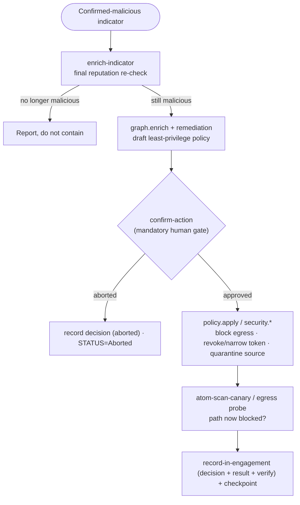

# Contain Indicator

Execute containment for a confirmed-malicious indicator against a live agent/deployment: translate it
into the narrowest policy that stops the abuse — an egress allowlist denial, a scoped-token revoke, or a
source quarantine — gate it on a human decision, apply it at the gateway/PDP, and record the decision.
The agent-security analogue of "IOC containment": blocking is least-privilege policy enforced at the
`policy.apply`/runtime `security.*` boundary, never an ad-hoc firewall rule. This is a **state-changing**
runbook — the `confirm-action` gate is mandatory.

## When to Activate

- An investigation/IRP confirmed an indicator is malicious (canary egress, timeline traces a privileged
  action to it, external intel corroborated) and it must be stopped now.
- `investigate-agent-incident`, `deep-dive-indicator-analysis`, or an `irp-*` runbook routed here.

## Objective

Stop the confirmed indicator's abuse with the least-privilege policy that does the job, applied only
after explicit human approval, verified, and recorded as a `decision` — without over-blocking legitimate
agent function.

## Scope

Covers: final reputation re-check, authoring the least-privilege containment policy, the human gate,
applying it, and verifying + recording. Excludes: full eradication/recovery (the `irp-*` runbooks),
investigation/confirmation (the investigate runbooks — containment assumes the indicator is already
confirmed), and broad remediation policy design (`remediation`).

## Inputs

- `${INDICATOR_VALUE}`: string — the confirmed-malicious indicator. *Source:* a confirmed finding.
- `${INDICATOR_TYPE}`: one of `egress | identity | tool | component | artifact`.
- `${INCIDENT_ID}`: the engagement incident this containment belongs to. *Source:* the routing runbook.
- `${AGENT_TARGET}`: the agent/deployment to enforce on. *Source:* engagement.
- `${CONTAINMENT_INTENT}` (optional): preferred action (`block-egress | revoke-token | narrow-scope |
  quarantine-source`); derived from the type if absent.

## Outputs

- `${REPUTATION_CONFIRM}`: the pre-action re-check (still malicious?).
- `${PROPOSED_POLICY}`: the least-privilege policy drafted for the gate (what it denies, nothing more).
- `${DECISION}`: the `confirm-action` result (`approved | aborted`) recorded as a `decision` event.
- `${CONTAINMENT_RESULT}`: applied action + enforcement point (`policy.apply` / `security.*`) + `audit_id`.
- `${VERIFICATION}`: post-apply check that the path is now blocked (canary re-scan / egress probe).
- `${STATUS}`: ["Success" | "Partial" | "Aborted" | "Failure"].

## Tools

- **Gateway (connected, metered — carry `X-ARS-Token`, record each `audit_id`):** `graph.enrich` (what
  the indicator legitimately touches, to scope the policy tightly), `policy.apply` (enforce the
  allowlist/scope/quarantine at the PDP), runtime `security.*` (revoke token / isolate / egress block),
  `canary.scan`/`canary.verify` (post-apply verification), `registry.resolve`/`knowledge.query`
  (final reputation re-check).
- **Client-side:** author the least-privilege policy; decide the enforcement point; mediate the gate;
  judge the verification. The policy design + judgement is the harness's.
- **Sibling skills:** `engagement` (open/context) · `enrich-indicator` (final re-check) ·
  `confirm-action` (**mandatory gate**) · `remediation` (emits the policy-as-code) · `atom-scan-canary`
  (verification) · `record-in-engagement`.

## Workflow Steps & Diagram

1. **Open + re-check.** `engagement.open(${AGENT_TARGET})`; `enrich-indicator(${INDICATOR_VALUE})` for a
   final reputation confirm → `${REPUTATION_CONFIRM}`. If it no longer reads malicious, stop and report
   (do not contain on stale intel).
2. **Scope the policy.** `graph.enrich` to see what the indicator legitimately touches; `remediation`
   drafts the **narrowest** policy by type — egress: deny just that endpoint; identity: revoke/narrow
   just the abused scope; tool: disable just that capability; source: quarantine just that artifact/doc.
   → `${PROPOSED_POLICY}`.
3. **Human gate (mandatory).** `confirm-action` presenting `${PROPOSED_POLICY}` + blast radius + the
   evidence. Record the `decision` event. If `aborted` → record + stop (`${STATUS}` = Aborted).
4. **Apply (if approved).** Enforce via `policy.apply` (allowlist/scope/quarantine at the PDP) and/or
   runtime `security.*` (revoke token, isolate runtime, block egress). → `${CONTAINMENT_RESULT}` +
   `audit_id`.
5. **Verify.** `atom-scan-canary` (`canary.scan`/`canary.verify`) or an egress probe confirms the path
   is now blocked → `${VERIFICATION}`.
6. **Record + checkpoint.** `record-in-engagement` the `decision` + containment + verification events;
   `engagement.checkpoint`; `memory.capture` the decision + the *why*.

## Decision Logic / Completion Criteria

- **Never apply without `confirm-action`.** Every action is recorded as a `decision` event (dual-use
  discipline). Policy must be **least-privilege** — deny only the confirmed-abused path; an over-broad
  block that breaks legitimate agent function is a failure, not a success.
- IF the final re-check clears the indicator THEN stop and report — do not contain on stale confirmation.
- IF verification shows the path still open THEN tighten the policy and re-gate, or escalate to the owning
  `irp-*` runbook.
- **Done when:** the indicator is confirmed, the gate recorded an approve/abort, (if approved) the policy
  is applied and verified blocked, and all events are recorded.

## Integration

- **Composes:** `enrich-indicator`, `confirm-action`, `remediation`, `atom-scan-canary`,
  `record-in-engagement`; `engagement` bookends.
- **Called by:** `irp-prompt-injection` and the other `irp-*` runbooks, `investigate-agent-incident`,
  `deep-dive-indicator-analysis`, `endpoint-agent-triage-isolation`.
- **Offline:** containment is **advisory** — `remediation` emits the policy-as-code and the run records
  it as pending-apply; no `policy.apply`/`security.*` enforcement and no canary verification (both noted
  pending). **Connected:** full enforcement at the PDP/runtime with canary verification, metered, each
  `audit_id` recorded.
