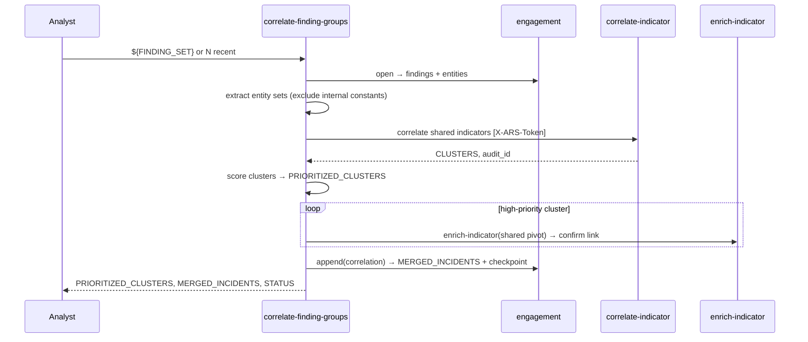

# Correlate Finding Groups

Take a set of recent open findings/alerts, understand each well enough to know its disposition and
entities, cluster them by shared indicators, prioritize the clusters by combined impact, and merge each
real cluster into one incident on the engagement. The agent-security analogue of SOC "group cases"
(folding in the v2 refinement): the entities are agent indicators, the case is the engagement, and a
group becomes one incident so responders work the campaign, not the symptoms.

## When to Activate

- The engagement has several open findings/alerts that may stem from one root cause or campaign.
- Triage produced a burst of related findings that should be investigated as a group.

## Objective

Produce prioritized clusters of related findings — each with its shared indicators, combined priority,
and rationale — and fold each cluster into a single incident, so downstream investigation runs once per
group.

## Scope

Covers: gathering the finding set, extracting entities, clustering by shared indicators, prioritizing
clusters, light enrichment of the shared pivots, and merging into incidents. Excludes: deep
per-finding investigation (`investigate-agent-incident`), closing duplicates
(`close-duplicate-findings-wf`), containment.

## Inputs

- `${FINDING_SET}` (optional): explicit finding/incident ids to group. If absent, the N most recent
  open findings. *Source:* engagement.
- `${N}` (optional): int — how many recent findings to consider when `${FINDING_SET}` is absent
  (default 10).
- `${GROUPING_CRITERIA}` (optional): e.g. `shared_identity | shared_egress | shared_component |
  weakness_class`. If absent, cluster on observed shared indicators.
- `${TIME_WINDOW_HOURS}` (optional): int — lookback for selecting findings (default 168).

## Outputs

- `${CLUSTERS}`: groups of finding ids with their shared indicators/entities.
- `${PRIORITIZED_CLUSTERS}`: clusters ordered by combined impact (size × shared-indicator criticality ×
  max severity).
- `${MERGED_INCIDENTS}`: the incident id each cluster folded into + the `correlation` events recorded.
- `${GROUPING_SUMMARY}`: short rationale for the grouping + prioritization.
- `${STATUS}`: ["Success" | "Partial" | "Failure"].

## Tools

- **Gateway (connected, metered — carry `X-ARS-Token`, record each `audit_id`):** `graph.enrich` (shared
  entity relationships), `risk.score` (cluster priority), reached via the composed siblings;
  `memory.recall` for prior groupings.
- **Client-side:** build each finding's entity set; compute shared-indicator overlap; cluster;
  prioritize; decide which clusters are real incidents. The clustering + judgement is the harness's.
- **Sibling skills:** `engagement` (open/context/append) · `correlate-indicator` (shared-indicator
  correlation) · `enrich-indicator` (shared-pivot enrichment, high-priority clusters only) ·
  `atom-score-finding` (priority) · `record-in-engagement`.
- **Guardrail:** do **not** treat internal/organizational constants (an org domain, a shared service
  account baseline) as a grouping indicator — they over-cluster.

## Workflow Steps & Diagram

1. **Open + gather.** `engagement.open`; resolve `${FINDING_SET}` (or the N recent open findings). For
   each, read its disposition + entities from the engagement context.
2. **Extract entities.** Build each finding's indicator set (components, identities, egress, weaknesses)
   — excluding internal constants per the guardrail.
3. **Cluster.** `correlate-indicator` to find shared indicators across findings; group on
   `${GROUPING_CRITERIA}` or observed overlap → `${CLUSTERS}`.
4. **Prioritize.** `atom-score-finding` per cluster over combined features (size, shared-indicator
   criticality, max severity) → `${PRIORITIZED_CLUSTERS}`.
5. **Enrich shared pivots.** For high-priority clusters only, `enrich-indicator` the shared indicator(s)
   to confirm the link is real (not coincidental).
6. **Merge.** For each confirmed cluster, `engagement.append` a `correlation` event folding its findings
   into one `${MERGED_INCIDENTS}` entry; `record-in-engagement`; checkpoint.

## Decision Logic / Completion Criteria

- A cluster is a real incident when its members share a **non-trivial** indicator (a specific identity,
  egress, component, or weakness chain) confirmed by enrichment — not just a severity or an internal
  constant.
- IF a cluster is one root cause across many findings THEN merge + hand the incident to
  `investigate-agent-incident`.
- IF members are identical (same indicator, same signature) THEN route to `close-duplicate-findings-wf`
  instead of merging as distinct.
- **Done when:** the finding set is clustered, clusters are prioritized, shared pivots on top clusters
  are confirmed, and merges are recorded.

## Integration

- **Composes:** `correlate-indicator`, `enrich-indicator`, `atom-score-finding`, `record-in-engagement`;
  `engagement` bookends.
- **Called by:** the `soc-triage` playbook; feeds `investigate-agent-incident` and
  `close-duplicate-findings-wf`.
- **Offline:** clustering runs over the local engagement findings + graph; priority uses local features.
  **Connected:** `graph.enrich` + `risk.score` grounding + shared-memory prior groupings, metered.
