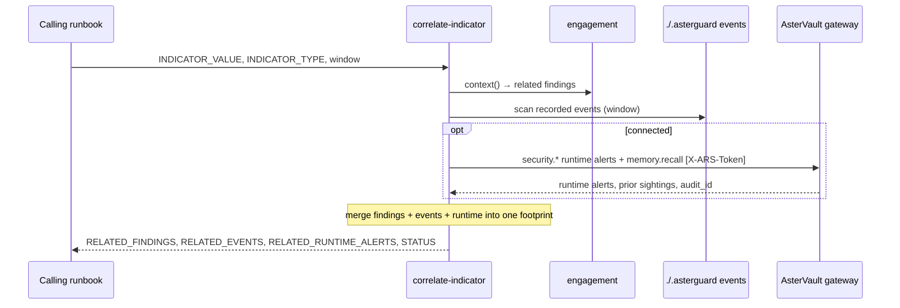

# Common Step: Correlate Indicator

Cross-reference a single indicator against three surfaces at once — the engagement's findings, its
recorded agent/tool/egress events, and live runtime alerts — and return what relates to it. The
reusable building block that tells a triage or investigation runbook whether an indicator is a one-off
or a thread in a larger incident. It is the agent-security analogue of a SOC "correlate IOC with SIEM
alerts & cases" step, retargeted from SIEM/SOAR to our recorded events + runtime audit + engagement.

## When to Activate

- You have one indicator and need its full footprint before weighting severity or opening/escalating
  an incident.
- Called by `triage-agent-alert`, `investigate-agent-incident`, `deep-dive-indicator-analysis`, and
  the hunts — anywhere the source would "correlate the IOC across alerts and cases".

## Objective

Return, for one indicator, the related findings, the related recorded events, and the related live
runtime alerts, each summarized — so the caller can judge blast radius and decide isolated-vs-campaign
— without pivoting to new entities (that is `pivot-on-indicator`) or de-duping (that is
`check-duplicate-findings`).

## Scope

Covers: correlating one indicator across engagement findings, `./.asterguard/` recorded events, and
runtime `security.*` alerts. Excludes: enrichment of the indicator itself (use `enrich-indicator`),
graph/knowledge pivoting, and disposition.

## Inputs

- `${INDICATOR_VALUE}`: string — the indicator (weakness_id, component, identity, egress endpoint, or
  artifact hash). *Source:* an alert/finding field or a prior runbook output.
- `${INDICATOR_TYPE}`: one of `weakness_id | component | identity | egress | artifact | finding_id`.
- `${TIME_FRAME_HOURS}` (optional): int — lookback for events + runtime alerts (default: 168 = 7 days).
- `${TARGET}`: string — the engagement to correlate within. *Source:* engagement context.

## Outputs

- `${RELATED_FINDINGS}`: list — findings/incidents in the engagement that reference the indicator.
- `${RELATED_EVENTS}`: list — recorded agent tool-calls / egress / scan events touching the indicator.
- `${RELATED_RUNTIME_ALERTS}`: list — live runtime alerts (proxy/runtimevault) for the indicator.
- `${AUDIT_ID}` (optional): string — `audit_id` of the metered runtime/memory lane, when connected.
- `${STATUS}`: ["Success" | "Partial" | "Failure"] — with a per-lane note.

## Tools

- **Gateway (connected, metered — carry `X-ARS-Token`, record the `audit_id`):**
  runtime `security.*` (runtimevault) — live egress/tool-call alerts for the indicator; `memory.recall`
  — prior sightings across engagements.
- **Client-side:** reduce the engagement context to findings referencing the indicator; scan
  `./.asterguard/` recorded events for matches within the time frame; merge the three surfaces into one
  footprint.
- **Sibling skills:** `engagement` (`context()`); `atom-trace-egress` (recorded egress for an
  endpoint); `atom-recall-memory`.

## Workflow Steps & Diagram

1. **Receive** `${INDICATOR_VALUE}` + `${INDICATOR_TYPE}` (+ time frame) from the caller.
2. **Findings lane.** `engagement.context()` → findings/incidents referencing the indicator →
   `${RELATED_FINDINGS}`.
3. **Events lane.** Scan `./.asterguard/` recorded events (tool-calls, egress, scans) in the window for
   the indicator; for an `egress` indicator use `atom-trace-egress` → `${RELATED_EVENTS}`.
4. **Runtime lane (connected).** Query runtime `security.*` for live alerts on the indicator →
   `${RELATED_RUNTIME_ALERTS}`. Offline or on failure: skip and note the degraded lane in `${STATUS}`.
5. **Merge + return.** Assemble the three surfaces into the indicator's footprint and return with
   `${STATUS}`.

## Decision Logic / Completion Criteria

- IF the indicator appears in more than one surface (e.g. an open finding **and** a live runtime
  alert) THEN flag it as an active thread — the caller should raise severity / escalate, not close.
- IF it appears only in old recorded events with no open finding or live alert THEN flag it as
  historical context for the caller to weight.
- IF no surface references it THEN return empty footprint — treat as isolated.
- **Done when:** all three lanes have returned or recorded a degraded note and the footprint is
  assembled.

## Integration

- **Composes:** `engagement` (context), `atom-trace-egress`, `atom-recall-memory`.
- **Called by:** `triage-agent-alert`, `investigate-agent-incident`, `deep-dive-indicator-analysis`,
  the hunts.
- **Offline:** correlates engagement findings + local recorded events only; the runtime + memory lanes
  are noted unavailable. **Connected:** adds metered runtime `security.*` + `memory.recall`.
