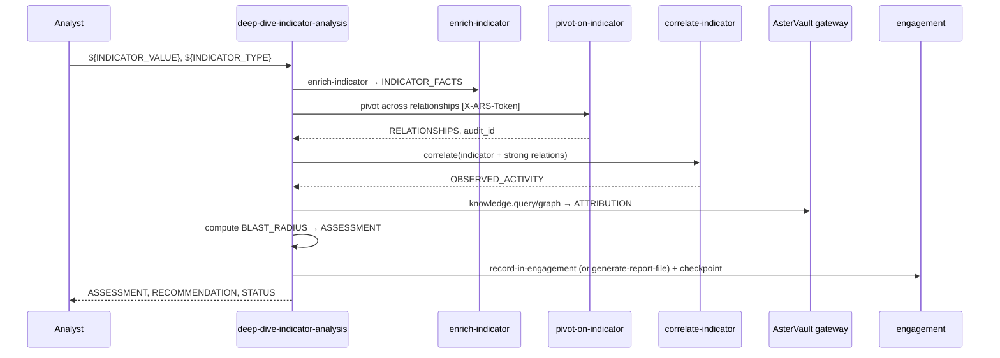

# Deep-Dive Indicator Analysis

Exhaustive analysis of a **single** indicator escalated from triage or surfaced mid-investigation,
going well beyond first-pass `enrich-indicator`: pivot it through the security graph and knowledge
corpus, map every relationship, compute its blast radius, correlate observed activity, and attribute it
to known attack patterns/campaigns. The agent-security analogue of a "deep dive IOC analysis" — the
indicator is a weakness/component/identity/egress/artifact, the infrastructure is the agent's
dependency + authority + reach graph.

## When to Activate

- `investigate-agent-incident` flagged one indicator as critical or unresolved.
- A triage runbook escalated a single high-signal indicator for forensic depth.

## Objective

Produce the complete picture for one indicator: what it is, everything it connects to, where it has
actually been observed, what known pattern/campaign it belongs to, and the assets/identities within its
blast radius — with an assessment and recommendation (not a disposition on the whole incident).

## Scope

Covers: one indicator, deeply — multi-hop pivoting, relationship mapping, blast-radius computation,
observed-activity correlation, pattern attribution. Excludes: the full incident (`investigate-agent-incident`),
containment (`contain-indicator`), and multi-indicator grouping (`correlate-finding-groups`).

## Inputs

- `${INDICATOR_VALUE}`: string — the indicator (e.g. `LLM01-prompt-injection`, `langchain-core@0.2.1`,
  `svc:billing-agent`, `https://paste.ee/x`, `sha256:…`). *Source:* triage/investigation output.
- `${INDICATOR_TYPE}`: one of `weakness_id | component | identity | egress | artifact | finding_id`.
- `${INCIDENT_ID}` (optional): the engagement incident to document into. If absent, write a standalone
  report via `generate-report-file`.
- `${TIME_WINDOW_HOURS}` (optional): int — lookback for recorded events (default 168).

## Outputs

- `${INDICATOR_FACTS}`: full registry/graph identity (from `enrich-indicator`).
- `${RELATIONSHIPS}`: the mapped neighbourhood — deps, reach, granted authority, linked weaknesses/TTPs.
- `${OBSERVED_ACTIVITY}`: where the indicator (and its strong relations) actually appear in recorded
  events / runtime audit.
- `${BLAST_RADIUS}`: assets, identities, and data reachable through it if abused.
- `${ATTRIBUTION}`: known pattern/campaign/threat-actor the indicator maps to, if any.
- `${ASSESSMENT}` + `${RECOMMENDATION}`; `${STATUS}`: ["Success" | "Partial" | "Failure"].

## Tools

- **Gateway (connected, metered — carry `X-ARS-Token`, record each `audit_id`):** `graph.enrich`
  (relationships/reach), `knowledge.query`/`knowledge.graph` (patterns/attribution), `registry.resolve`
  (weakness facts), `memory.recall` (prior sightings), runtime `security.*` (observed activity).
- **Client-side:** choose pivot directions by type; traverse multi-hop; compute blast radius over the
  returned graph; attribute to patterns; form the assessment.
- **Sibling skills:** `engagement` (open/context) · `enrich-indicator` (first pass) ·
  `pivot-on-indicator` (the pivots) · `correlate-indicator` (observed activity) · `atom-query-pattern` ·
  `atom-trace-egress` · `generate-report-file` (standalone) · `record-in-engagement`.

## Workflow Steps & Diagram

1. **Open + first pass.** `engagement.open`; `enrich-indicator(${INDICATOR_VALUE}, ${INDICATOR_TYPE})`
   → `${INDICATOR_FACTS}` + any prior sightings/waivers.
2. **Pivot exhaustively.** `pivot-on-indicator` across the type-appropriate relationships (component →
   deps/dependents/reach; identity → granted tools/scopes/assumable roles; egress → callers/data flows;
   weakness → CWE/CAPEC/ATT&CK/affected components). → `${RELATIONSHIPS}`.
3. **Observe.** `correlate-indicator` over recorded events + runtime audit for the indicator and its
   strongest relations across `${TIME_WINDOW_HOURS}` → `${OBSERVED_ACTIVITY}`; note which relations were
   actually seen (prioritise those).
4. **Blast radius.** From the graph + observed activity, compute what is reachable/exposed if the
   indicator is abused → `${BLAST_RADIUS}` (assets, identities, confidential data, egress).
5. **Attribute.** `atom-query-pattern` (`knowledge.query`/`knowledge.graph`) to map the indicator +
   its TTPs to a known pattern/campaign/actor → `${ATTRIBUTION}`.
6. **Assess.** Synthesise into `${ASSESSMENT}` + `${RECOMMENDATION}` (e.g. contain, escalate to IRP,
   monitor, waive).
7. **Document.** IF `${INCIDENT_ID}` → `record-in-engagement` the deep-dive events; ELSE
   `generate-report-file` a standalone deep-dive report (naming this runbook at the top). Checkpoint.

## Decision Logic / Completion Criteria

- IF the blast radius reaches confidential data or privileged authority AND the indicator is observed in
  recorded activity THEN recommend `contain-indicator` + escalate.
- IF attribution matches a known active campaign THEN recommend `proactive-pattern-campaign-hunt` to
  sweep for siblings.
- IF benign/waived with no observed activity THEN recommend close/monitor.
- **Done when:** relationships are mapped, observed activity is resolved, blast radius is computed,
  attribution is attempted, and assessment + recommendation are recorded (or reported).

## Integration

- **Composes:** `enrich-indicator`, `pivot-on-indicator`, `correlate-indicator`, `atom-query-pattern`,
  `atom-trace-egress`, `generate-report-file`, `record-in-engagement`; `engagement` bookends.
- **Called by:** `investigate-agent-incident`, the `irp-*` runbooks, the hunts.
- **Offline:** pivots/attribution degrade to the local graph + pack knowledge; observed activity uses
  recorded events only. **Connected:** full multi-hop `graph.enrich` + `knowledge.graph` + runtime
  audit, metered.
