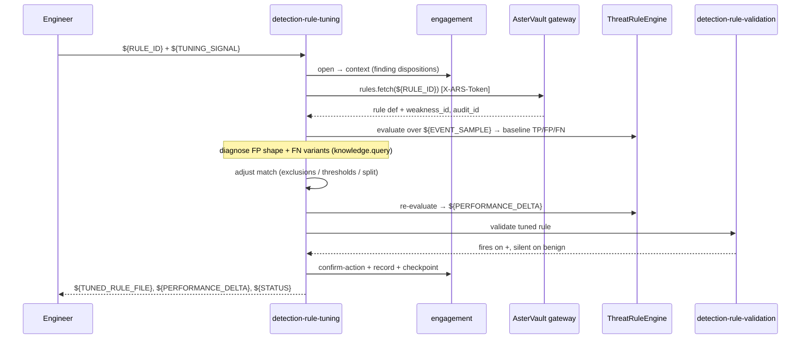

# Detection: Tune an Agent Threat Rule

Tune a shipped `.rule.yaml` threat rule whose signal-to-noise has drifted: it flags benign agent
behavior (false positives) or misses variants of the target behavior (false negatives). Measure its
current performance against recorded agent events, adjust the match (add exclusions, tighten/loosen
conditions, split the rule), re-validate with the `ThreatRuleEngine`, and ship the tuned rule. The
agent-security analogue of SIEM rule tuning — but the rule matches graph/events, and feedback comes
from the engagement's own finding dispositions, not SOAR cases.

## When to Activate

- A rule produces a high volume of findings dispositioned as benign/authorized in the engagement
  (false positives).
- A hunt or incident showed the rule missed a variant of the behavior it should catch (false negative).
- Periodic rule review flagged poor precision/recall.

## Objective

Produce a tuned `${RULE_FILE}` with measurably better precision/recall over recorded events — fewer
benign flags, fewer missed variants — re-validated and shipped, without losing true-positive coverage.

## Scope

Covers: adjusting one existing rule's match + re-validating + shipping. Excludes: authoring a new rule
(`detection-as-code-agent-rules`), pure fire-correctness validation of a new rule
(`detection-rule-validation`), coverage gap-finding (`detection-coverage-evaluation`).

## Inputs

- `${RULE_ID}`: the rule to tune. *Source:* the pack / a noisy or missed finding.
- `${TUNING_SIGNAL}`: why — FP pattern (benign behavior flagged) and/or FN scenario (variant missed),
  with example events. *Source:* engagement finding dispositions / a hunt handoff.
- `${EVENT_SAMPLE}` (optional): recorded true-positive / false-positive / benign event rows to measure
  against. *Source:* `./.asterguard/events` + engagement history.
- `${ANALYSIS_WINDOW}` (optional): how much recorded history to measure over (default: the engagement's
  current context).

## Outputs

- `${TUNED_RULE_FILE}`: the adjusted `.rule.yaml` (refined match, exclusions, thresholds, or a split).
- `${PERFORMANCE_DELTA}`: before/after precision/recall over `${EVENT_SAMPLE}` (FP↓ / FN↓ / TP held).
- `${VALIDATION_RESULT}`: `detection-rule-validation` pass on the tuned rule.
- `${SHIP_STATUS}`: branch/PR + CI result.
- `${STATUS}`: ["Success" | "Partial" | "Failure"].

## Tools

- **Gateway (connected, metered — `X-ARS-Token`, record `audit_id`):** `rules.fetch(profile)` (current
  rule definition), `registry.resolve` (keep the weakness grounding intact), runtime `security.*`
  (recorded events to measure against), `knowledge.query` (variant behaviors for the FN side).
- **Client-side:** run the `ThreatRuleEngine` over the event sample to classify current TP/FP/FN;
  diagnose FP/FN root causes; edit the match; re-measure.
- **Sibling skills:** `engagement` (finding dispositions = tuning feedback), `atom-fetch-rules`,
  `atom-resolve-weakness`, `detection-rule-validation`, `confirm-action`, `record-in-engagement`.

## Workflow Steps & Diagram

1. **Open engagement.** `engagement.open(${TARGET or pack})` → context (incl. finding dispositions).
   Connected: ensure the ARS token.
2. **Fetch the rule.** `atom-fetch-rules`(`rules.fetch`) → current `${RULE_ID}` definition + its
   `weakness_id`.
3. **Measure current performance.** Run the `ThreatRuleEngine` over `${EVENT_SAMPLE}` /
   `./.asterguard/events` across `${ANALYSIS_WINDOW}`; classify TP / FP / benign vs the engagement's
   dispositions → baseline precision/recall.
4. **Diagnose.** FP side: find the common shape of benign-but-flagged events (an authorized principal,
   a normal tool-call pattern). FN side: `knowledge.query` variants of the behavior the current match
   misses.
5. **Adjust the match.** Add scoped exclusions, tighten/loosen conditions, adjust thresholds, or split
   into more specific rules — keep the `weakness_id` grounding intact; never widen so far that TP
   coverage drops.
6. **Re-measure + validate.** Re-run the engine → `${PERFORMANCE_DELTA}`; `detection-rule-validation`
   confirms the tuned rule still fires on true-positives and is now silent on the benign sample.
7. **Review + ship (human-gated).** `confirm-action` on the delta; branch + PR + CI → `${SHIP_STATUS}`.
8. **Record + checkpoint.** `record-in-engagement` the tuning decision + delta; `engagement.checkpoint`.

## Decision Logic / Completion Criteria

- Ship the tuned rule only when `${PERFORMANCE_DELTA}` shows FP and/or FN **down** with true-positive
  coverage **held** (not traded away), validated by `detection-rule-validation`, reviewed via
  `confirm-action`, and CI-green.
- If a single rule cannot cut FPs without dropping TPs, **split** it into more specific rules rather
  than over-broadening.
- **Done when:** the tuned rule is merged (or blocked with a reason), the delta is recorded, and the
  engagement is checkpointed.

## Integration

- **Composes:** `atom-fetch-rules`, `atom-resolve-weakness`, `detection-rule-validation`,
  `confirm-action`, `record-in-engagement`; `engagement` (dispositions as feedback) bookends.
- **Called by:** `detection-coverage-evaluation` (precision gaps), a `hunt-*`/IRP handoff (missed
  variant); tuned rules feed `playbook-runner` / `ThreatRuleEngine` and `detection-report`.
- **Offline:** measure + tune against local `./.asterguard/events` and local pack rules; `rules.fetch`
  degrades to local load; CI/merge noted as pending. **Connected:** full `rules.fetch` + runtime
  `security.*` event access + metered CI, with `audit_id`s recorded.
