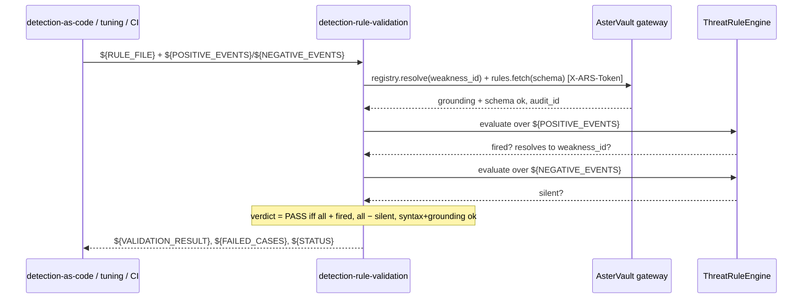

# Detection: Validate a Threat Rule Fires Correctly

The pre-ship gate for a `.rule.yaml` agent threat rule: prove it does what it claims **before** it
reaches production. Run the rule through the `ThreatRuleEngine` over curated known-positive events (it
must fire and resolve to the intended weakness id) and known-negative/benign events (it must stay
silent), plus syntax + grounding checks. Return a pass/fail verdict with the evidence. This is the
fire-correctness check `detection-as-code-agent-rules` and `detection-rule-tuning` call before they
ship; it does not itself tune or author.

## When to Activate

- `detection-as-code-agent-rules` authored a new rule and needs it validated before review/ship.
- `detection-rule-tuning` adjusted a rule and needs the tuned version re-validated.
- CI runs this on every rule PR as the fire-correctness gate.

## Objective

Return a deterministic pass/fail for one `${RULE_FILE}`: fires on every known-positive (resolving to
`${WEAKNESS_ID}`), silent on every known-negative, syntactically valid, and correctly grounded — with
the per-case evidence.

## Scope

Covers: validating one rule's fire-correctness + syntax + grounding over a known-positive/negative
event set. Excludes: tuning precision/recall against production noise (`detection-rule-tuning`),
authoring (`detection-as-code-agent-rules`), coverage measurement (`detection-coverage-evaluation`).

## Inputs

- `${RULE_FILE}`: the `.rule.yaml` to validate. *Source:* `detection-as-code-agent-rules` /
  `detection-rule-tuning`.
- `${POSITIVE_EVENTS}`: known-positive event rows / graph fixtures the rule **must** fire on. *Source:*
  the originating hunt's evidence / fixtures in the pack.
- `${NEGATIVE_EVENTS}`: known-negative / benign event rows the rule **must not** fire on. *Source:*
  benign fixtures / dispositioned false-positives.
- `${WEAKNESS_ID}` (optional): the weakness the rule must resolve to. *Source:* the rule's metadata.

## Outputs

- `${VALIDATION_RESULT}`: `{syntax: pass|fail, grounding: pass|fail, positives: n/N fired,
  negatives: m/M silent, verdict: PASS|FAIL}`.
- `${FAILED_CASES}`: the positive events that didn't fire + negative events that did (with why).
- `${STATUS}`: ["Success" | "Partial" | "Failure"] — Success means the validation ran, not that the
  rule passed.

## Tools

- **Gateway (connected, metered — `X-ARS-Token`, record `audit_id`):** `registry.resolve` (confirm the
  rule's `weakness_id` grounds to a real weakness), `rules.fetch` (schema/version of the pack rule
  format, for syntax).
- **Client-side:** run the `ThreatRuleEngine` over `${POSITIVE_EVENTS}` and `${NEGATIVE_EVENTS}` +
  graph fixtures; check syntax against the pack schema; assemble the verdict + failed cases. This is
  the deterministic, client-side core — no judgment call needed.
- **Sibling skills:** `engagement`, `atom-resolve-weakness`, `atom-fetch-rules`, `record-in-engagement`;
  returns its verdict to `detection-as-code-agent-rules` / `detection-rule-tuning`.

## Workflow Steps & Diagram

1. **Open engagement.** `engagement.open(${TARGET or pack})` → context. Connected: ensure the ARS token.
   (When called inside CI or another detection runbook, reuse the open engagement.)
2. **Syntax + grounding check.** Validate `${RULE_FILE}` against the pack `.rule.yaml` schema
   (`atom-fetch-rules` for the format/version); `atom-resolve-weakness`(`registry.resolve`) confirms its
   `weakness_id` is real. Fail fast on a syntax or grounding error.
3. **Positive run.** Run the `ThreatRuleEngine` over `${POSITIVE_EVENTS}` (+ graph fixtures): every case
   must fire **and** resolve to `${WEAKNESS_ID}`. Record any that didn't → `${FAILED_CASES}`.
4. **Negative run.** Run the engine over `${NEGATIVE_EVENTS}`: every case must stay silent. Record any
   that fired → `${FAILED_CASES}`.
5. **Verdict.** `PASS` iff syntax + grounding pass, all positives fired to the right weakness, and all
   negatives stayed silent; else `FAIL` with `${FAILED_CASES}`.
6. **Return + record.** Hand `${VALIDATION_RESULT}` back to the caller; `record-in-engagement` the
   validation event (rule id, verdict, counts). Checkpoint if this was a standalone run.

## Decision Logic / Completion Criteria

- **PASS** requires: syntax valid, `weakness_id` grounds, **every** positive fired (to the right
  weakness), **every** negative silent. Any miss → **FAIL** with the offending cases named.
- Validation is deterministic and client-side — it reports fire-correctness; it never edits the rule
  (tuning does) nor decides ship (review in `detection-as-code-agent-rules` does).
- **Done when:** the verdict + per-case evidence are returned to the caller and the validation event is
  recorded.

## Integration

- **Composes:** `atom-resolve-weakness`, `atom-fetch-rules`, `record-in-engagement`; `engagement`
  bookends (or reuses the caller's).
- **Called by:** `detection-as-code-agent-rules` (pre-ship gate), `detection-rule-tuning` (re-validate),
  and CI on every rule PR; its verdict gates the merge.
- **Offline:** runs fully — the engine + fixtures are local; grounding (`registry.resolve`) degrades to
  local pack data (mark grounding `unresolved` rather than failing if the registry is offline, and note
  it). **Connected:** grounding + schema fetch are live and metered, with `audit_id`s recorded.
