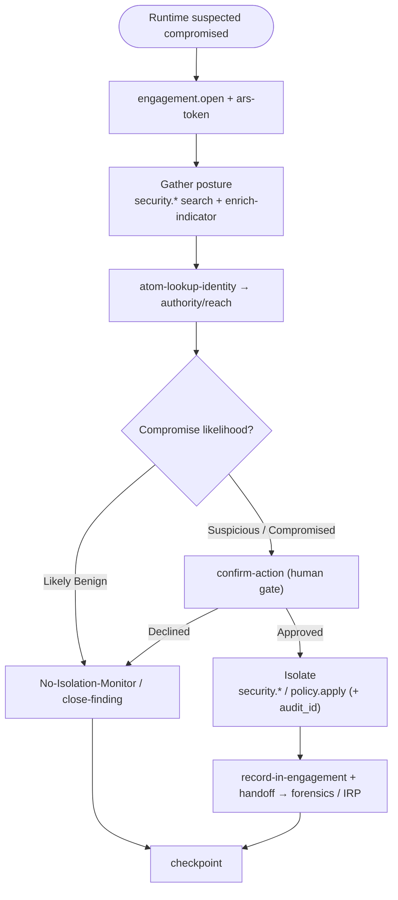

# Runbook: Endpoint Agent Triage & Isolation

Initial triage **and** human-gated containment of a potentially compromised **agent runtime/host** — the
agent-security analogue of endpoint triage + isolation. Gather the runtime's posture and the authority
it holds, assess the likelihood of compromise, and — if confirmed — isolate it: cut its egress / freeze
its token / quarantine the runtime, each gated through `confirm-action`. This is the one triage runbook
whose scope includes a containment action; it stops short of forensics and eradication.

## When to Activate

- A runtime `security.*` alert, a malware/tool-abuse triage, or a user report indicates an agent runtime
  or its host is compromised and may need to be cut off.
- `malicious-dependency-triage`, `suspicious-tool-call-triage`, or an IRP requested isolation of a
  specific agent runtime/host.

## Objective

Assess whether an agent runtime/host is compromised and, when confirmed and authorized, contain it —
block its egress, freeze/revoke its token, or quarantine the runtime — minimizing blast radius while
preserving the engagement record, and hand off to deeper IR.

## Scope

Covers: gather runtime posture + authority, assess compromise likelihood, and the **human-gated
isolation** action (egress block / token freeze / runtime quarantine).
Excludes: deep forensic analysis, malware removal / eradication, and recovery/re-imaging — those follow
in `irp-tool-abuse-rce` / `irp-agent-credential-compromise` / `investigate-agent-incident`.

## Inputs

- `${RUNTIME_ID}`: string — the agent runtime/host identifier (deployment, pod/host, service principal).
  *Source:* alert field / engagement / upstream triage. Typed `identity`/`component` for enrichment.
- `${AGENT_IDENTITY}`: string — the service principal the runtime runs as. *Source:* runtime metadata.
- `${CASE_ID}`: string — the engagement incident/finding id. *Source:* upstream triage / engagement.
- `${REASON_FOR_TRIAGE}` (optional): string — why this runtime is suspect. *Source:* the escalating
  runbook.
- `${TIME_FRAME_HOURS}` (optional): int — lookback for the posture/activity search (default 72).

## Outputs

- `${ASSESSMENT}`: ["Likely Benign" | "Suspicious" | "Compromised"] — likelihood verdict + rationale.
- `${ACTION_TAKEN}` / route: ["No-Isolation-Monitor" | "Isolated → <egress-block|token-freeze|
  quarantine>" | "Isolation-Declined"] — the containment outcome.
- `${POSTURE}`: runtime activity + posture summary (recorded-events + `graph.enrich`).
- `${AUTHORITY}`: the identity's granted tools/scopes/reach (from `atom-lookup-identity`).
- `${CONTAINMENT}`: the isolation applied, each with its `confirm-action` `decision` event + `audit_id`.
- `${HANDOFF}`: the next runbook/owner (forensics / IR).
- `${STATUS}`: ["Success" | "Partial" | "Failure"] — with a per-lane note on non-success.

## Tools

- **Gateway (connected, metered — carry `X-ARS-Token`, record each `audit_id`):** `graph.enrich`
  (runtime posture / reach), `knowledge.query`, `memory.recall`, `risk.score` (via the composed skills);
  **containment:** runtime `security.*` (isolate/egress) + `policy.apply` (least-privilege policy).
- **Client-side:** reconstruct runtime posture; assess compromise likelihood; author the isolation
  policy; decide which containment primitive fits.
- **Sibling skills:** `engagement` (open/context/checkpoint) · `atom-lookup-identity` ·
  `enrich-indicator` · `confirm-action` (the human gate) · `record-in-engagement` · `close-finding` (if
  cleared).

## Workflow Steps & Diagram

1. **Open engagement.** `engagement.open(${RUNTIME_ID} / ${CASE_ID})` → context + history. Connected:
   ensure the ARS token via `ars-token`.
2. **Gather posture.** One targeted runtime `security.*` search over `${TIME_FRAME_HOURS}` for the
   runtime's recent tool-calls / egress / anomalous activity → `${POSTURE}`; `enrich-indicator` on
   `${RUNTIME_ID}` for graph context. Connected: carries `X-ARS-Token`, returns `audit_id`.
3. **Map authority.** `atom-lookup-identity(${AGENT_IDENTITY})` → `${AUTHORITY}`: the tools/scopes/reach
   at stake (sets the urgency and the blast radius if left running).
4. **Assess compromise likelihood.** Weigh posture + authority + any upstream verdict →
   `${ASSESSMENT}` (Likely Benign / Suspicious / Compromised).
5. **Decide isolation.** If Likely Benign: `close-finding` or route **No-Isolation-Monitor**; skip to
   step 8. If Suspicious/Compromised: choose the containment primitive (egress block / token freeze /
   runtime quarantine) by what the authority + posture show.
6. **Human gate (mandatory).** `confirm-action` with the proposed isolation, the affected identity/reach,
   and whether it is reversible. **Only on an explicit yes** proceed; a no → **Isolation-Declined**.
7. **Execute containment (connected).** Apply via runtime `security.*` (isolate / block egress) and/or
   `policy.apply` (least-privilege / token freeze). Record each as a `decision` event with its
   `audit_id` → `${CONTAINMENT}`. **Offline:** emit the policy as advisory (not auto-applied) and mark it
   pending.
8. **Record + hand off.** `record-in-engagement` the `verdict` + `decision` events; set `${HANDOFF}` to
   forensics / the matching IRP; `engagement.checkpoint`.

## Decision Logic / Completion Criteria

- IF `${ASSESSMENT}` = Likely Benign THEN **No-Isolation-Monitor** (or `close-finding` if the signal was
  spurious); no containment.
- IF Suspicious/Compromised THEN propose isolation and route through `confirm-action` — **every**
  containment action is human-gated and recorded as a `decision` (dual-use discipline). On approval,
  **Isolated** via runtime `security.*` / `policy.apply`; on refusal, **Isolation-Declined** (monitor +
  escalate).
- Prefer the least-disruptive primitive that cuts the abused authority (token freeze / egress block
  before full quarantine), and say whether it is reversible in the `confirm-action` prompt.
- **Done when:** posture + authority are gathered, likelihood is assessed, any containment is
  human-gated + applied (or emitted advisory offline) + recorded, the handoff is set, and the engagement
  is checkpointed.

## Integration

- **Composes:** `atom-lookup-identity`, `enrich-indicator`, `confirm-action`, `close-finding`;
  `engagement` + `record-in-engagement` bookends.
- **Escalated from:** `malicious-dependency-triage`, `suspicious-tool-call-triage`, the IRPs.
  **Hands off to:** `irp-tool-abuse-rce`, `irp-agent-credential-compromise`,
  `investigate-agent-incident`.
- **Offline:** posture/authority grounding degrade to local recorded events + the local graph;
  containment is **advisory only** (policy emitted, not auto-applied) and marked pending. **Connected:**
  full posture grounding + live isolation via `security.*`/`policy.apply`, metered, each metered call
  records an `audit_id`.
