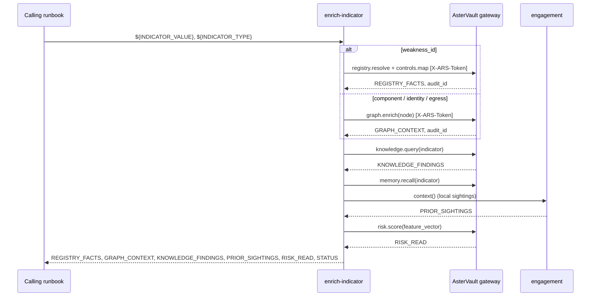

# Common Step: Enrich Indicator

Perform standardized first-pass enrichment for a single **indicator** using the AsterVault gateway's
grounding surface plus this engagement's own history. The reusable building block every triage,
investigation, and hunt runbook calls instead of wiring the lookups itself. It is the agent-security
analogue of a SOC "enrich IOC" step: here an indicator is not an IP/domain/hash but a **weakness id**,
a **component**, an **agent identity**, an **egress endpoint**, or a **model/dependency artifact**.

## When to Activate

- Any runbook needs context on one indicator before deciding (triage severity, investigation pivot,
  hunt lead).
- Called by `triage-agent-alert`, `triage-agent-finding`, `investigate-agent-incident`,
  `deep-dive-indicator-analysis`, the hunts, and the IRPs.

## Objective

Return a single structured enrichment for one indicator: what it is (registry/graph), what's known
about it (knowledge corpus), whether we've seen it here before (memory + engagement), and a first-pass
risk read — without deciding disposition (the caller does that).

## Scope

Covers: resolving + grounding one indicator, a knowledge/intel lookup, a prior-sightings check, and a
first-pass `risk.score`. Excludes: disposition, containment, reporting, multi-indicator correlation
(use `correlate-indicator`).

## Inputs

- `${INDICATOR_VALUE}`: string — the indicator (e.g. `LLM01-prompt-injection`, `langchain-core@0.2.1`,
  `svc:billing-agent`, `https://paste.ee/x`, `sha256:…`). *Source:* an alert/finding field, a graph
  node, or a prior runbook output.
- `${INDICATOR_TYPE}`: one of `weakness_id | component | identity | egress | artifact | finding_id`.

## Outputs

- `${REGISTRY_FACTS}`: definition/STRIDE/CWE/attack_refs/controls (for a weakness) or node identity
  (for a graph node).
- `${GRAPH_CONTEXT}`: where it sits — deps, reach, granted authority, linked weaknesses.
- `${KNOWLEDGE_FINDINGS}`: known attack/exploit patterns + intel for it.
- `${PRIOR_SIGHTINGS}`: `{seen: yes|no, findings:[…], waivers:[…], decisions:[…]}` from memory +
  engagement context.
- `${RISK_READ}`: first-pass ARS/DRS index + rationale (not a disposition).
- `${STATUS}`: ["Success" | "Partial" | "Failure"] with a per-lane note.

## Tools

- **Gateway (connected, metered — carry `X-ARS-Token`, record each `audit_id`):**
  - `atom-resolve-weakness` → `registry.resolve` (weakness) — for `weakness_id`.
  - `atom-enrich-component` / `atom-lookup-identity` / `atom-trace-egress` → `graph.enrich(node)` — for
    `component` / `identity` / `egress`.
  - `atom-query-pattern` → `knowledge.query` — known patterns/intel.
  - `atom-recall-memory` → `memory.recall` — prior sightings.
  - `atom-score-finding` → `risk.score` — first-pass index.
- **Client-side:** select the lane by `${INDICATOR_TYPE}`; merge lane outputs; compute the first-pass
  read from the returned feature vector.
- **Sibling skills:** `engagement` (reads `context()` for local sightings); the `atom-*` skills above.

## Workflow Steps & Diagram

1. **Receive** `${INDICATOR_VALUE}` + `${INDICATOR_TYPE}` from the calling runbook.
2. **Registry / graph lane (by type):**
   - `weakness_id` → `atom-resolve-weakness` → `${REGISTRY_FACTS}` (+ `controls.map` for controls).
   - `component` → `atom-enrich-component`; `identity` → `atom-lookup-identity`; `egress` →
     `atom-trace-egress` → `${GRAPH_CONTEXT}`.
   - **Degrade:** if a grounding call fails (quota/offline), note it in `${STATUS}` and fall back to the
     local graph in `./.asterguard/` / local pack data; never abort.
3. **Knowledge lane:** `atom-query-pattern` (`knowledge.query`) for known patterns/intel →
   `${KNOWLEDGE_FINDINGS}`.
4. **Prior-sightings lane:** `atom-recall-memory` (`memory.recall`) **and** `engagement.context()` →
   merge into `${PRIOR_SIGHTINGS}` (was it waived? already proven? open finding?).
5. **First-pass risk:** `atom-score-finding` (`risk.score`) over the merged feature vector →
   `${RISK_READ}` (index + rationale; **not** a disposition).
6. **Return** all outputs + `${STATUS}` to the caller. (Persistence is the caller's job via
   `record-in-engagement`.)

## Decision Logic / Completion Criteria

- Set `${STATUS}` = `Partial` if any lane degraded; include which, so the caller can weight it.
- If `${PRIOR_SIGHTINGS}.waivers` is non-empty, surface the waiver + its *why* prominently — a waived
  indicator usually short-circuits the caller's triage.
- **Done when:** all four lanes have either returned or recorded a degraded note, and the five output
  fields are populated.

## Integration

- **Composes:** `atom-resolve-weakness`, `atom-enrich-component`, `atom-lookup-identity`,
  `atom-trace-egress`, `atom-query-pattern`, `atom-recall-memory`, `atom-score-finding`.
- **Called by:** triage, investigation, hunting, and IRP runbooks.
- **Offline:** registry/graph/knowledge degrade to local `./.asterguard/` + pack data; memory lane uses
  the local engagement only. **Connected:** full grounding + shared memory, metered.
