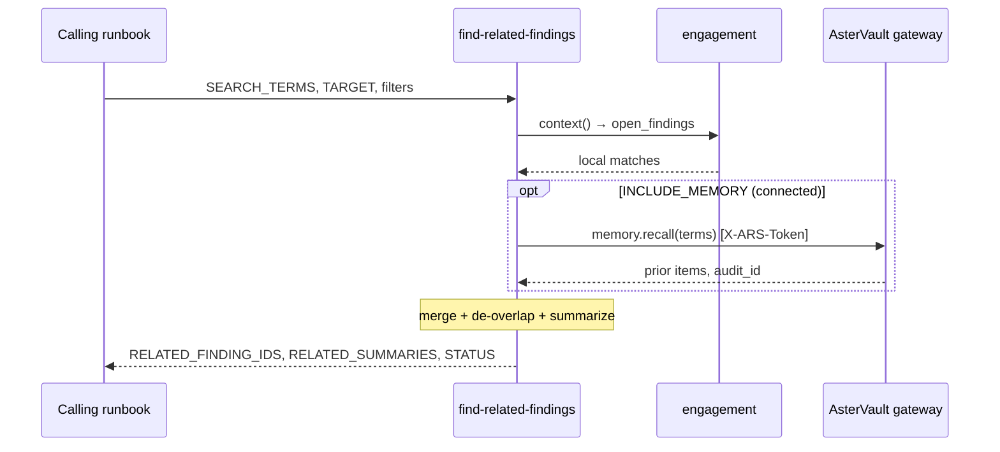

# Common Step: Find Related Findings

Identify existing OPEN findings or incidents that are potentially relevant to the current work, keyed
on an indicator or entity. The reusable building block a triage or investigation runbook calls before
it opens anything new. It is the agent-security analogue of a SOC "find the relevant SOAR case" step —
except the case is the **engagement**, so the search runs over the engagement's folded context and the
team's shared memory, not a vendor case list.

## When to Activate

- A runbook is about to open a finding/incident and needs to attach it to an existing thread if one
  exists (don't fork a second investigation of the same thing).
- Called by `triage-agent-alert`, `triage-agent-finding`, `investigate-agent-incident`, and
  `correlate-finding-groups` — anywhere the source would "list/find the relevant case".

## Objective

Return the set of OPEN findings/incidents related to one or more search terms, drawn from the local
engagement context and shared memory, with enough summary to let the caller decide **attach vs open
new** — without closing, deduping, or correlating alerts (those are other skills).

## Scope

Covers: searching the engagement event stream + `memory.recall` for related OPEN items by
indicator/entity, and summarizing the matches. Excludes: duplicate collapse (use
`check-duplicate-findings`), alert/runtime correlation (use `correlate-indicator`), and graph pivoting
(use `pivot-on-indicator`).

## Inputs

- `${SEARCH_TERMS}`: list[string] — indicators/entities to match (e.g.
  `["LLM01-prompt-injection", "svc:billing-agent", "paste.ee"]`). *Source:* an alert/finding field or
  a prior runbook output.
- `${TARGET}`: string — the engagement whose context is searched. *Source:* engagement context.
- `${STATUS_FILTER}` (optional): `open | closed | all` — default `open`.
- `${INCLUDE_MEMORY}` (optional): bool — also search cross-engagement shared memory (default: true
  connected, ignored offline).

## Outputs

- `${RELATED_FINDING_IDS}`: list — ids of related findings/incidents.
- `${RELATED_SUMMARIES}`: list — `{id, weakness_id, title, severity/index, status, source:
  engagement|memory}` per match.
- `${AUDIT_ID}` (optional): string — `audit_id` of the metered `memory.recall`, when connected.
- `${STATUS}`: ["Success" | "Partial" | "Failure"] — with a per-lane note.

## Tools

- **Gateway (connected, metered — carry `X-ARS-Token`, record the `audit_id`):**
  `memory.recall` (via `atom-recall-memory`) — prior findings/incidents/waivers for the terms.
- **Client-side:** reduce the engagement event stream to OPEN findings keyed by weakness_id + location;
  match `${SEARCH_TERMS}` against them and against the recalled records; merge + de-overlap the two
  lanes; build `${RELATED_SUMMARIES}`.
- **Sibling skills:** `engagement` (`context()` for local open findings); `atom-recall-memory`.

## Workflow Steps & Diagram

1. **Receive** `${SEARCH_TERMS}` + `${TARGET}` (+ filters) from the caller.
2. **Local lane.** `engagement.context()` → the folded set of `open_findings` (and, if
   `${STATUS_FILTER}` != `open`, closed ones); match the search terms against weakness ids, locations,
   components, identities, and egress endpoints recorded on each.
3. **Memory lane (connected).** `atom-recall-memory` (`memory.recall`) over the same terms →
   cross-engagement related items. Offline or on failure: skip and note the degraded lane in
   `${STATUS}`.
4. **Merge.** Union the two lanes, de-overlap by id, tag each row's `source`, and build
   `${RELATED_SUMMARIES}`.
5. **Return** `${RELATED_FINDING_IDS}` + `${RELATED_SUMMARIES}` + `${STATUS}` for the caller's
   attach-vs-open decision.

## Decision Logic / Completion Criteria

- IF a related OPEN item is found THEN return it so the caller **attaches** new evidence to that
  thread rather than opening a duplicate.
- IF only CLOSED/waived matches are found THEN surface them (with the waiver's *why*) so the caller can
  honor or re-open, but do not treat as an open thread.
- IF nothing matches THEN return empty — the caller is clear to open a new finding.
- **Done when:** both lanes have returned or recorded a degraded note and the summaries are populated.

## Integration

- **Composes:** `engagement` (context), `atom-recall-memory`.
- **Called by:** `triage-agent-alert`, `triage-agent-finding`, `investigate-agent-incident`,
  `correlate-finding-groups`.
- **Offline:** searches the local engagement only; memory lane is noted unavailable.
  **Connected:** adds the metered cross-engagement `memory.recall`.
