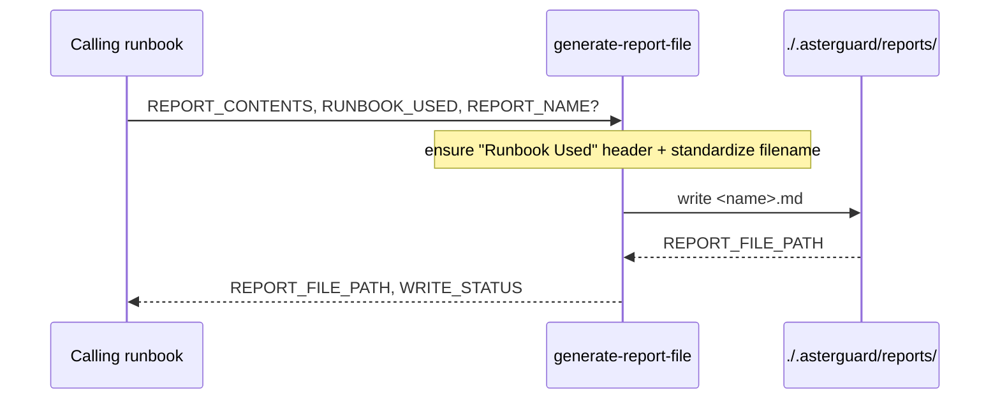

# Common Step: Generate Report File

Write finished report content to a standard location with a standard name and the required provenance
header. The reusable building block every reporting runbook calls to land its artifact. It is the
agent-security analogue of a SOC "generate report file" step — retargeted to `./.asterguard/reports/`
and bound to the pack's reporting discipline (the report must name the runbook that produced it).

## When to Activate

- A runbook has assembled report content (Markdown) and needs it persisted as a file.
- Called by `agent-alert-report`, `agent-incident-report`, `detection-report`, `post-incident-review`,
  and any runbook whose Outputs include a written report — anywhere the source would "write the report
  file".

## Objective

Persist `${REPORT_CONTENTS}` to `./.asterguard/reports/<standard-name>.md`, guaranteeing the
`**Runbook Used:**` header is present at the top, and return the file path — without composing the
report body (the caller does that) or shipping it anywhere.

## Scope

Covers: enforcing the header, standardizing the filename, writing the file under
`./.asterguard/reports/`, and returning the path. Excludes: authoring the report content, choosing what
to include, HTML-artifact rendering (that is `risk-report`), and any egress of the file.

## Inputs

- `${REPORT_CONTENTS}`: string — the full report body (Markdown). *Source:* the calling reporting
  runbook.
- `${RUNBOOK_USED}`: string — the skill name of the runbook that produced the report (e.g.
  `irp-prompt-injection`). *Source:* the caller. Used for the mandatory header.
- `${REPORT_NAME}` (optional): string — base filename; if omitted, derive
  `<runbook>_<target>_<UTC-date>.md`. *Source:* caller or derived.
- `${TARGET}` (optional): string — engagement target, for the derived name + the header.

## Outputs

- `${REPORT_FILE_PATH}`: string — absolute/relative path to the written file under
  `./.asterguard/reports/`.
- `${WRITE_STATUS}`: ["Success" | "Failure"] — with a message on failure.

## Tools

- **Gateway (connected, metered):** none — writing a local report draws no quota and needs no token.
- **Client-side:** ensure the `./.asterguard/reports/` directory exists; verify/prepend the
  `**Runbook Used:** ${RUNBOOK_USED}` header (per the reporting guideline); standardize the filename
  (`.md`, UTC date, no spaces); write the file.
- **Sibling skills:** called after `engagement.context()` has supplied the trace the caller rendered;
  the written path is then referenced in a `note`/`gate_verdict` event via `record-in-engagement`.

## Workflow Steps & Diagram

1. **Receive** `${REPORT_CONTENTS}` + `${RUNBOOK_USED}` (+ optional name/target) from the caller.
2. **Enforce header.** Confirm the body opens with `**Runbook Used:** ${RUNBOOK_USED}`; if missing,
   prepend it. This is required so a reader + the `evals` rubric can trace output → procedure.
3. **Standardize name.** Use `${REPORT_NAME}` or derive `<runbook>_<target>_<UTC-date>.md`; ensure the
   `.md` extension and a filesystem-safe name.
4. **Write.** Create `./.asterguard/reports/` if absent and write the file → `${REPORT_FILE_PATH}`.
5. **Return** `${REPORT_FILE_PATH}` + `${WRITE_STATUS}`. (The caller records the path as an event and
   decides any sharing — this skill never egresses the file.)

## Decision Logic / Completion Criteria

- IF the `**Runbook Used:**` header is absent THEN prepend it before writing — a report without it is
  non-conformant and must not be emitted.
- IF the write fails (path/permission) THEN `${WRITE_STATUS}` = `Failure` with the reason; the caller
  keeps the content and retries rather than losing it.
- **Done when:** the file exists under `./.asterguard/reports/` with the header present and the path is
  returned.

## Integration

- **Composes:** local filesystem write under `./.asterguard/reports/`; `record-in-engagement` (the
  caller logs the artifact path).
- **Called by:** `agent-alert-report`, `agent-incident-report`, `detection-report`,
  `post-incident-review`.
- **Offline:** fully functional — a local file write, no token, no quota. **Connected:** identical; the
  artifact stays local, only the structural `note` (path + runbook) may sync via the caller.
