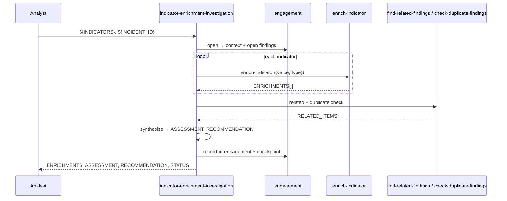

# Indicator Enrichment Investigation

The basic enrichment workflow: take the indicators off an alert/finding, run each through
`enrich-indicator`, check whether they tie to existing open items, synthesise a first-pass risk read,
and record it. The agent-security analogue of Tier-1 "basic IOC enrichment" — fast, standardized, built
to feed a close/escalate decision, not to reach a disposition itself. It *orchestrates* the common
enrichment block; it never re-implements the lookups.

## When to Activate

- A new agent alert/finding arrives with one or more indicators needing quick context before routing.
- `triage-agent-alert`/`triage-agent-finding` wants standardized enrichment across an indicator set.

## Objective

For a set of indicators, return a consolidated first-pass enrichment (facts, graph context, known
patterns, prior sightings, risk read) plus related/duplicate open items, recorded to the engagement,
with a suggested next step.

## Scope

Covers: driving `enrich-indicator` over a set, a related/duplicate check, a synthesised first-pass
assessment, and recording. Excludes: deep analysis (`deep-dive-indicator-analysis`), the full
investigation (`investigate-agent-incident`), timeline reconstruction, containment.

## Inputs

- `${INDICATORS}`: list of `{value, type}` — the indicators to enrich. *Source:* alert/finding fields.
- `${INCIDENT_ID}` (optional): the engagement finding to record under. *Source:* triage output.
- `${EVENT_WINDOW_HOURS}` (optional): int — lookback for the recorded-events lane (default 24).

## Outputs

- `${ENRICHMENTS}`: per-indicator `enrich-indicator` result (facts, graph, knowledge, sightings, risk).
- `${RELATED_ITEMS}`: related + duplicate open findings/incidents (`find-related-findings` /
  `check-duplicate-findings`).
- `${ASSESSMENT}`: consolidated first-pass read (Informational/Low/Medium/High).
- `${RECOMMENDATION}`: suggested route (Escalate / Monitor / Close-FP / Contain).
- `${RECORD_STATUS}` + `${STATUS}`: ["Success" | "Partial" | "Failure"].

## Tools

- **Gateway (connected, metered — carry `X-ARS-Token`, record each `audit_id`):** all grounding is
  reached *through* the composed siblings (`registry.resolve`/`graph.enrich`/`knowledge.query`/
  `memory.recall`/`risk.score`); this wrapper issues no raw gateway call of its own.
- **Client-side:** iterate the indicator set; merge per-indicator reads into one assessment; pick a
  recommendation.
- **Sibling skills:** `engagement` (open/context) · `enrich-indicator` (per indicator) ·
  `find-related-findings` · `check-duplicate-findings` · `record-in-engagement`.

## Workflow Steps & Diagram

1. **Open engagement.** `engagement.open`; load context + open findings. Connected: `ars-token`.
2. **Enrich each indicator.** For every `{value, type}` in `${INDICATORS}`, call `enrich-indicator`
   (do **not** inline `registry.resolve`/`graph.enrich`/…). Collect into `${ENRICHMENTS}`.
3. **Relate + dedupe.** `find-related-findings` and `check-duplicate-findings` over the enriched
   indicators + engagement/memory → `${RELATED_ITEMS}` (surface any prior waiver loudly).
4. **Synthesise.** Combine the per-indicator reads + related items into `${ASSESSMENT}` and a
   `${RECOMMENDATION}`.
5. **Record.** `record-in-engagement` the enrichment events + assessment (optional `memory.capture` via
   `memory-capture` for structural records); `engagement.checkpoint`. → `${RECORD_STATUS}`.

## Decision Logic / Completion Criteria

- IF any indicator returns high risk / a known malicious pattern THEN `${RECOMMENDATION}` = Escalate →
  `investigate-agent-incident` (or Contain if already confirmed).
- IF a matching duplicate open item exists THEN link it via `${RELATED_ITEMS}` and recommend merge
  (`correlate-finding-groups`) rather than a new line.
- IF all benign/waived THEN Close-FP / Monitor.
- **Done when:** every indicator is enriched or its lane degradation is noted, the related/duplicate
  check ran, and the assessment + recommendation are recorded.

## Integration

- **Composes:** `enrich-indicator`, `find-related-findings`, `check-duplicate-findings`,
  `record-in-engagement`; `engagement` bookends.
- **Called by:** `triage-agent-alert`, `triage-agent-finding`, `investigate-agent-incident` (as a fast
  first pass).
- **Offline:** enrichment degrades per `enrich-indicator`'s offline behaviour; related/dupe checks run
  over the local engagement only. **Connected:** full grounding + shared memory, metered through the
  composed siblings.
