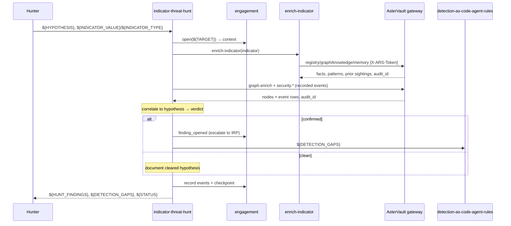

# Hunt: Indicator Threat Hunt

Proactively hunt a given **indicator** across the built security graph, the recorded agent-event
history in `./.asterguard/`, and shared memory. The agent-security analogue of an IOC sweep: the
indicator is not an IP/domain/hash but a `weakness_id`, `component`, `identity`, `egress`, or
`artifact`. Confirm or clear its presence under the hunt hypothesis; escalate confirmed activity and
turn every confirmed gap into a detection rule.

## When to Activate

- A fresh indicator arrives (new intel, a prior incident's artifact, a hunt lead) and you must check
  whether it touches this target.
- `enrich-indicator` or a triage runbook surfaced an indicator worth a proactive sweep.

## Objective

Determine presence/absence of `${INDICATOR_VALUE}` across the target's graph + recorded events +
memory under `${HYPOTHESIS}`, enrich any hit, and route confirmed activity to response — without
containing it (that is the IRP's job).

## Scope

Covers: a single indicator (or a small list), grounded enrichment, graph/event sweep, prior-sightings
check, and escalation of confirmed hits. Excludes: containment/eradication (IRPs), deep
multi-hypothesis hunts (`advanced-agent-threat-hunt`), TTP-chain hunts (`hunt-tool-abuse-lateral`).

## Inputs

- `${HYPOTHESIS}`: string — what the hunt is testing (e.g. "this leaked token is still granted to a
  live agent"). *Source:* analyst / intel.
- `${INDICATOR_VALUE}`: string — the indicator. *Source:* intel, prior finding, graph node.
- `${INDICATOR_TYPE}`: one of `weakness_id | component | identity | egress | artifact | finding_id`.
- `${TARGET}`: the engagement target (repo / image / live agent). *Source:* engagement.
- `${LOOKBACK}` (optional): recorded-event window (default: the engagement's current context).

## Outputs

- `${HUNT_FINDINGS}`: `{indicator, verdict: present|absent|suspected, evidence:[graph nodes, event
  rows, canary hits], enrichment}`.
- `${DETECTION_GAPS}`: confirmed behaviors with no covering rule → handed to `detection-as-code-agent-rules`.
- `${ESCALATION}`: incident/finding id if confirmed activity was escalated.
- `${STATUS}`: ["Success" | "Partial" | "Failure"] with a per-lane note.

## Tools

- **Gateway (connected, metered — carry `X-ARS-Token`, record each `audit_id`):** `graph.enrich`
  (where the indicator sits), `knowledge.query` (known patterns), `memory.recall` (prior sightings),
  `risk.score` (first-pass index), runtime `security.*` (recorded egress/tool-call audit).
- **Client-side:** build the sweep over the local graph + `./.asterguard/events`; correlate hits to the
  hypothesis; decide present/absent/suspected.
- **Sibling skills:** `engagement` (open/checkpoint), `enrich-indicator`, `correlate-indicator`,
  `record-in-engagement`, `detection-as-code-agent-rules`; atoms `atom-recall-memory`,
  `atom-trace-egress`, `atom-enrich-component`.

## Workflow Steps & Diagram

1. **Open engagement.** `engagement.open(${TARGET})` → context + history. Connected: ensure the ARS
   token via `ars-token`.
2. **Enrich the indicator.** `enrich-indicator(${INDICATOR_VALUE}, ${INDICATOR_TYPE})` → registry/graph
   facts, known patterns, prior sightings, first-pass risk read.
3. **Sweep the graph + events.** Locate every node matching the indicator in the built graph; search
   recorded agent tool-calls / egress in `./.asterguard/events` (runtime `security.*` connected) over
   `${LOOKBACK}` for activity involving it. Note negative results explicitly.
4. **Correlate to the hypothesis.** `correlate-indicator` across findings/events/memory → does the
   evidence support `${HYPOTHESIS}`? Verdict present/absent/suspected.
5. **Escalate or clear.** Confirmed activity → open a finding/incident and hand off to the matching IRP
   (do **not** contain here). Clean → document the cleared hypothesis.
6. **Close the gap.** For each confirmed behavior with no covering threat-rule, emit a
   `${DETECTION_GAPS}` entry for `detection-as-code-agent-rules`.
7. **Record + checkpoint.** `record-in-engagement` the hunt events (queries run, verdict, gaps);
   `engagement.checkpoint`.

## Decision Logic / Completion Criteria

- **Present** when the indicator appears on an active graph path **and** a recorded event involves it
  under the hypothesis; **suspected** when one holds but not the other; **absent** when neither does
  across the full `${LOOKBACK}`.
- Confirmed present → escalate (new finding/incident); never contain inside a hunt.
- **Done when:** the indicator has been swept across graph + events + memory, the verdict is set with
  evidence (including negative results), gaps are handed off, and the engagement is checkpointed.

## Integration

- **Composes:** `enrich-indicator`, `correlate-indicator`, `record-in-engagement`,
  `detection-as-code-agent-rules`; `engagement` bookends; atoms `atom-recall-memory`,
  `atom-trace-egress`, `atom-enrich-component`.
- **Called by:** `threat-hunt` playbook; escalates to `irp-*`.
- **Offline:** graph/event sweep runs on local `./.asterguard/` data; grounding/memory degrade to local
  pack + local engagement; note degraded lanes. **Connected:** full graph/knowledge/memory grounding +
  runtime `security.*` audit, metered.
