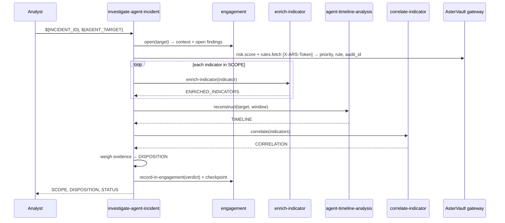

# Investigate an Agent Incident

Run the core investigation of an escalated agent incident end to end: pull the engagement's folded
context, confirm priority against the risk index, enrich every indicator, rebuild what the agent did,
correlate it across prior findings and runtime events, and land a disposition with its rationale. The
agent-security analogue of a SOC "prioritize and investigate a case" — the *case* is the engagement,
the *entities* are the agent's indicators (weaknesses, components, identities, egress, artifacts), and
the *rule logic* is the weakness registry + threat rules the finding fired against.

## When to Activate

- `triage-agent-alert`, `triage-agent-finding`, or `suspicious-tool-call-triage` escalated an item that
  needs deeper work than triage.
- An engagement has one or more open high-priority findings that have not yet been investigated.

## Objective

Produce one coherent investigation of a single agent incident: the confirmed scope, the enriched
indicators, the reconstructed timeline, the cross-correlation, and a disposition (true-positive /
false-positive / benign / needs-response) with a priority and the evidence behind it.

## Scope

Covers: scoping, indicator enrichment, timeline reconstruction, correlation, and disposition for one
incident. Excludes: containment (`contain-indicator`), the IR lifecycle (the `irp-*` runbooks),
proactive hunting (the `hunt-*` runbooks), and report authoring (`agent-incident-report`).

## Inputs

- `${INCIDENT_ID}`: string — the engagement finding/incident id under investigation. *Source:* the
  escalating triage runbook or the engagement.
- `${AGENT_TARGET}`: string — the affected agent/deployment (service principal, endpoint). *Source:*
  the finding or engagement context.
- `${INDICATORS}` (optional): list — known indicators with their types; discovered if not supplied.
  *Source:* triage output / finding fields.
- `${TIME_WINDOW_HOURS}` (optional): int — lookback for recorded events / runtime audit (default 168).

## Outputs

- `${SCOPE}`: the agents, tools, identities, egress endpoints, and data touched by the incident.
- `${ENRICHED_INDICATORS}`: per-indicator `enrich-indicator` verdicts.
- `${TIMELINE}`: the reconstructed action/tool-call/egress chain (`agent-timeline-analysis`).
- `${CORRELATION}`: related findings/incidents/runtime events and the shared pivots.
- `${DISPOSITION}`: `{verdict, priority, rationale, recommended_route}`.
- `${STATUS}`: ["Success" | "Partial" | "Failure"] with a per-lane note.

## Tools

- **Gateway (connected, metered — carry `X-ARS-Token`, record each `audit_id`):** `registry.resolve` /
  `graph.enrich` / `knowledge.query` / `memory.recall` (via the enrich/pivot/correlate siblings),
  `risk.score` (priority), `rules.fetch` (the rule the finding fired against), runtime `security.*`
  (recorded audit / egress).
- **Client-side:** select indicators to enrich; reconstruct and order the timeline; correlate; weigh
  evidence into a verdict + priority. The judgment is the harness's.
- **Sibling skills:** `engagement` (open/context/checkpoint) · `enrich-indicator` ·
  `agent-timeline-analysis` · `correlate-indicator` · `pivot-on-indicator` · `atom-score-finding` ·
  `atom-fetch-rules` · `record-in-engagement`.

## Workflow Steps & Diagram

1. **Open engagement.** `engagement.open(${AGENT_TARGET})` → folded context + open findings + history.
   Connected: ensure the ARS token via `ars-token`.
2. **Confirm priority.** `atom-score-finding` (`risk.score`) over the finding's feature vector; if it
   disagrees with the escalated priority, note it. Pull the firing rule with `atom-fetch-rules`
   (`rules.fetch`) to ground *why* this tripped.
3. **Scope.** Enumerate `${INDICATORS}` from the finding + engagement (tools invoked, identities used,
   egress reached, artifacts loaded). → `${SCOPE}`.
4. **Enrich indicators.** For each indicator call `enrich-indicator` (do not inline its lookups) →
   `${ENRICHED_INDICATORS}`. Surface any prior waiver/decision prominently.
5. **Reconstruct timeline.** `agent-timeline-analysis` over recorded events + runtime audit for
   `${TIME_WINDOW_HOURS}` → `${TIMELINE}` (the tool-call chain that led to the alerted action).
6. **Correlate + pivot.** `correlate-indicator` across findings/events/runtime; `pivot-on-indicator`
   on the strongest leads to pull in related nodes/TTPs. → `${CORRELATION}`.
7. **Disposition.** Weigh enrichment + timeline + correlation into `${DISPOSITION}` (verdict, priority,
   rationale, route to `contain-indicator` / an `irp-*` / close).
8. **Record + checkpoint.** `record-in-engagement` the `verdict` + evidence events; `engagement.checkpoint`.

## Decision Logic / Completion Criteria

- IF a canary egressed, or the timeline traces a privileged action to untrusted input / an abused
  identity THEN verdict `true-positive` → route `contain-indicator` + the matching `irp-*`.
- ELSE IF enrichment shows a waived/benign indicator with no corroborating timeline THEN
  `false-positive` / `benign` → `close-finding`.
- ELSE `needs-more` → `deep-dive-indicator-analysis` on the strongest indicator.
- **Done when:** every in-scope indicator is enriched, the timeline is built (or its gap is noted), the
  correlation ran, and `${DISPOSITION}` carries a verdict + priority + rationale.

## Integration

- **Composes:** `enrich-indicator`, `agent-timeline-analysis`, `correlate-indicator`,
  `pivot-on-indicator`, `atom-score-finding`, `atom-fetch-rules`, `record-in-engagement`; `engagement`
  bookends.
- **Called by:** the `incident-response` playbook; escalated from the triage runbooks.
- **Offline:** grounding degrades to local `./.asterguard/` graph + pack rules; timeline uses recorded
  events only (runtime audit noted as unavailable). **Connected:** full grounding + runtime audit +
  metering, each metered call's `audit_id` recorded.
