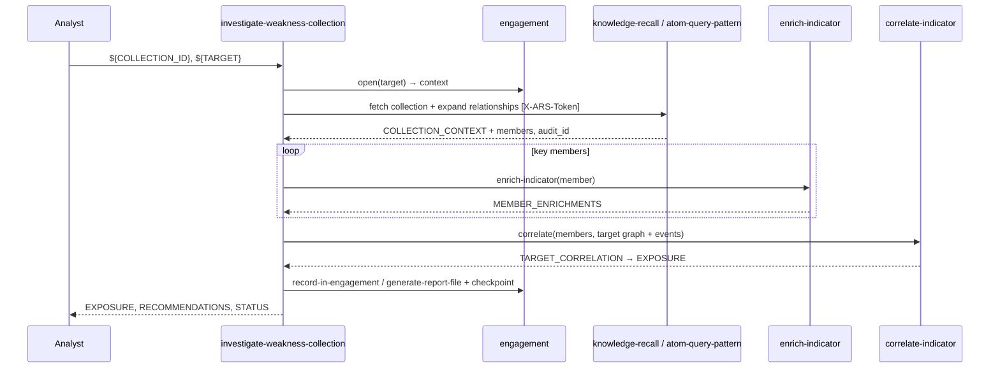

# Investigate a Weakness Collection

Investigate a named **collection** — a curated set of related weaknesses/TTPs, or a campaign pattern —
against the target: expand its members and their relationships, enrich the key ones, correlate them with
the target's security graph and recorded events, and report where the collection actually lands. The
agent-security analogue of "investigate a GTI collection": the collection is a weakness/TTP set
(threat-rule profile, campaign pattern, or a curated weakness bundle) rather than a vendor intel object.

## When to Activate

- A threat-intel/campaign pattern or a curated weakness bundle (`${COLLECTION_ID}`) must be assessed
  against this target.
- A hunt or advisory references a named collection and you need to know if the target is exposed to it.

## Objective

Produce a structured read of the collection vs the target: its expanded members + relationships, their
enrichment, their correlation with the target's graph + recorded events, and the recommended actions
for the parts that touch the target.

## Scope

Covers: expanding a collection, enriching its members, correlating with the target's graph + recorded
events, and reporting. Excludes: the point-in-time overlap comparison (`compare-weakness-collection`),
proactive sweeping (`proactive-pattern-campaign-hunt`), and containment.

## Inputs

- `${COLLECTION_ID}`: string — the weakness/TTP collection or campaign id. *Source:* analyst, advisory,
  or a hunt lead.
- `${TARGET}`: string — the agent/app/deployment to investigate against. *Source:* engagement.
- `${RELATIONSHIPS}` (optional): list — which relationships to expand (default: `associations`,
  `attack_techniques`, `weaknesses`, `components`, `identities`, `egress`, `campaigns`, `controls`).
- `${EVENT_WINDOW_HOURS}` (optional): int — lookback for recorded-event correlation (default 72).

## Outputs

- `${COLLECTION_CONTEXT}`: the collection's definition + type + expanded members.
- `${MEMBER_ENRICHMENTS}`: `enrich-indicator` reads for the key members (weaknesses/components/egress).
- `${TARGET_CORRELATION}`: which members map onto the target's graph nodes + appear in recorded events.
- `${EXPOSURE}`: the subset of the collection the target is actually exposed to, with evidence.
- `${RECOMMENDATIONS}` + `${REPORT_PATH}` (standalone) or recorded events; `${STATUS}`.

## Tools

- **Gateway (connected, metered — carry `X-ARS-Token`, record each `audit_id`):** `knowledge.query` /
  `knowledge.graph` (expand the collection + relationships), `graph.enrich` (map members to the target
  graph), `registry.resolve` (weakness facts), runtime `security.*` (recorded-event correlation).
- **Client-side:** choose relationships to expand; select key members; map members to target nodes;
  judge real exposure vs catalog membership.
- **Sibling skills:** `engagement` (open/context) · `atom-query-pattern` / `knowledge-recall`
  (collection expansion) · `enrich-indicator` (members) · `correlate-indicator` (target + events) ·
  `pivot-on-indicator` (member relationships) · `generate-report-file` · `record-in-engagement`.

## Workflow Steps & Diagram

1. **Open + fetch collection.** `engagement.open(${TARGET})`; `knowledge-recall`/`atom-query-pattern`
   to pull `${COLLECTION_ID}`'s definition + type → `${COLLECTION_CONTEXT}`.
2. **Expand relationships.** For each name in `${RELATIONSHIPS}`, `pivot-on-indicator`/`knowledge.graph`
   to enumerate related weaknesses/TTPs/components/identities/egress. Collect members.
3. **Enrich key members.** `enrich-indicator` the high-signal members (weaknesses, components, egress) →
   `${MEMBER_ENRICHMENTS}`.
4. **Correlate with target.** `correlate-indicator` to map each member onto the target's graph nodes and
   recorded events over `${EVENT_WINDOW_HOURS}` → `${TARGET_CORRELATION}`; the members that map are the
   target's real `${EXPOSURE}`.
5. **Assess + report.** Summarise exposure + recommended actions; `generate-report-file` (standalone) or
   `record-in-engagement` the collection-investigation events (name this runbook at the report top).
6. **Checkpoint.** `engagement.checkpoint`.

## Decision Logic / Completion Criteria

- A member is **real exposure** only when it maps to a target graph node or appears in recorded events —
  catalog membership alone is not exposure.
- IF a mapped member is observed in recorded activity THEN escalate it to
  `deep-dive-indicator-analysis` / `investigate-agent-incident`.
- IF the target has no mapped members THEN report "not exposed to this collection" with the checked
  members as evidence.
- **Done when:** the collection is expanded, key members are enriched, each is correlated against the
  target, exposure is determined, and the result is reported/recorded.

## Integration

- **Composes:** `knowledge-recall`, `atom-query-pattern`, `enrich-indicator`, `correlate-indicator`,
  `pivot-on-indicator`, `generate-report-file`, `record-in-engagement`; `engagement` bookends.
- **Called by:** `proactive-pattern-campaign-hunt`, `apt-agent-threat-hunt`; pairs with
  `compare-weakness-collection`.
- **Offline:** collection expansion degrades to the local weakness registry / pack rules; correlation
  uses recorded events only. **Connected:** full `knowledge.graph` expansion + target graph + runtime
  correlation, metered.
