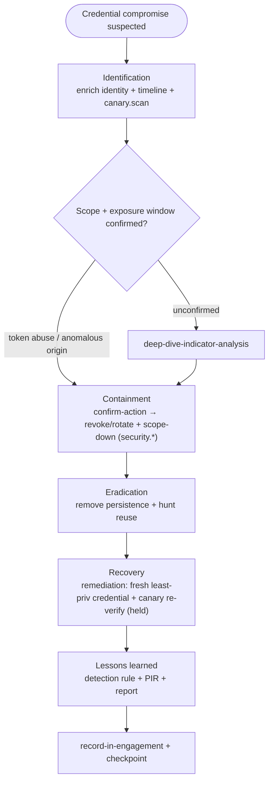

# Agent Credential Compromise Incident Response Plan (IRP)

Structured response when an agent's **identity** is compromised — its token, service principal, API key,
or OAuth grant is in attacker hands and being used to call tools, reach egress, or access data as the
agent. Confirm it, scope what the stolen identity touched, contain by revoking/rotating and scoping the
identity down, hunt for reuse and planted persistence, recover to a least-privilege credential, and
capture lessons. The agent-security analogue of a compromised-user-account IRP — the "account" is a
non-human agent identity, so containment is token revocation + scope reduction, not a password reset.
This runbook orchestrates sub-runbooks; it does not re-implement them.

## When to Activate

- A leaked/rotated-out credential appears in use, a runtime `security.*` alert shows the agent identity
  acting from an unexpected origin, or impossible-concurrency / anomalous-scope use of the token.
- `triage-agent-alert`, `suspicious-tool-call-triage`, or `hunt-agentic-ttp-credential-access`
  escalated a suspected identity compromise.

## Objective

Contain and remediate a compromised agent identity end to end — cut the attacker's access, scope the
identity to least privilege, hunt every place the credential was reused, and restore the agent on a
fresh, narrowly-scoped credential.

## Scope

Covers the full response lifecycle for one compromised agent identity on one deployment. Relies on
sub-runbooks for detailed steps. Excludes proactive credential-access hunting
(`hunt-agentic-ttp-credential-access`) and over-privilege hunting (`hunt-over-privilege`).

## Phases (PICERL)

1. **Preparation** *(ongoing)* — agent identities + granted scopes known (`agent-profiling`,
   `atom-lookup-identity`), runtime egress/audit on, short-lived-credential and rotation path in place,
   credential-access threat-rules active (`rules.fetch`).
2. **Identification** — confirm the compromise, establish the exposure window, scope which tool calls /
   egress / data the stolen identity touched and from where.
3. **Containment** — cut the abused identity: revoke/rotate the token, narrow or suspend its grants,
   terminate active sessions — each human-gated.
4. **Eradication** — remove attacker persistence tied to the identity (rogue OAuth grants, added keys,
   altered scopes, forwarding/automation rules) and purge reuse across other systems.
5. **Recovery** — reissue a fresh least-privilege, short-lived credential; restore the agent; verify the
   old credential is dead and the new one holds via a canary/egress check.
6. **Lessons Learned** — `post-incident-review`; ship a detection rule for the reuse pattern.

## Inputs

- `${INCIDENT_ID}`: the engagement incident/finding id for this event. *Source:* escalating triage
  runbook or runtime alert.
- `${AGENT_IDENTITY}`: the compromised identity (service principal, token id, key, OAuth client —
  e.g. `svc:billing-agent`). *Source:* the alert / engagement.
- `${AGENT_TARGET}`: the affected agent/deployment using that identity. *Source:* engagement.
- `${COMPROMISE_ARTIFACTS}`: what's known — how it leaked (if known), the exposure window, observed
  origins/IPs, the tool calls/egress/data accessed under it. *Source:* triage output / runtime audit.

## Outputs

- `${SCOPE}`: tool calls, egress endpoints, data, and systems touched by the stolen identity, with the
  exposure window.
- `${CONTAINMENT_ACTIONS}`: revocations / rotations / scope reductions / session kills applied (each with
  a `decision` event + `audit_id`).
- `${ERADICATION_STATUS}`: attacker persistence + credential reuse removed.
- `${RECOVERY_STATUS}`: fresh least-privilege credential issued; old credential confirmed dead; canary
  re-verification result.
- `${INCIDENT_REPORT}`: via `agent-incident-report`.

## Tools

- **Gateway (connected, metered — carry `X-ARS-Token`, record each `audit_id`):** `graph.enrich`
  (identity's granted tools/scopes/authority + reach), `knowledge.query` (credential-access patterns),
  `memory.recall`/`memory.capture`, `policy.apply` (scope-down / egress policy), `canary.scan`/
  `canary.verify` (reuse evidence + recovery check), runtime `security.*` (revoke/rotate, session kill,
  egress/audit).
- **Client-side:** reconstruct the identity's action timeline over the exposure window; decide scope;
  author the least-privilege grant/policy; plan the rotation.
- **Sub-runbooks:** `enrich-indicator` (on `${AGENT_IDENTITY}` as an `identity`), `agent-timeline-analysis`,
  `hunt-agentic-ttp-credential-access` (reuse hunt), `contain-indicator`, `confirm-action`, `remediation`,
  `agent-incident-report`, `post-incident-review`, `detection-as-code-agent-rules`; bookended by
  `engagement` + `record-in-engagement`.

## Workflow Steps & Diagram

1. **Open + scope (Identification).** `engagement.open(${AGENT_TARGET})`; `enrich-indicator` on
   `${AGENT_IDENTITY}` (type `identity`) → granted scopes, reach, prior sightings; `agent-timeline-analysis`
   over the runtime audit to reconstruct every tool call / egress / data access under the identity across
   the exposure window, and from which origins. A `canary.scan` confirms whether planted canaries the
   identity could reach egressed (hard proof of active abuse). → `${SCOPE}`.
2. **Contain (human-gated).** For the abused identity, `contain-indicator` → `confirm-action` →
   runtime `security.*` / `policy.apply`: revoke or rotate the token, narrow or suspend its grants,
   terminate active sessions. Record each as a `decision` event with its `audit_id`. → `${CONTAINMENT_ACTIONS}`.
3. **Eradicate.** Remove attacker persistence tied to the identity — rogue OAuth grants, added API keys,
   widened scopes, automation/forwarding rules — via `memory.recall` + timeline; then
   `hunt-agentic-ttp-credential-access` to find and cut reuse of the credential on other agents/systems.
   → `${ERADICATION_STATUS}`.
4. **Recover.** `remediation` reissues a fresh least-privilege, short-lived credential (scoped grant,
   egress allowlist); restore the agent to it; verify the old credential is dead (a call with it must
   fail) and re-run the canary episode on the new identity — it must now **hold**. → `${RECOVERY_STATUS}`.
5. **Lessons learned.** `detection-as-code-agent-rules` ships a `.rule.yaml` for the reuse/anomalous-origin
   pattern; `post-incident-review`; `agent-incident-report` writes the report (naming this runbook at the top).
6. **Checkpoint.** `record-in-engagement` all events; `engagement.checkpoint`; `memory.capture` the
   decision + fix + the *why*.

## Decision Logic / Completion Criteria

- **Confirmed** when the identity is observed acting from an unexpected origin, a canary it could reach
  egressed, or a tool call/egress in the timeline traces to use after the credential was exposed.
- Every containment/eradication step is **human-gated** via `confirm-action` and recorded as a
  `decision` (dual-use discipline).
- **Done when:** the compromised credential is revoked/rotated and confirmed dead, the identity is scoped
  to least privilege, persistence + reuse are removed, recovery is verified by a canary run on the fresh
  identity that now **holds**, the report is written, and a detection rule is shipped.

## Integration

- **Composes:** `enrich-indicator`, `agent-timeline-analysis`, `hunt-agentic-ttp-credential-access`,
  `contain-indicator`, `confirm-action`, `remediation`, `agent-incident-report`, `post-incident-review`,
  `detection-as-code-agent-rules`; `engagement` + `record-in-engagement` bookends.
- **Escalated from:** `triage-agent-alert`, `suspicious-tool-call-triage`,
  `hunt-agentic-ttp-credential-access`.
- **Offline:** revocation/rotation is advisory (policy emitted, not auto-applied); reuse hunt uses the
  local graph; canary re-verify needs the gateway, so note it as pending. **Connected:** full containment
  via runtime `security.*`/`policy.apply`, metered, with canary verification.
