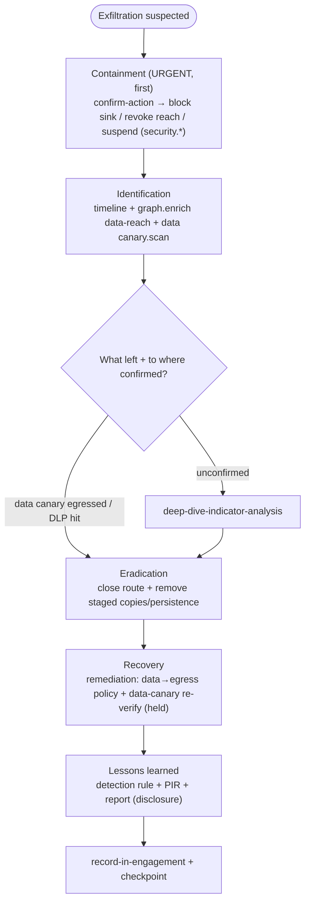

# Data-Exfiltration-via-Agent Incident Response Plan (IRP)

Structured response when confidential data is flowing out **through an agent** — the agent read regulated
or sensitive data and moved it to an egress endpoint, an external tool, or a recipient it should not
reach. Stop the flow first, then scope exactly what left, eradicate the exfil path and persistence,
recover to a policy that blocks the path, and capture lessons. The agent-security analogue of a
ransomware IRP — the shared trait is **impact urgency**: contain the active flow before full analysis,
because every minute more data leaves. (The impact here is confidentiality loss, not encryption.) This
runbook orchestrates sub-runbooks; it does not re-implement them.

## When to Activate

- A canary/honeypot data egress hit, a runtime `security.*` egress alert, or a DLP/volume anomaly shows
  sensitive data leaving via the agent.
- `triage-agent-alert`, `suspicious-tool-call-triage`, or `hunt-exfil-paths` escalated a suspected
  exfiltration.

## Objective

Stop active data exfiltration through an agent, scope precisely what data left and to where, remove the
exfil path and any persistence, and restore the agent to a configuration that holds the
confidential-data → egress boundary.

## Scope

Covers the full response lifecycle for one data-exfiltration incident on one agent/deployment. Relies on
sub-runbooks for detailed steps. Excludes proactive exfil-path hunting (`hunt-exfil-paths`) and
pre-release data-flow assessment (`information-flow`, `data-flow`).

## Phases (PICERL)

1. **Preparation** *(ongoing)* — the agent's data reach + egress surface known (`information-flow`,
   `data-flow`, `agent-profiling`), data canaries planted (`canary-testing`), runtime egress/audit + DLP
   on, exfil threat-rules active (`rules.fetch`).
2. **Identification** — confirm the exfiltration, identify the egress sink(s), and scope which data
   classes / records / stores left and over which window.
3. **Containment** *(urgent, first)* — cut the active flow: block the egress sink, revoke the agent's
   reach to the data, suspend the agent — each human-gated, prioritized over full analysis.
4. **Eradication** — remove the exfil path (block the sink, close the tool/route) and any persistence
   (staged copies, scheduled transfers, poisoned memory directing egress).
5. **Recovery** — restore the agent on a policy that enforces the data → egress boundary (egress
   allowlist, data-scope reduction, DLP); verify with a fresh data-canary run that the path no longer holds.
6. **Lessons Learned** — `post-incident-review`; ship a detection rule for the exfil pattern; assess
   notification/disclosure obligations from `${SCOPE}`.

## Inputs

- `${INCIDENT_ID}`: the engagement incident/finding id for this event. *Source:* escalating triage
  runbook or runtime alert.
- `${AGENT_TARGET}`: the affected agent/deployment. *Source:* engagement.
- `${EGRESS_SINK}`: the endpoint/tool/recipient data is leaving to (e.g. `https://paste.ee/x`,
  `tool:email_send`). *Source:* runtime audit / triage.
- `${EXFIL_ARTIFACTS}`: what's known — data classes/stores involved, volume, the window, the triggering
  input/turn, identities used. *Source:* triage output / runtime audit / DLP.

## Outputs

- `${SCOPE}`: data classes / records / stores that left, to which sink(s), over which window — the
  confidentiality-impact assessment.
- `${CONTAINMENT_ACTIONS}`: egress blocks / data-reach revocations / agent suspension applied (each with
  a `decision` event + `audit_id`).
- `${ERADICATION_STATUS}`: exfil path + persistence removed; sink blocked.
- `${RECOVERY_STATUS}`: data → egress boundary restored; data-canary re-verification result.
- `${INCIDENT_REPORT}`: via `agent-incident-report`, including disclosure/notification considerations.

## Tools

- **Gateway (connected, metered — carry `X-ARS-Token`, record each `audit_id`):** `graph.enrich`
  (data reach, exfil path, egress authority), `knowledge.query` (exfil patterns), `canary.scan`/
  `canary.verify` (data-egress evidence + recovery check), `policy.apply` (egress allowlist, data-scope
  policy), `memory.recall`/`memory.capture`, runtime `security.*` (block egress, suspend agent, DLP/audit).
- **Client-side:** reconstruct the data-flow timeline; quantify what left (classes/records/stores);
  decide scope + disclosure impact; author the data → egress policy.
- **Sub-runbooks:** `enrich-indicator` (on `${EGRESS_SINK}` as an `egress`), `agent-timeline-analysis`,
  `hunt-exfil-paths`, `contain-indicator`, `confirm-action`, `remediation`, `agent-incident-report`,
  `post-incident-review`, `detection-as-code-agent-rules`; bookended by `engagement` +
  `record-in-engagement`.

## Workflow Steps & Diagram

1. **Contain the active flow FIRST (urgent).** If egress is still live, go straight to a human-gated cut:
   `contain-indicator` → `confirm-action` → runtime `security.*` / `policy.apply` blocks `${EGRESS_SINK}`,
   revokes the agent's reach to the data, or suspends the agent. Record each as a `decision` event with
   its `audit_id`. Containment precedes full scoping because data is leaving. → initial `${CONTAINMENT_ACTIONS}`.
2. **Open + scope (Identification).** `engagement.open(${AGENT_TARGET})`; `agent-timeline-analysis` over
   the runtime/DLP audit + `graph.enrich` on the data-reach path to quantify which data classes / records
   / stores left, to where, over which window; `enrich-indicator` on `${EGRESS_SINK}`; a `canary.scan`
   confirms whether a planted **data canary** egressed (hard proof of what reached the sink). → `${SCOPE}`.
3. **Eradicate.** Remove the exfil path — close the tool/route, keep the sink blocked — and any
   persistence: staged/copied data, scheduled transfers, poisoned memory directing egress (via
   `memory.recall` + timeline). → `${ERADICATION_STATUS}`.
4. **Recover.** `remediation` emits the policy that enforces the data → egress boundary (egress
   allowlist, data-scope reduction, DLP rule); restore the agent; re-run the data-canary episode — the
   path must now be **held**. → `${RECOVERY_STATUS}`.
5. **Lessons learned.** `detection-as-code-agent-rules` ships a `.rule.yaml` for the exfil pattern;
   `post-incident-review`; `agent-incident-report` writes the report (naming this runbook at the top) and
   records disclosure/notification considerations derived from `${SCOPE}`.
6. **Checkpoint.** `record-in-engagement` all events; `engagement.checkpoint`; `memory.capture` the
   decision + fix + the *why*.

## Decision Logic / Completion Criteria

- **Containment precedes analysis** while egress is live — cut the flow first, then scope.
- **Confirmed** when a data canary egressed, the runtime/DLP audit shows sensitive data to an unapproved
  sink, or a data-read → egress chain traces through the timeline.
- Every containment/eradication step is **human-gated** via `confirm-action` and recorded as a
  `decision` (dual-use discipline).
- **Done when:** the flow is stopped, what-left is scoped (with disclosure impact), path + persistence
  are removed, recovery is verified by a data-canary run that now **holds**, the report is written, and a
  detection rule is shipped.

## Integration

- **Composes:** `enrich-indicator`, `agent-timeline-analysis`, `hunt-exfil-paths`, `contain-indicator`,
  `confirm-action`, `remediation`, `agent-incident-report`, `post-incident-review`,
  `detection-as-code-agent-rules`, `canary-testing`; `engagement` + `record-in-engagement` bookends.
- **Escalated from:** `triage-agent-alert`, `suspicious-tool-call-triage`, `hunt-exfil-paths`.
- **Offline:** egress block / data-reach revocation are advisory (policy emitted, not auto-applied);
  scoping uses the local data-flow graph; data-canary re-verify needs the gateway, so note it as pending.
  **Connected:** full containment via runtime `security.*`/`policy.apply`, metered, with data-canary
  verification.
