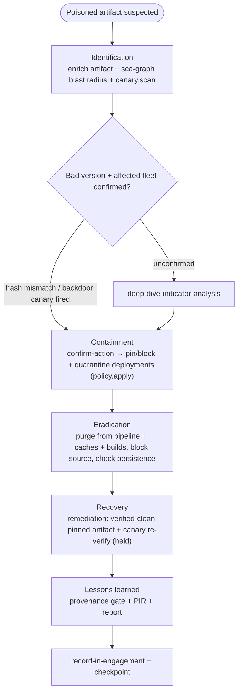

# Model / Supply-Chain Incident Response Plan (IRP)

Structured response when the artifact an agent runs is itself compromised — a **poisoned model** (bad
weights/hash, a backdoored or trojaned model) or a **compromised dependency** (backdoored, typosquatted,
or tampered package/image) that entered the agent's supply chain via the AI-BOM/SBOM. Confirm the bad
artifact, scope every deployment that pulled it, contain by pinning/blocking and isolating affected
agents, eradicate the artifact from the pipeline + caches, recover to a verified-clean artifact, and
capture lessons. The build/run analogue of a malware IRP — the "malware" arrived as a *trusted
dependency or model*, so eradication targets the BOM, the registry/cache, and the pin, not an endpoint
signature. This runbook orchestrates sub-runbooks; it does not re-implement them.

## When to Activate

- A model/artifact hash mismatch, a flagged or yanked dependency, a compromised upstream advisory, or a
  canary firing from behavior attributable to a specific model/package version.
- `malicious-dependency-triage`, `triage-agent-finding`, or `cloud-agent-vuln-triage` escalated a
  suspected poisoned-artifact / supply-chain incident.

## Objective

Contain and remediate a poisoned-model / compromised-dependency incident end to end — stop affected
agents from running the bad artifact, remove it from the supply chain and caches, and restore every
deployment onto a verified-clean, pinned artifact.

## Scope

Covers the full response lifecycle for one compromised model/dependency across the agent fleet that
consumes it. Relies on sub-runbooks for detailed steps. Excludes the run-time tool-abuse path
(`irp-tool-abuse-rce`) and pre-release SBOM/AI-BOM assessment (`sca-graph`, `information-flow`).

## Phases (PICERL)

1. **Preparation** *(ongoing)* — AI-BOM/SBOM built and pinned per deployment (`sca-graph`), artifact
   hashes known, model/dep provenance + signatures checked at build, canaries planted (`canary-testing`),
   supply-chain threat-rules active (`rules.fetch`).
2. **Identification** — confirm the artifact is compromised, establish the bad version/hash, and scope
   every agent/deployment whose BOM pulled it (the blast radius).
3. **Containment** — stop affected agents from loading the artifact: pin/block the bad version, quarantine
   the deployments, cut the pull path — each human-gated.
4. **Eradication** — purge the artifact from the pipeline, registry/package cache, and build artifacts;
   block the source/version; check for planted persistence (poisoned fine-tune, injected weights,
   post-install hooks).
5. **Recovery** — rebuild/redeploy onto a verified-clean artifact (signature + hash pinned); verify with
   a fresh canary run that the backdoor behavior no longer holds.
6. **Lessons Learned** — `post-incident-review`; ship a detection rule / provenance gate so a bad hash is
   caught at build next time.

## Inputs

- `${INCIDENT_ID}`: the engagement incident/finding id for this event. *Source:* escalating triage
  runbook or an advisory.
- `${BAD_ARTIFACT}`: the compromised model/dependency + version/hash (e.g. `model:llama-x@sha256:…`,
  `pypi:requests-ng@2.3.1`). *Source:* triage / advisory / BOM.
- `${AFFECTED_FLEET}` (derived): the agents/deployments whose AI-BOM/SBOM include `${BAD_ARTIFACT}`.
  *Source:* `sca-graph` / `graph.enrich`.
- `${SUPPLY_CHAIN_ARTIFACTS}`: what's known — how it entered (upstream compromise, typosquat, tampered
  mirror), observed malicious behavior, the hash diff. *Source:* triage output / advisory.

## Outputs

- `${SCOPE}`: the blast radius — every deployment that pulled `${BAD_ARTIFACT}`, and the behavior it
  introduced.
- `${CONTAINMENT_ACTIONS}`: pins/blocks / deployment quarantines / pull-path cuts applied (each with a
  `decision` event + `audit_id`).
- `${ERADICATION_STATUS}`: artifact purged from pipeline + caches + builds; source/version blocked;
  persistence checked.
- `${RECOVERY_STATUS}`: fleet rebuilt on a verified-clean pinned artifact; canary re-verification result.
- `${INCIDENT_REPORT}`: via `agent-incident-report`.

## Tools

- **Gateway (connected, metered — carry `X-ARS-Token`, record each `audit_id`):** `registry.resolve`
  (classify the artifact + known weaknesses), `graph.enrich` (BOM membership → the affected fleet, reach),
  `knowledge.query` (supply-chain / poisoning patterns), `canary.scan`/`canary.verify` (backdoor-behavior
  evidence + recovery check), `policy.apply` (pin/block policy, provenance gate), `memory.recall`/
  `memory.capture`, runtime `security.*` (quarantine deployments, audit).
- **Client-side:** diff the bad vs known-good hash; compute the blast radius from the BOM graph; decide
  scope; author the pin/block + provenance-gate policy; plan the rebuild.
- **Sub-runbooks:** `enrich-indicator` (on `${BAD_ARTIFACT}` as an `artifact`), `sca-graph` (BOM blast
  radius), `malicious-dependency-triage`, `contain-indicator`, `confirm-action`, `remediation`,
  `agent-incident-report`, `post-incident-review`, `detection-as-code-agent-rules`; bookended by
  `engagement` + `record-in-engagement`.

## Workflow Steps & Diagram

1. **Open + scope (Identification).** `engagement.open` (the fleet/target); `enrich-indicator` on
   `${BAD_ARTIFACT}` (type `artifact`) → registry classification, provenance, known weaknesses;
   `sca-graph` + `graph.enrich` compute the **blast radius** — every deployment whose AI-BOM/SBOM pulled
   it; a `canary.scan` confirms whether the backdoor behavior fired on an affected agent (hard proof).
   → `${SCOPE}`.
2. **Contain (human-gated).** For each affected deployment, `contain-indicator` → `confirm-action` →
   `policy.apply` / runtime `security.*`: pin/block the bad version in the registry, quarantine the
   deployment, cut the pull path. Record each as a `decision` event with its `audit_id`.
   → `${CONTAINMENT_ACTIONS}`.
3. **Eradicate.** Purge `${BAD_ARTIFACT}` from the pipeline, package/model registry cache, and build
   artifacts; block the source/version; check for planted persistence — a poisoned fine-tune layer,
   injected weights, post-install/build hooks — via timeline + `knowledge.query`. → `${ERADICATION_STATUS}`.
4. **Recover.** `remediation` pins a verified-clean artifact (signature + hash) and emits the provenance
   gate; rebuild/redeploy the fleet; re-run the canary episode — the backdoor behavior must now be
   **held**. → `${RECOVERY_STATUS}`.
5. **Lessons learned.** `detection-as-code-agent-rules` ships a `.rule.yaml` / build-time provenance gate
   so the bad hash is caught at build; `post-incident-review`; `agent-incident-report` writes the report
   (naming this runbook at the top).
6. **Checkpoint.** `record-in-engagement` all events; `engagement.checkpoint`; `memory.capture` the
   decision + fix + the *why*.

## Decision Logic / Completion Criteria

- **Confirmed** when the artifact hash mismatches the known-good / signed value, an advisory names the
  version compromised, or a canary confirms backdoor behavior attributable to the version.
- Every containment/eradication step is **human-gated** via `confirm-action` and recorded as a
  `decision` (dual-use discipline).
- **Done when:** the bad version is pinned/blocked fleet-wide, the artifact is purged from pipeline +
  caches + builds and its source blocked, the fleet is recovered on a verified-clean pinned artifact,
  recovery is verified by a canary run that now **holds**, the report is written, and a build-time
  provenance gate / detection rule is shipped.

## Integration

- **Composes:** `enrich-indicator`, `sca-graph`, `malicious-dependency-triage`, `contain-indicator`,
  `confirm-action`, `remediation`, `agent-incident-report`, `post-incident-review`,
  `detection-as-code-agent-rules`, `canary-testing`; `engagement` + `record-in-engagement` bookends.
- **Escalated from:** `malicious-dependency-triage`, `triage-agent-finding`, `cloud-agent-vuln-triage`.
- **Offline:** pin/block + quarantine are advisory (policy emitted, not auto-applied); blast radius uses
  the local BOM graph; canary re-verify needs the gateway, so note it as pending. **Connected:** full
  containment via `policy.apply`/runtime `security.*`, metered, with canary verification.
