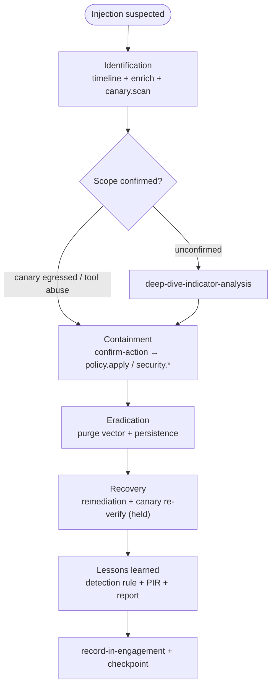

# Prompt-Injection Incident Response Plan (IRP)

Structured response for a prompt-injection incident against a live agent: confirm it, scope it, contain
the authority the injection abused, eradicate the injection vector, recover the agent to a safe
configuration, and capture lessons. The agent-security analogue of a phishing IRP — the "lure" is
untrusted content reaching the model's context, and the "click" is the agent taking a privileged action
on the attacker's behalf. This runbook orchestrates sub-runbooks; it does not re-implement them.

## When to Activate

- A canary egress/honeypot hit, a runtime `security.*` alert, or a user report indicates an agent
  followed instructions from untrusted content.
- `triage-agent-alert` or `suspicious-tool-call-triage` escalated a suspected injection.

## Objective

Contain and remediate a prompt-injection incident end to end, minimizing data exposure and unauthorized
tool/egress actions, and restore the agent to a trusted, least-privilege configuration.

## Scope

Covers the full response lifecycle for one prompt-injection incident on one agent/deployment. Relies on
sub-runbooks for detailed steps. Excludes proactive hunting (`hunt-prompt-injection-exposure`) and
pre-release testing (`behavioral-redteam`).

## Phases (PICERL)

1. **Preparation** *(ongoing)* — canaries planted (`canary-testing`), runtime egress/audit on, the
   agent's authority graph known (`agent-profiling`), injection threat-rules active (`rules.fetch`).
2. **Identification** — confirm the injection, extract the untrusted vector, scope which tool calls /
   egress / data the agent touched under its influence.
3. **Containment** — cut the abused authority: block the egress, revoke/narrow the token, quarantine
   the poisoned context/source — each human-gated.
4. **Eradication** — remove the injection vector (purge the poisoned document/memory/tool result,
   block the source) and any planted persistence (poisoned long-term memory, altered instructions).
5. **Recovery** — restore the agent to a trusted system prompt + least-privilege policy; verify with a
   fresh canary run that the path no longer holds.
6. **Lessons Learned** — `post-incident-review`; ship a detection rule so it's caught next time.

## Inputs

- `${INCIDENT_ID}`: the engagement incident/finding id for this event. *Source:* the escalating triage
  runbook or a runtime alert.
- `${AGENT_TARGET}`: the affected agent/deployment (endpoint, service principal). *Source:* engagement.
- `${INJECTION_ARTIFACTS}`: what's known — the untrusted source (document/url/tool/email), the offending
  turn(s), the tool calls/egress observed, affected data/identities. *Source:* triage output / runtime
  audit.

## Outputs

- `${SCOPE}`: tool calls, egress endpoints, data, and identities touched under injection.
- `${CONTAINMENT_ACTIONS}`: egress blocks / token changes / quarantines applied (each with a `decision`
  event + `audit_id`).
- `${ERADICATION_STATUS}`: injection vector + persistence removed.
- `${RECOVERY_STATUS}`: safe config restored; canary re-verification result.
- `${INCIDENT_REPORT}`: via `agent-incident-report`.

## Tools

- **Gateway (connected, metered):** `graph.enrich` (authority/reach of the abused path),
  `knowledge.query` (known injection patterns), `canary.scan`/`canary.verify` (hard evidence + recovery
  check), `policy.apply` (containment as policy), `memory.recall`/`memory.capture`, runtime `security.*`
  (egress/audit, isolate).
- **Client-side:** reconstruct the influenced timeline; decide scope; author the least-privilege policy.
- **Sub-runbooks:** `enrich-indicator`, `agent-timeline-analysis`, `contain-indicator`,
  `confirm-action`, `remediation`, `agent-incident-report`, `post-incident-review`,
  `detection-as-code-agent-rules`; bookended by `engagement` + `record-in-engagement`.

## Workflow Steps & Diagram

1. **Open + scope (Identification).** `engagement.open(${AGENT_TARGET})`; `agent-timeline-analysis`
   over the runtime audit to reconstruct what the agent did while under injection; `enrich-indicator`
   on the untrusted source + each egress endpoint; a `canary.scan` confirms whether planted canaries
   egressed (hard proof). → `${SCOPE}`.
2. **Contain (human-gated).** For each abused authority, `contain-indicator` → `confirm-action` →
   `policy.apply` / runtime `security.*`: block the egress, revoke or narrow the agent token, quarantine
   the poisoned source/context. Record each as a `decision` event with its `audit_id`. → `${CONTAINMENT_ACTIONS}`.
3. **Eradicate.** Purge the injection vector (poisoned document, tool result, or long-term memory
   entry) and block its source; check for planted persistence in the agent's stored instructions/memory
   via `memory.recall` + timeline. → `${ERADICATION_STATUS}`.
4. **Recover.** `remediation` emits the least-privilege policy (egress allowlist, scoped token, input
   provenance/trust boundary); restore the trusted system prompt; re-run the canary episode — the path
   must now be **held**. → `${RECOVERY_STATUS}`.
5. **Lessons learned.** `detection-as-code-agent-rules` ships a `.rule.yaml` for this injection pattern;
   `post-incident-review`; `agent-incident-report` writes the report (naming this runbook at the top).
6. **Checkpoint.** `record-in-engagement` all events; `engagement.checkpoint`; `memory.capture` the
   decision + fix + the *why*.

## Decision Logic / Completion Criteria

- **Confirmed** when a canary egressed, a runtime egress to an attacker-controlled endpoint is in the
  audit, or a privileged tool call traces to untrusted input in the timeline.
- Every containment/eradication step is **human-gated** via `confirm-action` and recorded as a
  `decision` (dual-use discipline).
- **Done when:** the abused authority is contained, the vector + persistence are removed, recovery is
  verified by a canary run that now **holds**, the report is written, and a detection rule is shipped.

## Integration

- **Composes:** `enrich-indicator`, `agent-timeline-analysis`, `contain-indicator`, `confirm-action`,
  `remediation`, `agent-incident-report`, `post-incident-review`, `detection-as-code-agent-rules`,
  `canary-testing`; `engagement` + `record-in-engagement` bookends.
- **Escalated from:** `triage-agent-alert`, `suspicious-tool-call-triage`.
- **Offline:** containment is advisory (policy emitted, not auto-applied); canary re-verify needs the
  gateway, so note it as pending. **Connected:** full containment via `policy.apply`/`security.*`,
  metered, with canary verification.
