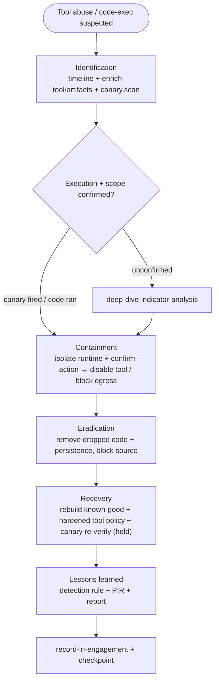

# Agent Tool-Abuse / Code-Execution Incident Response Plan (IRP)

Structured response when an agent **tool** becomes the execution primitive for an attacker — the agent
was steered into running attacker-supplied code or abusing a dangerous capability (shell/exec,
code-interpreter, arbitrary file-write, a DB or cloud-admin tool) to run commands, drop artifacts, or
pivot. Confirm it, scope what ran and what it touched, contain the capability and any dropped artifacts,
eradicate the malicious code + persistence, recover the runtime and the tool policy, and capture lessons.
The agent-security analogue of a malware IRP — the "malware" is attacker code executed *through the
agent's own tools*, so eradication targets dropped artifacts + the over-permissive tool grant, not an EDR
signature. This runbook orchestrates sub-runbooks; it does not re-implement them.

## When to Activate

- A runtime `security.*` alert on a dangerous tool invocation, a canary/honeypot execution hit, or
  evidence that the agent ran code / commands it should not have.
- `triage-agent-alert`, `suspicious-tool-call-triage`, or `malicious-dependency-triage` escalated a
  suspected code-execution-via-tool incident.
- `endpoint-agent-triage-isolation` flagged a compromised agent runtime/host.

## Objective

Contain and remediate an agent tool-abuse / code-execution incident end to end — stop further execution,
remove attacker code and persistence from the runtime, and restore the agent on a hardened, least-
privilege tool policy.

## Scope

Covers the full response lifecycle for one tool-abuse / code-execution incident on one agent/runtime.
Relies on sub-runbooks for detailed steps. Excludes the poisoned-dependency supply-chain path
(`irp-model-supply-chain`) and proactive over-privilege/injection hunting (`hunt-over-privilege`,
`hunt-prompt-injection-exposure`).

## Phases (PICERL)

1. **Preparation** *(ongoing)* — the agent's tool inventory + authority known (`agent-profiling`),
   runtime `security.*` exec/egress audit on, canaries planted (`canary-testing`), dangerous-tool
   threat-rules active (`rules.fetch`), a runtime isolation/rebuild path in place.
2. **Identification** — confirm execution occurred, classify what ran, scope the commands / dropped
   artifacts / tools / egress / data touched and the entry that triggered it.
3. **Containment** — isolate the runtime, disable or gate the abused tool, block egress — each human-gated.
4. **Eradication** — remove the malicious code and any persistence (dropped files, scheduled tasks,
   added tools/grants, poisoned memory) and block the source.
5. **Recovery** — rebuild or restore the runtime to a known-good state on a hardened, least-privilege
   tool policy; verify with a fresh canary run that execution no longer holds.
6. **Lessons Learned** — `post-incident-review`; ship a detection rule for the abuse pattern.

## Inputs

- `${INCIDENT_ID}`: the engagement incident/finding id for this event. *Source:* escalating triage
  runbook or runtime alert.
- `${AGENT_TARGET}`: the affected agent/runtime (endpoint, container, service principal). *Source:* engagement.
- `${ABUSED_TOOL}`: the tool/capability used for execution (e.g. `tool:shell`, `tool:code_interpreter`,
  `tool:db_admin`). *Source:* runtime audit / triage.
- `${EXECUTION_ARTIFACTS}`: what's known — the commands/code run, dropped files/hashes, egress observed,
  the triggering input/turn, affected data/identities. *Source:* triage output / runtime audit.

## Outputs

- `${SCOPE}`: commands/code executed, artifacts dropped (with hashes), tools + egress + data touched, and
  the triggering entry.
- `${CONTAINMENT_ACTIONS}`: runtime isolation / tool disablement / egress blocks applied (each with a
  `decision` event + `audit_id`).
- `${ERADICATION_STATUS}`: malicious code + persistence removed; source blocked.
- `${RECOVERY_STATUS}`: runtime rebuilt/restored on a hardened tool policy; canary re-verification result.
- `${INCIDENT_REPORT}`: via `agent-incident-report`.

## Tools

- **Gateway (connected, metered — carry `X-ARS-Token`, record each `audit_id`):** `graph.enrich`
  (tool authority/reach, affected components), `knowledge.query` (tool-abuse / code-exec patterns),
  `canary.scan`/`canary.verify` (execution evidence + recovery check), `policy.apply` (tool gating,
  egress allowlist), `memory.recall`/`memory.capture`, runtime `security.*` (isolate runtime, disable
  tool, block egress, exec audit), `registry.resolve` (classify a dropped artifact).
- **Client-side:** reconstruct the execution timeline; classify the dropped artifacts; decide scope;
  author the hardened least-privilege tool policy; plan the rebuild.
- **Sub-runbooks:** `enrich-indicator` (on `${ABUSED_TOOL}` and dropped `artifact`s), `agent-timeline-analysis`,
  `endpoint-agent-triage-isolation`, `contain-indicator`, `confirm-action`, `remediation`,
  `agent-incident-report`, `post-incident-review`, `detection-as-code-agent-rules`; bookended by
  `engagement` + `record-in-engagement`.

## Workflow Steps & Diagram

1. **Open + scope (Identification).** `engagement.open(${AGENT_TARGET})`; `agent-timeline-analysis` over
   the runtime exec/egress audit to reconstruct what ran, what it dropped, and what it reached;
   `enrich-indicator` on `${ABUSED_TOOL}` (type `tool`) and on each dropped `artifact` (hash) and egress
   endpoint; a `canary.scan` confirms whether a planted exec/egress canary fired (hard proof). → `${SCOPE}`.
2. **Contain (human-gated).** `endpoint-agent-triage-isolation` to isolate the runtime; `contain-indicator`
   → `confirm-action` → runtime `security.*` / `policy.apply`: disable or gate `${ABUSED_TOOL}`, block
   the egress. Record each as a `decision` event with its `audit_id`. → `${CONTAINMENT_ACTIONS}`.
3. **Eradicate.** Remove the malicious code and persistence — dropped files, scheduled tasks/services,
   added tools or grants, poisoned long-term memory (via `memory.recall` + timeline) — and block the
   source. → `${ERADICATION_STATUS}`.
4. **Recover.** Prefer **rebuild from a known-good image** over cleaning (execution confidence is hard to
   establish); `remediation` emits the hardened least-privilege tool policy (gate/remove the dangerous
   tool, scope the token, egress allowlist, input trust boundary); restore the agent; re-run the canary
   episode — execution must now be **held**. → `${RECOVERY_STATUS}`.
5. **Lessons learned.** `detection-as-code-agent-rules` ships a `.rule.yaml` for the tool-abuse pattern;
   `post-incident-review`; `agent-incident-report` writes the report (naming this runbook at the top).
6. **Checkpoint.** `record-in-engagement` all events; `engagement.checkpoint`; `memory.capture` the
   decision + fix + the *why*.

## Decision Logic / Completion Criteria

- **Confirmed** when an exec/egress canary fired, the runtime audit shows attacker commands/code run via
  the tool, or a dropped artifact traces to the agent's tool invocation in the timeline.
- Every containment/eradication step is **human-gated** via `confirm-action` and recorded as a
  `decision` (dual-use discipline).
- **Done when:** the runtime is isolated, the abused tool is disabled or gated, code + persistence are
  removed and the source blocked, recovery is verified by a canary run that now **holds**, the report is
  written, and a detection rule is shipped.

## Integration

- **Composes:** `enrich-indicator`, `agent-timeline-analysis`, `endpoint-agent-triage-isolation`,
  `contain-indicator`, `confirm-action`, `remediation`, `agent-incident-report`, `post-incident-review`,
  `detection-as-code-agent-rules`, `canary-testing`; `engagement` + `record-in-engagement` bookends.
- **Escalated from:** `triage-agent-alert`, `suspicious-tool-call-triage`, `malicious-dependency-triage`,
  `endpoint-agent-triage-isolation`.
- **Offline:** isolation/tool-disable are advisory (policy emitted, not auto-applied); artifact
  classification uses local pack data; canary re-verify needs the gateway, so note it as pending.
  **Connected:** full containment via runtime `security.*`/`policy.apply`, metered, with canary verification.
