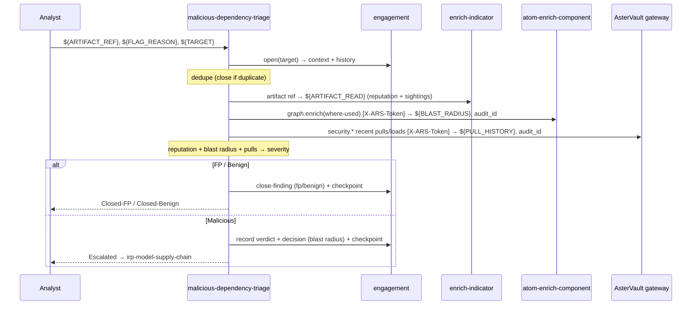

# Runbook: Malicious Dependency / Model Artifact Triage

Initial triage of a **flagged dependency or model artifact** surfaced by the AI-BOM / SBOM — a poisoned
package, a typosquat of a trusted name, or a known-bad model/package hash. The agent-security analogue
of malware triage: the "file hash" is an `artifact` (model/package/image hash) or a `component`
(dependency), and the "detonation sandbox" is reputation grounding plus where-used graph analysis.
Triage only: it scopes + routes; it does not reverse-engineer or quarantine.

## When to Activate

- AI-BOM / SBOM scanning (`sca-graph`, `local-scan`) flags a dependency or model artifact: known-bad
  hash, typosquat match, poisoned-package indicator, or a yanked/compromised version.
- `triage-agent-alert` routed a supply-chain finding here for artifact-centric triage.

## Objective

Determine whether a flagged artifact is a true supply-chain threat and scope its blast radius (which
agents/components load it), then route: escalate to the model-supply-chain IRP, or close as
benign/false-positive/duplicate.

## Scope

Covers: enrich the artifact, map where it is used across the graph, check recent pulls/loads in recorded
events, relate to open findings, assess severity, and route.
Excludes: reverse engineering / deep artifact forensics, quarantine or version-pinning enforcement
(human-gated via `irp-model-supply-chain` + `remediation` + `confirm-action`).

## Inputs

- `${ARTIFACT_REF}`: string — the flagged artifact: a hash (`sha256:…`), a package coordinate
  (`langchain-core@0.2.1`), or a model id. *Source:* AI-BOM/SBOM finding. Typed `artifact` or
  `component` for `enrich-indicator`.
- `${FLAG_REASON}`: string — why it was flagged (known-bad hash, typosquat, poisoned, yanked).
  *Source:* scanner.
- `${TARGET}`: string — the app/repo whose BOM raised it. *Source:* engagement.
- `${TIME_FRAME_HOURS}` (optional): int — lookback for the recorded pulls/loads search (default 72).

## Outputs

- `${ASSESSMENT}`: ["False Positive" | "Benign" | "Duplicate" | "Malicious — <severity>"] — verdict +
  rationale.
- `${ACTION_TAKEN}` / route: ["Closed-FP" | "Closed-Benign" | "Closed-Duplicate" |
  "Escalated → irp-model-supply-chain"].
- `${ARTIFACT_READ}`: reputation/known-bad/typosquat facts + prior sightings (from `enrich-indicator`).
- `${BLAST_RADIUS}`: agents/components/services that depend on or load the artifact (from
  `atom-enrich-component` / `graph.enrich`).
- `${PULL_HISTORY}`: recent install/pull/model-load events for the artifact (recorded-events search).
- `${RELATED_FINDINGS}`: open findings sharing this artifact/component.
- `${STATUS}`: ["Success" | "Partial" | "Failure"] — with a per-lane note on non-success.

## Tools

- **Gateway (connected, metered — carry `X-ARS-Token`, record each `audit_id`):** `registry.resolve` /
  `knowledge.query` (artifact reputation), `graph.enrich` (where-used), `risk.score`, `memory.recall`
  (via the composed skills), runtime `security.*` pull/load search.
- **Client-side:** judge true-vs-false flag from reputation + BOM metadata; compute blast radius from the
  dependency graph; rank severity by reach + authority of affected agents.
- **Sibling skills:** `engagement` (open/context/checkpoint) · `enrich-indicator` ·
  `atom-enrich-component` · `find-related-findings` · `check-duplicate-findings` ·
  `record-in-engagement` · `close-finding`.

## Workflow Steps & Diagram

1. **Open engagement.** `engagement.open(${TARGET})` → context + history. Connected: ensure the ARS token
   via `ars-token`.
2. **Dedupe.** `check-duplicate-findings` on `${ARTIFACT_REF}` → if already an open finding,
   `close-finding` (reason=`duplicate`), route **Closed-Duplicate**. Stop.
3. **Enrich the artifact.** `enrich-indicator` on `${ARTIFACT_REF}` (type `artifact`/`component`) →
   `${ARTIFACT_READ}`: known-bad/typosquat/poisoned reputation, registry facts, prior sightings,
   first-pass `risk.score`. A surfaced waiver (e.g. a reviewed, accepted version) short-circuits toward a
   benign close.
4. **Map blast radius.** `atom-enrich-component` (`graph.enrich`) → `${BLAST_RADIUS}`: which agents /
   components / services depend on or load the artifact, and the authority those agents hold (reach ×
   privilege sets the severity).
5. **Check recent pulls/loads.** One targeted runtime `security.*` search over `${TIME_FRAME_HOURS}` for
   install/pull/model-load events for the artifact → `${PULL_HISTORY}` (was it actually pulled/loaded, or
   only present in a manifest?). Connected: carries `X-ARS-Token`, returns `audit_id`.
6. **Relate.** `find-related-findings` on artifact + affected components (status=open) →
   `${RELATED_FINDINGS}`.
7. **Assess + route.** Combine reputation + blast radius + pull history → `${ASSESSMENT}`. FP/Benign →
   `close-finding`. Malicious → escalate to `irp-model-supply-chain` with the blast radius.
   `record-in-engagement` the `verdict` + `decision` events (with `audit_id`s); `engagement.checkpoint`.

## Decision Logic / Completion Criteria

- IF `${DUPLICATE_OF}` confirmed THEN **Closed-Duplicate** → `close-finding`.
- IF reputation clears it (not actually known-bad; typosquat match was a legitimate name) or a valid
  waiver covers the version THEN **Closed-Benign**; if the flag was spurious, **Closed-FP**.
- IF reputation confirms poisoned/known-bad/typosquat AND `${BLAST_RADIUS}` shows it is loaded by a
  reachable agent (especially one with privileged authority) THEN **Malicious → Escalated** to
  `irp-model-supply-chain`; severity scales with reach × authority and whether `${PULL_HISTORY}` shows it
  was actually pulled/loaded (not merely declared).
- **Done when:** the artifact is enriched, blast radius + pull history are gathered, an assessment +
  severity are set, the route is taken, and events are recorded + checkpointed.

## Integration

- **Composes:** `enrich-indicator`, `atom-enrich-component`, `find-related-findings`,
  `check-duplicate-findings`, `close-finding`; `engagement` + `record-in-engagement` bookends.
- **Fed by:** `sca-graph`, `local-scan` (AI-BOM/SBOM). **Escalated from:** `triage-agent-alert`.
  **Escalates to:** `irp-model-supply-chain`; remediation handled by `remediation`.
- **Offline:** reputation/graph degrade to local pack data + the local dependency graph; blast radius
  from `./.asterguard/` BOM; assessment still produced (noted `Partial`). **Connected:** full
  `knowledge.query` + `graph.enrich` + runtime pull search, metered, each metered call records an
  `audit_id`.
