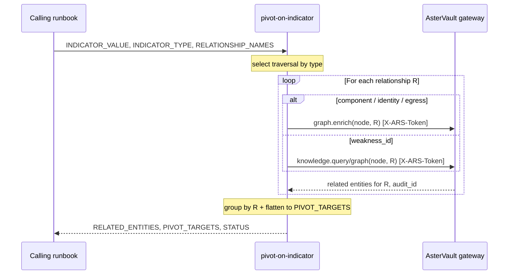

# Common Step: Pivot on Indicator

Expand a single indicator into its neighbourhood by following graph and knowledge relationships —
components it touches, weaknesses it links to, TTPs it exhibits, identities that can reach it. The
reusable building block that turns one confirmed lead into the next set of leads. It is the
agent-security analogue of a SOC "pivot on IOC using GTI relationships" step, retargeted from GTI
relationship traversal to `graph.enrich` + `knowledge.query` over our built security graph.

## When to Activate

- An indicator is confirmed worth chasing and you need the related entities to widen the
  investigation or hunt.
- Called by `deep-dive-indicator-analysis`, `investigate-agent-incident`, the hunts, and the IRPs —
  anywhere the source would "pivot on the IOC".

## Objective

Return the related entities discovered by traversing the requested relationships from one indicator —
grouped by relationship — so the caller can pick the next pivot targets, without enriching each one
(that is `enrich-indicator`) or deciding disposition.

## Scope

Covers: selecting the graph/knowledge traversal for the indicator type, querying each requested
relationship, and returning the related nodes/TTPs grouped by relationship. Excludes: first-pass
enrichment of the indicator, correlation across findings/runtime (use `correlate-indicator`), and
containment.

## Inputs

- `${INDICATOR_VALUE}`: string — the pivot origin (weakness_id, component, identity, egress, or
  artifact). *Source:* a confirmed finding/alert field or prior runbook output.
- `${INDICATOR_TYPE}`: one of `weakness_id | component | identity | egress | artifact`.
- `${RELATIONSHIP_NAMES}`: list[string] — relationships to traverse, valid for the type, e.g. for
  `component`: `["depends_on", "reached_by_identity", "linked_weaknesses"]`; for `weakness_id`:
  `["attack_techniques", "capec", "affected_components", "controls"]`; for `identity`:
  `["granted_tools", "reachable_egress", "assumed_by"]`.

## Outputs

- `${RELATED_ENTITIES}`: object — related entities keyed by relationship name.
- `${PIVOT_TARGETS}`: list — the flattened, de-duplicated set of next-pivot candidates (value + type).
- `${AUDIT_ID}` (optional): list — `audit_id`s of the metered `graph.enrich`/`knowledge.query` calls.
- `${STATUS}`: ["Success" | "Partial" | "Failure"] — with a per-relationship note.

## Tools

- **Gateway (connected, metered — carry `X-ARS-Token`, record each `audit_id`):**
  `graph.enrich(node)` (via `atom-enrich-component` / `atom-lookup-identity` / `atom-trace-egress`) —
  structural neighbours (deps, reach, authority, linked weaknesses); `knowledge.query` /
  `knowledge.graph` (via `atom-query-pattern`) — TTP/CAPEC/ATT&CK relationships for a weakness.
- **Client-side:** pick the traversal by `${INDICATOR_TYPE}`, iterate `${RELATIONSHIP_NAMES}`, group
  results, and flatten to `${PIVOT_TARGETS}` (typed for the next pivot/enrich).
- **Sibling skills:** the `atom-*` enrich/query skills above; `enrich-indicator` (the caller runs it on
  each selected pivot target next).

## Workflow Steps & Diagram

1. **Receive** `${INDICATOR_VALUE}` + `${INDICATOR_TYPE}` + `${RELATIONSHIP_NAMES}` from the caller.
2. **Select traversal.** By type: `component`/`identity`/`egress` → `graph.enrich` via the matching
   `atom-*`; `weakness_id` → `knowledge.query`/`knowledge.graph` via `atom-query-pattern` (+
   `graph.enrich` for affected components).
3. **Iterate relationships.** For each relationship, run the traversal and store results under that
   relationship key in `${RELATED_ENTITIES}`. **Degrade:** a failed/ungrounded relationship is noted in
   `${STATUS}` and falls back to the local graph in `./.asterguard/`; never abort the whole pivot.
4. **Flatten.** De-duplicate across relationships into `${PIVOT_TARGETS}`, each typed so the caller can
   enrich/pivot it next.
5. **Return** `${RELATED_ENTITIES}` + `${PIVOT_TARGETS}` + `${STATUS}`.

## Decision Logic / Completion Criteria

- IF a relationship returns a privileged/high-reach neighbour (e.g. an identity with broad
  `granted_tools`, or an egress on an exfil path) THEN prioritize it in `${PIVOT_TARGETS}` for the
  caller to enrich next.
- IF a relationship is unavailable (offline/ungrounded) THEN mark `${STATUS}` = `Partial` and still
  return what the other relationships yielded.
- **Done when:** every requested relationship has returned or recorded a degraded note and
  `${PIVOT_TARGETS}` is flattened.

## Integration

- **Composes:** `atom-enrich-component`, `atom-lookup-identity`, `atom-trace-egress`,
  `atom-query-pattern`.
- **Called by:** `deep-dive-indicator-analysis`, `investigate-agent-incident`, the hunts, the IRPs —
  which run `enrich-indicator` on the returned `${PIVOT_TARGETS}`.
- **Offline:** traverses the local `./.asterguard/` graph + pack knowledge only; ungrounded
  relationships are noted. **Connected:** full metered `graph.enrich` + `knowledge.query`.
