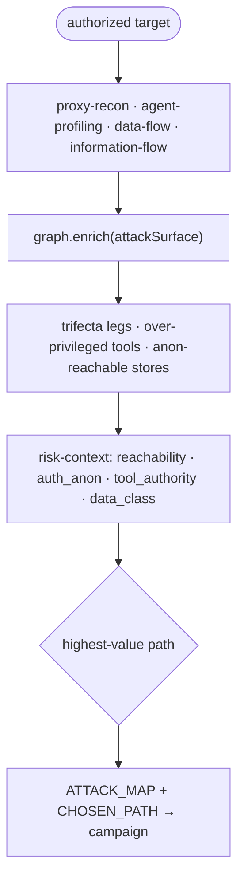

# Recon (offensive attack map + path selection)

Reconnaissance from the attacker's side: turn the target into a **map of where to attack**. It composes
the same collectors a defender uses, but reads the result offensively — which path reaches regulated
data through an effectful egress tool with the weakest control. You attack that path, not the whole app.

> **Authorized engagements only.** Recon here is over a target the operator owns or is engaged to test,
> through the gateway (scoped + audited). It does not scan third parties.

## When to Activate

- Step 2 of the `offensive-engineer` pipeline (after authorization).
- Any time an attacker needs the target's tools, authority boundaries, and reachable data laid out.

## Objective

Produce the offensive attack map + a ranked target list, and select the single highest-value path for
the campaign.

## Inputs

- `${TARGET}`: the authorized target (repo / image / live agent endpoint). *Source:* the RoE.
- `${OBJECTIVE}` (optional): the attack goal, or "derive from the attack graph".

## Outputs

- `${ATTACK_MAP}`: the graph with offensive annotations — tools + granted authority, egress channels,
  data stores + classes, identities, and the **trifecta legs**.
- `${TARGETS}`: ranked candidate paths (violating flow / over-privileged tool / anon-reachable store).
- `${CHOSEN_PATH}`: the one path the campaign aims at + why it was chosen.

## Method

1. **Map the surface.** `proxy-recon` (route the live agent through the gateway → the audit trail *is*
   your recon) and/or `agent-profiling` + `data-flow` + `information-flow` build the attack graph.
2. **Enrich offensively.** `graph.enrich` with `attackSurface`: the violating flows (regulated data
   reachable by an untrusted source with a missing control), over-privileged tools, anon-reachable
   stores, reachable egress channels.
3. **Find the trifecta legs.** Where **private data × untrusted input × an outbound channel** meet — the
   lethal combination an attacker needs. List each as a candidate.
4. **Rank + pick.** `risk-context` prioritizes by the features that matter offensively — reachability,
   `auth_anon`, `tool_authority`, `data_class`. Aim at the one path that reaches regulated data through
   an effectful egress tool. → `${CHOSEN_PATH}`.
5. **Record.** `record-in-engagement` the map + chosen path so the campaign and report reference it.

## Decision Logic / Completion Criteria

- Prefer a path that is **anonymously reachable** and reaches **regulated data** through an **effectful
  egress** tool — the highest-impact, lowest-effort target.
- **Done when:** the attack map is built, candidates are ranked, and one path is chosen with a stated
  rationale.

## Integration

- **Composes:** `proxy-recon`, `agent-profiling`, `data-flow`, `information-flow`, `risk-context`,
  `graph.enrich`; feeds `behavioral-redteam` + `exploit-chain`.
- **Offline:** builds the map from local artifacts / recorded traffic; `graph.enrich` degrades to the
  local graph. **Connected:** full attack-surface grounding, metered.
