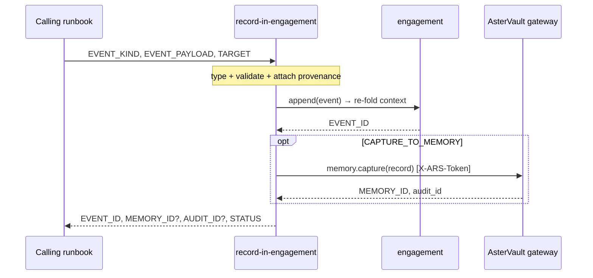

# Common Step: Record in Engagement

Append one **typed security event** to this engagement's append-only stream and re-fold the context.
The reusable building block every runbook calls instead of inventing its own store. It is the
agent-security analogue of a SOC "document in case / post case comment" step — except there is no
separate case object: **the engagement is the case**, and a comment is a typed event
(`finding_opened`, `verdict`, `decision`, `waiver`, `note`, …) on the stream, not free prose.

## When to Activate

- A runbook has produced something worth remembering: a finding opened, a disposition reached, a
  containment decision, a waiver granted, or an analyst note.
- Called at the end (or at each decision point) of `triage-agent-alert`, `investigate-agent-incident`,
  `confirm-action`, `close-finding`, the hunts, and the IRPs — anywhere the source would "post a case
  comment".

## Objective

Write exactly one well-typed event to `events.jsonl` via the `engagement` skill so the context fold
updates deterministically, and — when the record is structural and should compound for the team —
`memory.capture` it to shared memory. Return the event id (and `audit_id` when connected).

## Scope

Covers: typing + validating one event, appending it through `engagement.append`, and the optional
structural sync via `memory-capture`. Excludes: deciding *what* the disposition is (the caller
decides), multi-event reporting (use `generate-report-file`), and the human gate itself (use
`confirm-action`, which *calls* this skill to record its `decision`).

## Inputs

- `${EVENT_KIND}`: one of `finding_opened | finding_closed | verdict | decision | waiver | note |
  scan_completed | test_run | canary_hit | policy_recommended | policy_applied | gate_verdict`.
  *Source:* the calling runbook's step.
- `${EVENT_PAYLOAD}`: object — the typed body (e.g. for `verdict`: `{weakness_id, verdict, rationale}`;
  for `waiver`: `{weakness_id, reason, by, scope}`). *Source:* the caller's result.
- `${TARGET}`: string — the engagement target (repo / image / live agent) the event belongs to.
- `${CAPTURE_TO_MEMORY}` (optional): bool — sync the structural record to shared memory (default:
  true for `verdict`/`decision`/`waiver`/`finding_closed`, false for `note`).

## Outputs

- `${EVENT_ID}`: string — the id of the appended event.
- `${MEMORY_ID}` (optional): string — the shared-memory record id, when captured.
- `${AUDIT_ID}` (optional): string — the `audit_id` of the metered `memory.capture`, when connected.
- `${STATUS}`: ["Success" | "Partial" | "Failure"] — with a message on non-success.

## Tools

- **Gateway (connected, metered — carry `X-ARS-Token`, record the `audit_id`):** `memory.capture` —
  only for the structural half, when `${CAPTURE_TO_MEMORY}`.
- **Client-side:** select + validate `${EVENT_KIND}`, assemble the typed `${EVENT_PAYLOAD}` with
  provenance (harness, run_id, commit, actor, ts), and strip any raw code/data/PII before any sync.
- **Sibling skills:** `engagement` (`append` the event, re-fold context); `memory-capture` (structural
  sync).

## Workflow Steps & Diagram

1. **Receive** `${EVENT_KIND}` + `${EVENT_PAYLOAD}` + `${TARGET}` from the caller.
2. **Type + validate.** Confirm the kind is a known event kind and the payload carries the fields that
   kind requires; attach provenance. Reject a malformed event rather than write a loose one.
3. **Append.** `engagement.append(event)` → writes one line to `events.jsonl`, re-folds `context.json`,
   returns `${EVENT_ID}`. Offline this is the whole operation and it fully succeeds.
4. **Structural sync (optional).** If `${CAPTURE_TO_MEMORY}`, `memory-capture` the structural record
   (ids, weakness/control ids, verdict, *why* — never raw code/data) → `${MEMORY_ID}`, `${AUDIT_ID}`.
   On failure, degrade: the local append already holds; note it in `${STATUS}`.
5. **Return** `${EVENT_ID}` (+ memory/audit ids) and `${STATUS}`.

## Decision Logic / Completion Criteria

- IF `${EVENT_KIND}` is unknown or the payload is missing required fields THEN `${STATUS}` = `Failure`
  and write nothing — never append a loose or mistyped event.
- IF the local append succeeds but the memory sync fails THEN `${STATUS}` = `Partial` (the engagement
  record is the source of truth; the sync is best-effort).
- **Done when:** the event is in `events.jsonl`, the context has re-folded, and any requested
  structural sync has returned or recorded a degraded note.

## Integration

- **Composes:** `engagement` (append), `memory-capture` (structural sync).
- **Called by:** `confirm-action` (records its `decision`), `close-finding` (records `finding_closed`),
  triage / investigation / hunting / IRP runbooks (record `verdict`/`note`/`finding_opened`).
- **Offline:** append-only to the local engagement; no token, no quota, fully functional.
  **Connected:** the same local append plus a metered `memory.capture` of the structural record.
