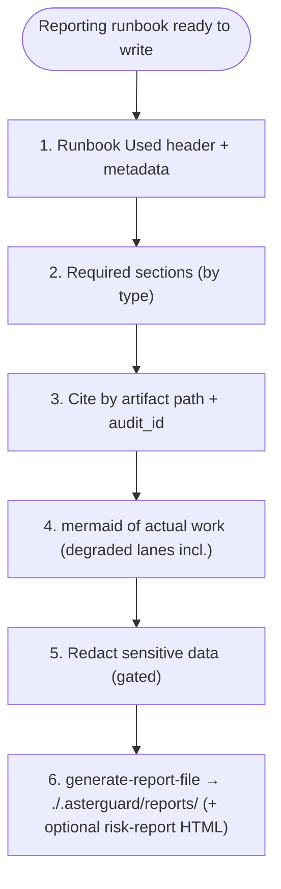

# Report Writing Guidelines (the reporting standard)

The single reference every reporting runbook in this pack conforms to. It fixes **structure**, the
**required sections**, the **`Runbook Used` header rule**, how to **cite evidence** (by `./.asterguard/`
artifact path + `audit_id`, never inline payloads), **redaction** discipline, and **where** reports are
written. It is a standard, not a workflow — the reporting runbooks (`agent-alert-report`,
`agent-incident-report`, `detection-report`) call these rules; a reader and the `evals` reporting rubric
grade against them.

## When to Activate

- Any reporting runbook is about to structure or write a report — apply this standard.
- An ad-hoc report is produced outside a reporting runbook — it still conforms to this.
- The `evals` reporting rubric needs the criteria a report is graded against.

## Objective

Define one consistent, auditable report standard so every report traces to its procedure, cites verifiable
evidence, carries no unredacted sensitive data, and reads the same across the library.

## Scope

Covers: the required metadata + sections, the `Runbook Used` rule, evidence/`audit_id` citation, the
mermaid-of-actual-work requirement, redaction, and the write location. Excludes: the content synthesis
itself (each reporting runbook does that) and HTML rendering (that is `risk-report`).

## The standard

### 1. Mandatory metadata header (every report, at the top)

- **`**Runbook Used:** <skill name>`** — the runbook that produced the work. **Required on every report**,
  first line of metadata, so output traces to procedure. A report with no runbook header is non-conformant.
- **Timestamp** — generation time (`YYYY-MM-DD HH:MM TZ`).
- **Target** — the agent/deployment (and `${INCIDENT_ID}` / `${ALERT_ID}` / `${RULE_IDS}` as applicable).
- **Engagement** — the engagement id, so the report ties back to the event stream (the system of record).

### 2. Required sections (by report type)

- **Alert report** (`agent-alert-report`): Alert Summary · Key Indicators · Enrichment Summary ·
  Disposition/Assessment · Immediate Actions · Workflow Diagram.
- **Incident report** (`agent-incident-report`): Executive Summary · Incident Timeline · Involved
  Indicators & Enrichment · Root Cause · Actions Taken (containment/eradication/recovery) ·
  Recommendations / Lessons Learned · Workflow Diagram.
- **Detection report** (`detection-report`): Rule Details · Coverage (vs weakness registry / ATT&CK) ·
  Performance / Tuning Outcomes · Findings & Recommendations · Workflow Diagram.

### 3. Evidence citation (not payloads)

- Cite every claim by its **`./.asterguard/<stage>.json` artifact path** and, for any connected metered
  call, its **`audit_id`** — so a reader can replay and the `evals` rubric can verify. Reference by path;
  never inline raw payloads, code, or data.
- Tie findings/decisions back to their **typed engagement events** (`finding_opened`, `verdict`,
  `decision`, `canary_hit`, `policy_applied`).

### 4. Workflow diagram = actual work

- Embed a ` ```mermaid ` diagram of the **actual** path performed (Analyst/Agent ↔ skills ↔ gateway
  tools), **including degraded lanes and tool failures** — the diagram reflects reality, not the ideal
  path. Artifacts render the fence natively; do not load a library.

### 5. Redaction (before writing)

- Before the file is written, sensitive data (PII, secrets, credentials, internal identifiers) is
  reviewed and **redacted/defanged** — gated via `confirm-action` for incident reports. Keep secrets out
  of the artifact; reference the finding, not the sensitive value.

### 6. Write location

- Reports are written to **`./.asterguard/reports/`** via `generate-report-file` (local-first, any harness
  reads them). An optional shareable **HTML** view is produced by handing the structured data to
  `risk-report`. Filenames carry the type + target + timestamp (e.g.
  `incident_report_<target>_<timestamp>.md`).

### 7. Voice

- Terse, mechanism-first, consistent terminology. Numbers only from the data. A report is substantially
  shorter than the raw stream — synthesis, not a transcript.

## Workflow Steps & Diagram

1. **Apply metadata.** Set the `**Runbook Used:**` header + timestamp + target + engagement id.
2. **Structure.** Use the required sections for the report type.
3. **Cite.** Reference every claim by artifact path + `audit_id`; link to typed engagement events.
4. **Diagram.** Embed the mermaid of the actual work (degraded lanes included).
5. **Redact.** Review/redact sensitive data (gated for incident reports).
6. **Write.** `generate-report-file` → `./.asterguard/reports/`; optional HTML via `risk-report`.



## Decision Logic / Completion Criteria

- A report is **conformant** only if: it carries `**Runbook Used:**` at the top, has every required
  section for its type, cites evidence by artifact path + `audit_id`, embeds an actual-work mermaid, and
  contains no unredacted sensitive data.
- **Done when:** the reporting runbook's output passes all six rules above and is written to
  `./.asterguard/reports/`.

## Integration

- **Applied by:** `agent-alert-report`, `agent-incident-report`, `detection-report` (and any ad-hoc
  report).
- **Composes with:** `generate-report-file` (write), `confirm-action` (redaction gate), `risk-report`
  (HTML view), `engagement` (the event stream reports cite).
- **Graded by:** the `evals` reporting rubric, which checks these same rules.
- **Offline:** the standard is harness-independent; reports write to `./.asterguard/reports/` with no
  network. **Connected:** citations additionally carry `audit_id`s from metered calls.
