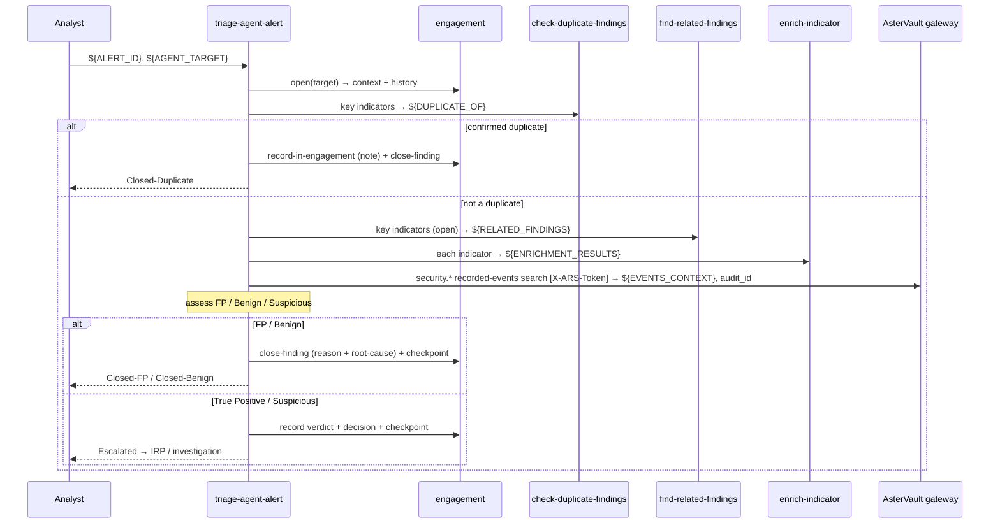

# Runbook: Triage Agent Alert

Standardized first-pass assessment of an incoming **runtime** agent alert/finding: decide whether it
is a false positive, benign, a duplicate to close, or a true positive to escalate. The agent-security
analogue of SOC alert triage — the "alert" is a runtime `security.*` signal, a canary egress hit, or a
user report, and the "entities" are indicators (weakness, component, agent identity, egress, artifact).
Triage only: it routes, it does not investigate deeply or contain.

## When to Activate

- A runtime `security.*` alert, a canary egress/honeypot hit, or a user report flags agent behavior.
- A new runtime finding lands on the engagement and needs an initial disposition before any deeper work.

## Objective

Produce a defensible disposition (`${ASSESSMENT}`) for one runtime alert and take the matching routing
action (`${ACTION_TAKEN}`) — escalate to the right IRP/investigation, or close as FP/benign/duplicate —
grounded in engagement history, dedupe, relation, enrichment, and one targeted recorded-events search.

## Scope

Covers: gather context, dedupe, relate, enrich key indicators, one targeted recorded-events search,
initial assessment, and the escalate/close routing.
Excludes: deep investigation (`investigate-agent-incident`), containment/eradication (the IRPs,
`contain-indicator`), and hunting — triage hands those off, it does not perform them.

## Inputs

- `${ALERT_ID}`: string — the runtime alert/finding id to triage. *Source:* a `security.*` alert, canary
  hit, or the engagement event that opened it.
- `${AGENT_TARGET}`: string — the affected agent/deployment (endpoint, service principal). *Source:*
  alert field / engagement context.
- `${ALERT_DETAILS}` (optional): object — alert name, severity, timestamp, raw indicators. *Source:* the
  alerting runtime.
- `${KEY_INDICATORS}` (derived): list — indicators extracted during context gathering (weakness_id,
  component, identity, egress, artifact), each typed for `enrich-indicator`.

## Outputs

- `${ASSESSMENT}`: ["False Positive" | "Benign True Positive" | "Duplicate" | "True Positive/Suspicious"]
  — the triage verdict with rationale.
- `${ACTION_TAKEN}` / route: ["Closed-FP" | "Closed-Benign" | "Closed-Duplicate" | "Escalated"] — and the
  target runbook/owner when escalated.
- `${DUPLICATE_OF}`: finding/incident id this duplicates, if any (from `check-duplicate-findings`).
- `${RELATED_FINDINGS}`: open findings related by shared indicators (from `find-related-findings`).
- `${ENRICHMENT_RESULTS}`: per-indicator enrichment (from `enrich-indicator`).
- `${EVENTS_CONTEXT}`: summary of the targeted recorded-events search.
- `${STATUS}`: ["Success" | "Partial" | "Failure"] — with a per-lane note on non-success.

## Tools

- **Gateway (connected, metered — carry `X-ARS-Token`, record each `audit_id`):** `graph.enrich`,
  `knowledge.query`, `memory.recall`, `risk.score` (reached via the composed skills), and the runtime
  `security.*` recorded-events search.
- **Client-side:** extract `${KEY_INDICATORS}` and `${ALERT_TYPE}` from the alert; weigh enrichment +
  related + events into one disposition; pick the escalation target.
- **Sibling skills:** `engagement` (open/context/checkpoint) · `check-duplicate-findings` ·
  `find-related-findings` · `enrich-indicator` · `record-in-engagement` · `close-finding` (on close).

## Workflow Steps & Diagram

1. **Open engagement.** `engagement.open(${AGENT_TARGET})` → load folded context + history. Connected:
   ensure the ARS token via `ars-token`. Pull the alert's prior events from `engagement.context()`.
2. **Gather context + extract indicators.** From `${ALERT_DETAILS}` + engagement context, derive
   `${ALERT_TYPE}` and the typed `${KEY_INDICATORS}`.
3. **Check duplicates.** `check-duplicate-findings` over the engagement + memory → `${DUPLICATE_OF}`.
   If a confirmed duplicate: `record-in-engagement` a `note`, then `close-finding`
   (reason=`duplicate`, root-cause=the prior finding id) and route **Closed-Duplicate**. Stop.
4. **Find related.** `find-related-findings` on `${KEY_INDICATORS}` (status=open) → `${RELATED_FINDINGS}`.
5. **Enrich key indicators.** For each indicator in `${KEY_INDICATORS}`, call `enrich-indicator`
   (registry/graph + knowledge + prior-sightings + first-pass `risk.score`) → `${ENRICHMENT_RESULTS}`.
   A surfaced **waiver** usually short-circuits to a benign close.
6. **Targeted recorded-events search.** One `${ALERT_TYPE}`-specific runtime `security.*` search (e.g.
   recent tool-calls / egress for the implicated identity or endpoint around the alert time) →
   `${EVENTS_CONTEXT}`. Connected: carries `X-ARS-Token`, returns `audit_id`.
7. **Initial assessment.** Weigh enrichment + related + events + prior sightings → `${ASSESSMENT}`:
   FP / Benign / Duplicate / True-Positive-Suspicious.
8. **Route + record.** FP/Benign → `close-finding` with reason + root-cause. Suspicious → set priority
   from the enriched `risk.score`, pick the escalation target (IRP or investigation), hand off.
   `record-in-engagement` the `verdict` + `decision` events (with `audit_id`s); `engagement.checkpoint`.

## Decision Logic / Completion Criteria

- IF `${DUPLICATE_OF}` confirmed THEN route **Closed-Duplicate** → `close-finding`.
- IF a prior **waiver** covers the indicator, or enrichment + events show expected/authorized behavior,
  THEN **Closed-Benign** (or **Closed-FP** if the signal itself was spurious).
- IF a canary egressed, a privileged tool-call traces to untrusted input, or events corroborate the
  signal THEN **Escalated** → the matching IRP (`irp-prompt-injection`,
  `irp-agent-credential-compromise`, …) or `investigate-agent-incident`.
- **Done when:** context gathered, dedupe + relate + enrichment + one events search complete, an
  assessment is set, the routing action is taken, and events are recorded + checkpointed.

## Integration

- **Composes:** `check-duplicate-findings`, `find-related-findings`, `enrich-indicator`,
  `close-finding`; `engagement` + `record-in-engagement` bookends.
- **Escalates to:** `irp-prompt-injection`, `irp-agent-credential-compromise`, `irp-tool-abuse-rce`,
  `irp-data-exfil-via-agent`, `investigate-agent-incident`. **Called by:** the `soc-triage` playbook.
- **Offline:** grounding/events degrade to local `./.asterguard/` recorded events + pack data; the run
  still produces a disposition (noted `Partial`). **Connected:** full grounding + runtime events,
  metered, each metered call records an `audit_id`.
