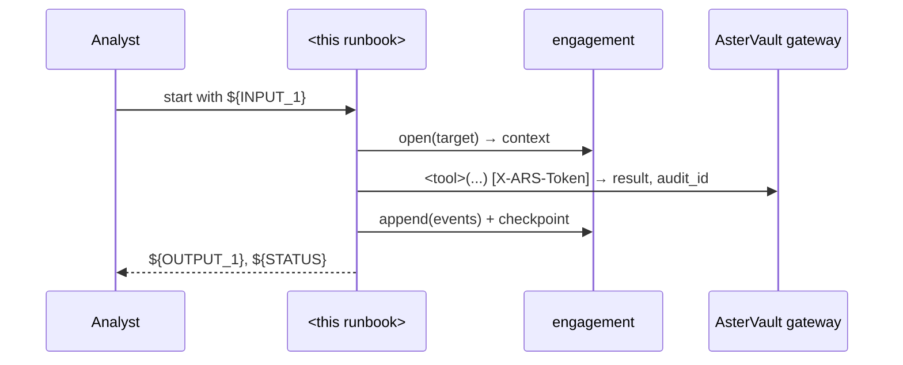

# <Verb-oriented title>

<One line: what this runbook accomplishes and why it exists.>

## When to Activate

- <trigger 1 — mirror the description>
- <trigger 2>

## Objective

<The single goal of this runbook.>

## Scope

Covers: <in bounds>.
Excludes: <out of bounds — e.g. deep investigation, containment, hunting>.

## Inputs

- `${INPUT_1}`: <type> — <description>. *Source:* <alert field / prior runbook output / engagement context>.
- `${INPUT_2}` (optional): <type> — <description>.

## Outputs

- `${OUTPUT_1}`: <type> — <description>.
- `${STATUS}`: ["Success" | "Partial" | "Failure"] — with a message on non-success.

## Tools

- **Gateway (connected, metered):** `registry.resolve` · `graph.enrich` · `risk.score` · `controls.map`
  · `knowledge.query` · `memory.recall`/`memory.capture` · `canary.*` · `policy.apply` · `rules.fetch`
  — use only the ones this runbook needs; carry `X-ARS-Token`; record each `audit_id`.
- **Client-side:** <the analysis/graph/judgment the harness does locally>.
- **Sibling skills:** `engagement` (open/checkpoint) · `enrich-indicator` · `record-in-engagement` ·
  `confirm-action` · <atomic/common skills this composes>.

## Workflow Steps & Diagram

1. **Open engagement.** `engagement.open(target)` → load context + history. Connected: ensure the ARS
   token via `ars-token`.
2. **<Step>** — <action, which skill/tool, what it returns>.
3. **<Step>** — <decision point>.
4. **Record + checkpoint.** `record-in-engagement` the typed events; `engagement.checkpoint`.

## Decision Logic / Completion Criteria

- IF <condition> THEN route `<ROUTE_A>` → <next runbook / action>.
- ELSE route `<ROUTE_B>` → <action>.
- **Done when:** <explicit completion criterion>.

## Integration

- **Composes:** <common skills>, <atomic skills>.
- **Called by:** <workflow/orchestrator/playbook that uses this>.
- **Offline:** <how the grounded lane degrades>. **Connected:** <grounding + metering + verification>.
